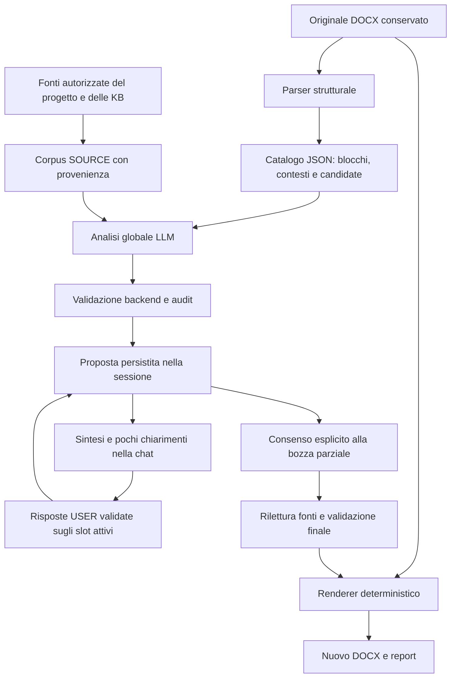

# Come Mapi compila un modulo Word

Guida di studio dell'architettura effettivamente presente nel repository al
**13 ottobre 2026**, baseline `1fd0d72`. Il percorso principale della chat usa
il **motore globale V12**. Questo documento descrive il sistema corrente:
non introduce un nuovo progetto né presenta i limiti aperti come già risolti.

Per studiarlo: leggere prima le sezioni 1–6, seguire l'esempio della sezione 7,
poi approfondire controlli, dialogo ed esportazione. I JSON completi da aprire
accanto alla guida sono raccolti in [RELATORI_00_GUIDA.md](RELATORI_00_GUIDA.md).

## 1. L'idea fondamentale

Mapi trasforma il Word in una **mappa strutturata delle posizioni compilabili**,
la affianca alle fonti disponibili e chiede al modello una proposta globale.
Il backend controlla quella proposta, conserva il risultato e gestisce i
chiarimenti nella chat. Alla richiesta di esportazione, applica soltanto i
valori ammessi a una nuova copia dell'originale.

Il modello non modifica direttamente un file Word. Non può inventare una
destinazione XML e scriverci liberamente. Propone associazioni tra posizioni,
significati e fatti; il codice controlla e materializza le associazioni ammesse.



Le responsabilità sono distribuite così:

| Componente | Responsabilità |
|---|---|
| Parser DOCX | Individuare le posizioni fisiche e il loro contesto strutturale. |
| Backend e database | Stabilire documenti/fonti ammessi, conservare sessione, revisioni, destinatari delle risposte e controlli. |
| Modello generativo | Interpretare sezioni, soggetti, ruoli, condizioni; proporre valori documentati e domande. |
| Frontend | Trasmettere il riferimento strutturato, mostrare messaggi, attività e download. |
| Renderer | Scrivere i valori autorizzati nelle posizioni note, partendo dall'originale. |

**L'iterazione modifica lo stato dei dati, non una bozza Word a ogni turno.**

## 2. Modulo, fonti e utente hanno autorità diverse

| Provenienza | Cosa può sostenere | Cosa non dimostra da sola |
|---|---|---|
| FORM | «Qui viene richiesto il numero di iscrizione del direttore tecnico». | Che un certo numero appartenga al direttore tecnico dell'azienda. |
| SOURCE | «La scheda aziendale indica Elisa Romano, direttore tecnico, iscrizione 8421». | Che sia la persona da indicare in qualunque campo personale del modulo. |
| USER | «Per questa domanda partecipo come società di ingegneria» oppure un valore fornito esplicitamente. | Che l'informazione sia stata verificata in una fonte documentale. |

Anche **ruolo** e **scope** sono distinti. `role=form/source` descrive l'uso
del documento; `scope` e `category` identificano il corpus da cui proviene.
Nel modello corrente una fonte può avere, per esempio:

- `scope="project:<project_id>"`, `category=null`: fonte del progetto corrente;
- `scope="global"`, `category="company"`: Company KB;
- `scope="global"`, `category="general"`: General KB.

Le due KB globali non vengono rinominate o fuse. Entrambe possono partecipare
secondo le regole esistenti; **General KB da sola non può verificare un fatto
personale o aziendale** nel motore globale.

Una conferma dell'utente può autorizzare l'uso di un valore SOURCE in un ramo
del modulo. Il valore conserva provenienza SOURCE; la conferma della condizione
resta USER. Un valore scritto dall'utente conserva invece provenienza USER.

Le bozze generate non vengono aggiunte automaticamente alle fonti fattuali:
altrimenti una proposta del sistema potrebbe diventare la prova di se stessa.

## 3. Due rappresentazioni dello stesso DOCX

Quando si carica un modulo, l'originale viene conservato. Dal documento si
ottengono due rappresentazioni con funzioni diverse.

**Rappresentazione documentale:** testo estratto, frammenti e indice con
`role=form`. Serve alla normale chat per domande come «riassumilo» o «quali
allegati richiede?». Può usare FTS5 o Qdrant.

**Rappresentazione strutturale:** XML/python-docx, paragrafi, tabelle,
placeholder e controlli supportati. Serve a sapere dove scrivere. La sessione
di compilazione costruisce questa rappresentazione dall'originale conservato.

Gli embedding non vengono usati per trovare una cella da modificare. Sapere
che un frammento parla del direttore tecnico non basta a identificare la
posizione del suo numero di iscrizione nel Word.

### Chat RAG e compilazione globale non sono lo stesso percorso

| Richiesta | Percorso principale |
|---|---|
| «Riassumi il modulo». | RAG FORM: recupero dei frammenti del modulo selezionato. |
| «Qual è la partita IVA?». | RAG SOURCE: recupero di fonti fattuali autorizzate. |
| «Abbiamo i dati richiesti?». | RAG MIXED: requisiti dal FORM, ricerche SOURCE e confronto separato. |
| `@modulo.docx` + «compila». | CompilationSession globale: catalogo strutturale e corpus SOURCE, proposta persistita e dialogo. |

Il compilatore globale attuale usa `load_document_corpus`: carica il **corpus
SOURCE completo entro i limiti previsti**, anziché eseguire una query vettoriale
per ogni campo. Include fonti del progetto corrente e KB globali consentite,
poi le rilegge attraverso i controlli del repository. Non incorpora i moduli
come prove fattuali e non legge le fonti di altri progetti.

FTS5/Qdrant restano quindi importanti per la chat e per il percorso MIXED;
non sono il meccanismo che assegna le posizioni nel nuovo compilatore globale.

## 4. Cosa succede quando scrivo «me lo compili?»

1. Il composer conserva la mention come riferimento strutturato al documento,
   non come semplice testo dopo `@`. Il menu distingue fonti e moduli.
2. Il backend controlla appartenenza al progetto, ruolo e formato. Una fonte
   PDF selezionata può essere consultata, ma non diventa un modulo DOCX.
3. Il planner di turno riceve messaggio, contesto conversazionale limitato,
   documento selezionato ed eventuale sessione/domanda attiva. Produce un
   `TurnPlan`: ad esempio consultazione, avvio, risposta ai chiarimenti,
   pausa, ripresa o generazione.
4. Se l'intento è compilare, `compilation_chat.py` usa il motore `global`.
   Per la coppia conversazione/modulo riprende una sessione compatibile già
   esistente oppure ne crea una.
5. La creazione conserva snapshot dell'originale, hash, riferimenti e versione.
   Non genera ancora il DOCX finale.
6. L'analisi produce catalogo, input JSON, risposta e audit. Un'altra chiamata
   breve prepara la sintesi iniziale e le domande ammesse.
7. Il frontend mostra il messaggio risultante nello stesso thread. Durante
   l'elaborazione mostra attività; i successivi GET di polling non sono
   ulteriori analisi LLM.

La mention da sola non avvia una compilazione. Una domanda normale con lo
stesso documento continua a essere una consultazione.

Il planner non può scegliere sessioni o destinatari arbitrari: il backend
possiede gli identificativi reali e gli slot delle domande attive.

## 5. Come nasce il catalogo JSON

Il parser legge il documento e individua le posizioni supportate: celle,
sequenze vuote/placeholder nei paragrafi e checkbox native riconosciute.
Il catalogo globale riunisce queste posizioni e i blocchi del corpo documento
nell'ordine originale.

Un **candidate è una possibile posizione**, non automaticamente un campo
obbligatorio. Può essere decorativo, appartenere a una sezione non pertinente,
richiedere una scelta oppure restare non valutato.

Esempi di ID strutturali:

| ID | Significato |
|---|---|
| `t0.r5.c1` | Cella individuata nella prima tabella, riga e colonna indicate dagli indici del parser. |
| `p53.s4` | Quinto slot testuale individuato nel paragrafo con indice 53. |
| `p39.cb0` | Checkbox nativa individuata nel relativo paragrafo. |

Gli ID sono stabili rispetto all'originale della sessione. Modificare il Word
di partenza può cambiare la mappa: non sono identificatori semantici universali.

Il catalogo comprende:

- `blocks`: paragrafi e tabelle, testo, struttura e ordine;
- `candidates`: ID, tipo, posizione, contesto locale e ancoraggi;
- `section_ids`: riferimenti alle sezioni quando desumibili dalla struttura;
- collegamenti di continuazione e paragrafi precedenti, per non perdere
  contesti che si estendono su più righe/paragrafi;
- `read_only_parts`: parti inventariate come non modificabili da questo percorso.

I titoli Word non sono sempre veri stili di intestazione: `section_ids` può
essere vuoto. In quel caso il modello deve interpretare i titoli nel testo
dei blocchi. Non esiste un riconoscitore codificato per uno specifico bando.

Nel testo vengono inseriti marker come `[[p53.s4]]`. Sono **etichette nel JSON
per il modello**, non testo aggiunto al file originale.

Il `reading_plan` aggiunge riferimenti strutturali, ruoli letterali e proprietà
presenti nelle fonti. Aiuta la lettura; non inventa fatti, non decide chi firma
e non sostituisce la validazione.

## 6. Che cosa riceve il modello: system prompt e user prompt

Il progetto non addestra un proprio modello. Costruisce richieste al modello
generativo configurato per il progetto. Nei materiali reali qui citati si
tratta di `deepseek-flash`; i dati aziendali sono quelli simulati della demo.

Ogni chiamata riceve esplicitamente il proprio contesto. La continuità deriva
da database e prompt ricostruiti dal backend, non da una memoria privata del
modello fra richieste HTTP.

Il modello usa le proprie capacità linguistiche per interpretare il documento;
la sua conoscenza generale non è una prova sui dati di questa azienda o pratica.
Per proporre un valore deve usare le evidenze ricevute, oppure un successivo
input USER riconoscibile come tale.

### System prompt: il compito e le regole

Il system prompt dell'analisi globale è `TASK` in
[compilation_global.py](backend/app/compilation_global.py). Impone di leggere
blocchi FORM e SOURCE, distinguere soggetti/ruoli, produrre JSON, citare estratti
e motivare le posizioni senza proposta.

La copia integrale realmente inviata è
[RELATORI_02A_MINERVINO_SYSTEM_PROMPT.txt](RELATORI_02A_MINERVINO_SYSTEM_PROMPT.txt).
È più lunga di questa spiegazione: contiene anche vincoli sulle condizioni,
sui collegamenti di ruolo, sulle checkbox e sulla copertura V12.

### User prompt: i dati della singola analisi

Qui «user prompt» non significa soltanto la frase umana «compila». Per
l'analisi globale è un JSON costruito dal backend con modulo e fonti. Il
messaggio umano è stato già interpretato dal router; questa analisi riceve
un compito documentale stabile.

La struttura principale è:

```text
{
  proposal_stage: "source_backed_hypotheses",
  project_id: progetto corrente,
  form: catalogo del DOCX,
  sources: frammenti SOURCE con testo e metadata,
  user_values: [],
  source_coverage: strategia e numero dei frammenti,
  schema_output: JSON Schema della proposta richiesta,
  reading_plan: riferimenti che aiutano a leggere il catalogo
}
```

Questo è uno schema di lettura, non un payload da inviare così com'è.
Il JSON reale completo è
[RELATORI_01_MINERVINO_INPUT_LLM.json](RELATORI_01_MINERVINO_INPUT_LLM.json).
`user_values=[]` riguarda la prima analisi; le risposte successive vengono
conservate e trattate dal dialogo della sessione.

La [richiesta HTTP completa](RELATORI_02_MINERVINO_RICHIESTA_LLM.json)
mostra la separazione:

```text
messages[0] = { role: "system", content: TASK }
messages[1] = { role: "user", content: JSON serializzato dell'input }
```

`response_format=json_object` chiede JSON al provider. Lo schema applicativo
specifico viene comunicato e validato dal codice; ricevere JSON sintatticamente
valido non equivale ad avere una proposta corretta.

### Perché ci sono ancora ID delle fonti?

Il modello cita `chunk_id`; il backend verifica il riferimento e conserva
anche `file_id`, `chunk_index`, nome, ruolo, scope, categoria e hash del contenuto.
Servono a risalire alla prova effettiva e a impedire che una citazione sia
scambiata con un'altra. Non sono etichette da mostrare all'utente nella chat.

Gli ID negativi dei materiali Minervino sono la rappresentazione interna
delle fonti globali; gli ID positivi identificano quelle di progetto.
L'autorizzazione controlla anche i metadata, non soltanto il segno dell'ID.

### I quattro compiti del modello, a confronto

| Chiamata | System prompt | Contesto nello user prompt | Risultato atteso |
|---|---|---|---|
| Router | Regole di intent e uso dei documenti/sessioni. | Ultimo messaggio, cronologia limitata, documento e slot attivi. | `TurnPlan`: cosa fare e quali risposte interpretare. |
| Analisi globale | Regole documentali, SOURCE, ruoli, destinazioni e contratto V12. | Catalogo completo entro budget, corpus SOURCE, schema e reading plan. | Proposta strutturata, non Word compilato. |
| Narratore | Sintesi iniziale oppure prosecuzione senza inventario ripetuto. | Proposte controllate, risposte persistite, ruoli e domande ammesse. | Sintesi/domande oppure sole domande residue e proposte da sospendere. |
| Verificatore USER | Controllo indipendente della pertinenza alla domanda. | Risposta, domanda attiva e decisioni ipotizzate dal router. | Slot supportati, non pertinenti o ambigui. |

Il contesto della chiamata successiva viene ricostruito dal backend: non si
invia necessariamente tutto il documento a tutti e quattro i compiti.

## 7. Esempio reale: come 8421 arriva nel campo giusto

Il seguente percorso è ricavato dalla sessione reale Minervino, non da un
esempio inventato per spiegare il sistema.

**Il FORM individua il ruolo.** Il paragrafo 50 contiene:

> la quale ha come Responsabile della Progettazione (per le società di professionisti) o Direttore Tecnico (per le società di ingegneria):

Il paragrafo 53 contiene il testo marcato:

```text
iscritto all’Ordine/Collegio professionale[[p53.s0]] sezione [[p53.s1]]della provincia di [[p53.s2]] dal [[p53.s3]] con il n. [[p53.s4]]
```

La voce reale del catalogo per l'ultima posizione è:

```json
{
  "type": "text",
  "context_id": "paragraph:53",
  "section_ids": [],
  "range": [298, 307],
  "slot_context": {
    "before": " con il n. ",
    "after": ""
  },
  "location": {"block_id": "paragraph:53"},
  "continuation_origin_paragraph_id": "paragraph:50",
  "anchor_paragraph_ids": ["paragraph:53"]
}
```

Il collegamento al paragrafo 50 aiuta a capire **di chi** è il numero.
`range` descrive la posizione nel testo originale; non contiene il valore.

**La SOURCE documenta persona e numero.** Il chunk `-45` di
`generalita-mapi.md`, Company KB, contiene nello stesso contesto il ruolo di
Elisa Romano e il numero di iscrizione simulato 8421. Non si sta prendendo
un numero qualsiasi dal modulo.

**Il modello propone tre collegamenti distinti.** Questo estratto riproduce
le voci reali della [risposta grezza](RELATORI_03_MINERVINO_RISPOSTA_LLM.json).
È un sottoinsieme esplicativo, non l'intera risposta valida: per esempio la
condizione `c_partecipazione` è definita nella mappa completa.

```json
{
  "facts": {
    "f_er_num": {
      "subject": "Elisa Romano",
      "entity": "person",
      "aspect": "professional",
      "property": "numero di iscrizione",
      "value": "8421",
      "evidence": [
        {
          "chunk_id": -45,
          "quote": "- Numero di iscrizione professionale simulato: 8421."
        }
      ]
    }
  },
  "bindings": {
    "b_er": {
      "form": {
        "paragraph_id": "paragraph:50",
        "quote": "la quale ha come Responsabile della Progettazione (per le società di professionisti) o Direttore Tecnico (per le società di ingegneria):"
      },
      "required_role": "Direttore Tecnico",
      "source_role": "direttore tecnico",
      "evidence": [
        {
          "chunk_id": -45,
          "quote": "### Ing. Elisa Romano - direttore tecnico"
        }
      ]
    }
  },
  "fields": {
    "p53.s4": {
      "label": "Numero di iscrizione",
      "kind": "data",
      "disposition": "conditional",
      "form": {
        "paragraph_id": "paragraph:53",
        "quote": "con il n. [[p53.s4]]"
      },
      "conditions": ["c_partecipazione"],
      "property": "numero di iscrizione",
      "fact_id": "f_er_num",
      "binding_id": "b_er",
      "reason": "Numero documentato; ramo non confermato"
    }
  }
}
```

La mappa `facts` evita di ripetere lo stesso fatto in ogni posizione.
`binding` collega il ruolo richiesto dal FORM alla persona documentata nelle
SOURCE. `fields` collega quella proprietà al candidate fisico.

Questo è il motivo per cui conoscere «Elisa Romano» non autorizza a inserirla
anche nel sottoscrittore, nel socio o in qualsiasi altro campo «nome e cognome».
Serve il collegamento al ruolo locale.

Dopo validazione, conferma del ramo ed esportazione, il report reale contiene:

| Candidate | Richiesta | Valore scritto | Provenienza |
|---|---|---|---|
| `p51.s0` | Nome e cognome della figura tecnica | Ing. Elisa Romano | SOURCE, chunk `-45` |
| `p52.s0` | Qualifica professionale | Ingegnere | SOURCE, chunk `-45` |
| `p53.s0` | Ordine/Collegio professionale | Ordine degli Ingegneri di Bari | SOURCE, chunk `-45` |
| `p53.s4` | Numero di iscrizione | 8421 | SOURCE, chunk `-45` |

La fonte demo dichiara invece non disponibili altri dati, fra cui la data di
abilitazione. Il numero dell'albo non può essere riutilizzato come data o
numero di iscrizione camerale.

## 8. Cosa propone l'analisi globale V12

L'output non è soltanto una lista `campo=valore`. Le mappe principali sono:

| Parte | Funzione |
|---|---|
| `facts` | Fatti proposti con soggetto, proprietà, valore ed estratti SOURCE. |
| `bindings` | Collegamenti fra ruolo locale FORM e ruolo/persona documentati. |
| `conditions` | Condizioni che governano l'uso di una o più posizioni. |
| `fields` | Associazioni alle destinazioni fisiche, con fatto e condizioni. |
| `choice_groups` | Opzioni checkbox, istruzione FORM e vincoli di selezione. |
| `clarifications` | Richieste locali ancorate al FORM senza un valore SOURCE sufficiente. |
| `coverage` | Motivi proposti per le posizioni senza assegnazione. |

La copertura V12 distingue un motivo valido, un motivo rifiutato, una posizione
esplicitamente non valutata e una vera omissione. Non converte automaticamente
tutto ciò che manca da `fields` in un campo obbligatorio da chiedere all'utente.

Un esito `source_not_found` è **una conclusione del modello sulla prima
analisi**, non una prova matematica che il dato non esista nella KB.
Una motivazione ancorata al FORM non autorizza un valore né prova da sola
la non applicabilità. La copertura iniziale non viene riscritta retroattivamente
come se fosse lo stato corrente dopo le risposte USER.

## 9. I controlli del backend

Il punto centrale è `validate_global_proposal` in
[compilation_global.py](backend/app/compilation_global.py). Il backend controlla
diversi collegamenti, non soltanto la presenza di una citazione.

1. **Contratto:** JSON, versione, tipi, limiti e assenza di chiavi duplicate.
2. **Destinazione:** il candidate esiste nel catalogo dell'originale.
3. **Grounding FORM:** l'estratto appartiene al contesto ammesso della
   destinazione e ne documenta la richiesta. Un marker isolato non basta.
4. **Grounding SOURCE:** il chunk è reale, autorizzato e di ruolo SOURCE;
   l'estratto è presente nel contenuto riletto e sostiene il valore proposto.
5. **Soggetto e proprietà:** fatto, proprietà del campo e collegamento di ruolo
   devono rispettare i vincoli del contratto; i riferimenti non possono essere
   scambiati liberamente fra persone o dati eterogenei.
6. **Condizioni:** le condizioni citate devono esistere, essere ancorate e
   governare le destinazioni dichiarate.
7. **Scrittura:** si applicano anche i validatori DOCX e le protezioni previste,
   comprese quelle sulle firme e sui valori non utilizzabili.

Le normalizzazioni degli estratti sono conservative, non una ricerca fuzzy
libera nel documento. Errori locali possono essere registrati senza eliminare
proposte indipendenti valide; un output complessivamente non utilizzabile
fa fallire il passaggio senza scrivere valori nel Word.

### Grounded non significa definitivamente corretto

Una proposta che supera i controlli conserva la natura di
`GROUNDED_PROPOSAL`, eventualmente condizionata. **Non viene promossa
automaticamente a `RESOLVED`.**

I controlli verificano riferimenti, estratti, relazioni ammesse e vincoli.
Non costituiscono un oracolo semantico: un indirizzo completo può essere
documentato e tuttavia troppo lungo per un campo che richiede soltanto il comune.
Il limite concreto è descritto nella sezione 15.

### Applicabilità: perché a volte serve una conferma

Nel contratto corrente una condizione basata su interpretazione `semantic`
rimane `unknown` per il backend: non basta che il modello la dichiari vera.
Alcuni confronti strutturati fra fatti validi possono invece essere verificati
deterministicamente entro i vincoli previsti.

Se esiste il valore SOURCE ma la condizione resta sconosciuta, il sistema
conserva una proposta condizionata. Una risposta USER può confermare il ramo;
una risposta negativa lo esclude senza scrivere un valore fattuale.

Questo protegge dalla falsa premessa «il modulo richiede X, quindi lo abbiamo».
Può anche produrre conferme eccessive quando il modello costruisce condizioni
troppo ampie: il fatto che una società sia di ingegneria non identifica
automaticamente il sottoscrittore e i suoi poteri per quella domanda.

## 10. La compilazione diventa conversazione

L'analisi globale non viene ripetuta dopo ogni risposta. La sessione conserva
l'audit iniziale, le conferme, i rinvii e i valori USER. Il dialogo opera su
questa rappresentazione persistita.

Il backend costruisce un insieme di domande ammesse: prima condizioni con
maggiore impatto, poi gruppi di scelta e chiarimenti locali. Non basta che il
modello inventi una domanda su un candidate per renderla applicabile.

Il narratore riceve un contesto ridotto: proposte valide, ruoli, estratti,
risposte precedenti, copertura e domande disponibili. Seleziona al massimo
**tre domande** da un insieme di massimo **24**.

Può sospendere proposte dubbie, ma non aggiungere fatti né rendere valida una
proposta respinta. La sintesi iniziale spiega ciò che è stato trovato; nei
turni successivi una ricevuta backend descrive gli aggiornamenti effettivi,
senza ripetere ogni volta l'inventario aziendale.

### Come viene interpretata una risposta

Gli slot delle domande sono associati dal backend a campi, condizioni o gruppi
reali. Il modello restituisce una decisione semantica per quegli slot, non
un nuovo `field_id` da inventare.

| Risposta interpretata | Effetto |
|---|---|
| `VALUE` | Valore USER sul destinatario attivo, se estratto e validato. |
| `CONDITION_TRUE/FALSE` | Conferma o esclusione USER della condizione attiva. |
| `UNKNOWN`, `SKIP`, `REFUSE` | Rinvio conservato; nessun valore inventato e nessun ritorno immediato alla stessa domanda. |
| `CLARIFY` | Nessuna associazione arbitraria; serve chiarimento. |
| Pausa/ripresa | Comando di sessione: stato e lavoro conservati. |
| Generazione | Consenso distinto dal fornire un nuovo valore. |

Per scritture e conferme, un verificatore semantico indipendente controlla la
pertinenza della risposta rispetto alla domanda. La stessa chiamata verifica
anche i rinvii che influenzano più campi di una condizione condivisa. Il rinvio
di un semplice campo locale non richiede sempre questo controllo aggiuntivo.

Il backend verifica inoltre che l'estratto USER sia presente nel messaggio,
che il valore sia ammissibile e che la versione sia attuale. Gli aggiornamenti
validi possono essere conservati anche se un'altra parte del gruppo è ambigua.

Il dialogo resta **limitato al gruppo attivo**. Non è ancora un editor libero
capace di applicare qualsiasi correzione a qualsiasi campo nominato in chat.
Un dato detto dall'utente non diventa una fonte documentale verificata.

## 11. Persistenza, stato e ripresa

SQLite conserva la sessione in `compilation_sessions`, con originale,
riferimenti, stato JSON e versione. `compilation_session_revisions` registra
le revisioni; `document_compilations` conserva le generazioni. La conversazione
ha inoltre i propri turni persistiti.

Nel motore globale le proposte e le posizioni sono nel catalogo/audit dello
stato JSON: non viene introdotta una tabella per ogni campo.

| Livello | Esempio | Come leggerlo |
|---|---|---|
| Sessione | `CREATED`, `ANALYZING`, `WAITING_FOR_USER`, `FAILED`, `GENERATED` | Avanzamento dell'operazione persistita. |
| Motore globale | `PENDING`, `ANALYZING`, `REVIEW` | Stato dell'analisi e disponibilità dell'audit. |
| Dialogo | `PENDING`, `READY`, domanda attiva | Preparazione del prossimo messaggio, non completezza del Word. |
| Pausa | `global_compilation.paused=true` | Orchestrazione sospesa; non richiede un nuovo enum di sessione. |
| Audit | `GROUNDED_PROPOSAL`, spiegazione accettata/rifiutata | Esito dei controlli sulla proposta iniziale. |

**`dialogue.phase=READY` non significa «tutti i campi sono compilati».**
Anche `GENERATED` significa che è stata prodotta una copia, non che questa
sia pronta per la presentazione.

Una nuova richiesta legge lo stato dal database. Versioni e transazioni
impediscono di sovrascrivere silenziosamente aggiornamenti concorrenti;
una lease distingue un'analisi in corso da un lavoro riprendibile.
Il frontend ricarica e osserva lo stato, senza esserne la fonte autorevole.

Non c'è un ciclo autonomo senza limite. Il nuovo percorso non analizza gruppi
di 12 candidate in successione: autorizza un'analisi globale e passaggi di
dialogo limitati. Un errore non autorizza a inventare dati o generare una
bozza incompleta in silenzio.

## 12. Quante chiamate LLM facciamo realmente?

«Una chiamata globale» significa **una chiamata per l'analisi del catalogo**,
non una sola chiamata per tutta la conversazione.

| Operazione normale | Chiamate tipiche |
|---|---|
| Avvio da chat | Router + analisi globale + narratore iniziale: 3. |
| Risposta con valore/conferma | Router + controllo di pertinenza + aggiornamento del dialogo: fino a 3. |
| Rinvio di un valore locale | Router + dialogo: normalmente 2. |
| Consenso alla bozza | Interpretazione del comando; il renderer non richiede un LLM. |
| Polling GET dello stato | 0. |

Sono conteggi del percorso normale, non una promessa per ogni richiesta:
il router può fare un solo retry di schema; alcuni controlli deterministici
possono evitare una chiamata e un errore può interrompere le fasi successive.
L'analisi globale non ha un retry automatico di riparazione. Una ripresa
esplicita può autorizzare un nuovo tentativo dopo un fallimento.

### Budget principali attuali

| Risorsa/fase | Limite |
|---|---|
| Originale DOCX / contenuto ZIP espanso | 20 MiB / 40 MiB, oltre agli altri controlli del parser. |
| Candidate nel catalogo globale | 400. |
| Catalogo globale serializzato | 200.000 caratteri; esistono anche limiti del parser preliminare. |
| Corpus SOURCE | 96 frammenti e 100.000 caratteri di contenuto. |
| Intero input JSON globale | 350.000 caratteri. |
| Output analisi globale | 49.152 token massimi; 500.000 caratteri da validare. |
| Timeout analisi | 300 secondi. |
| Contesto proposte del narratore | Prime 40 proposte selezionabili; è un limite reale della proiezione. |
| Domande disponibili / poste per messaggio | 24 / 3. |
| Narratore | 2.048 token, 45 secondi, nessun retry automatico. |
| Verificatore risposte USER | 768 token, 15 secondi, nessun retry automatico. |

I limiti in caratteri non sono limiti in token. Il corpus completo funziona
entro questi budget; superarli produce un errore esplicito, non un taglio
silenzioso né una ricerca alternativa automaticamente implementata.

Per l'analisi globale DeepSeek il codice abilita `thinking` con
`reasoning_effort="low"`; router, narratore e verificatore lo disabilitano.
Questa scelta dell'analisi è esplicita nel codice e non coincide necessariamente
con il semplice switch thinking della chat. Temperatura bassa non garantisce
risultati identici fra prove.

Nell'analisi reale Minervino qui archiviata: **267 candidate, 51 SOURCE,
72.405 token input e 30.291 token output**, di cui 23.877 di reasoning.
Il contatore `ai_seconds` dell'analisi è circa **121 secondi**, prima della
sintesi; include il lavoro misurato attorno alla richiesta e alla validazione.
Non è il tempo di tutta la conversazione né una misura della sola latenza HTTP.
Ridurre il numero di richieste non rende necessariamente breve una risposta
globale lunga con ragionamento.

## 13. Quando e come viene scritto il DOCX

L'esportazione corrente è una **bozza parziale esplicita**. Il sistema non
finge che tutte le posizioni siano risolte prima di consentire il download.

1. La chat raccoglie il consenso a generare la bozza, distinguendolo dalle
   risposte ai campi. Anche una copia senza valori richiede consenso esplicito.
2. `export_selection` ricava le proposte esaminate e non sospese, esclude
   quelle con condizioni non confermate e applica i vincoli dei gruppi.
3. Il backend rilegge le SOURCE e rivalida le proposte selezionate. Cambiamenti
   incompatibili di fonti o versione impediscono l'esportazione.
4. I valori USER vengono controllati separatamente. Non possono duplicare
   nello stesso campo un valore esportato come SOURCE.
5. Il renderer riceve la mappa finale delle posizioni testuali e, se presenti,
   le scelte checkbox validate.
6. `fill_docx` parte dallo snapshot dell'originale e produce una **nuova copia**.
7. DOCX, report e nuova revisione della sessione vengono salvati con i controlli
   di coerenza previsti. Una nuova generazione non modifica quella precedente.

Non c'è una chiamata LLM che riscrive il Word in questa fase.
Le posizioni non selezionate conservano il contenuto originale: di solito
vuoti/placeholder, senza valori inventati. Le scelte native possono avere
effetti di deselezione espliciti e tracciati per alternative esclusive.

Il report distingue:

- valori SOURCE, estratti, riferimenti e condizioni confermate;
- valori USER con testo dell'utente e senza finte evidenze SOURCE;
- posizioni scritte ed effetti sulle checkbox;
- hash originale/output, audit iniziale e revisione;
- natura parziale: `status="needs_review"`, `ready_for_submission=false`.

Nel report globale attuale `resolved=0` è intenzionale: non certifica come
definitivamente risolte le proposte esportate. Per sapere cosa è stato scritto
si leggono `fields`, `written_field_count` e gli effetti delle checkbox.

## 14. Checkbox: supporto presente, copertura ancora incompleta

Il sistema dispone di writer per checkbox native legacy/content control e
di validatori per gruppi di scelta ancorati al FORM. Il gruppo descrive le
opzioni e la cardinalità: ad esempio una sola alternativa o più selezioni.

Una SOURCE pertinente può sostenere una scelta; l'utente può scegliere fra
le alternative di un gruppo attivo. Il backend rivalida il gruppo e registra
anche le deselezioni necessarie. Gruppi incompleti o ambigui non diventano
liberamente scrivibili.

Nel caso reale Minervino il modello ha però restituito `choice_groups={}`.
Non avendo gruppi/assegnazioni checkbox valide, il renderer non ha ricevuto
scelte da materializzare. **Il writer esiste; non è dimostrata una copertura
affidabile del riconoscimento semantico su quel bando.** Simboli stampati che
sembrano caselle non equivalgono automaticamente a controlli nativi supportati.

Una conferma del ramo «società di ingegneria» non inventa da sola un gruppo
checkbox omesso dall'analisi. Questa distinzione spiega perché alcuni testi
possono essere compilati mentre le caselle restano vuote.

## 15. Cosa dimostra davvero il caso Minervino

La sessione `a067b0abf83f4d948137728669879604`, analisi
`e8ad0f46c3b34157bbe6c9988e1341f8`, ha prodotto una bozza con **20 posizioni
testuali SOURCE**, senza valori manuali USER. Più posizioni riusano gli stessi
fatti: 20 scritture non sono 20 informazioni indipendenti.

Nel [report dell'ultima esportazione](RELATORI_05_MINERVINO_REPORT_ULTIMA_BOZZA.json)
compaiono, fra gli altri:

| Posizione | Valore scritto | Prova |
|---|---|---|
| Operatore e denominazione societaria | Mapi Ingegneria S.r.l. | Company KB, chunk `-43`. |
| Partita IVA, in due posizioni | IT01234567890 | Company KB, chunk `-43`. |
| Sede legale nel ramo societario | Via Giovanni Amendola 172/C, 70126 Bari (BA), Italia | Company KB, chunk `-43`. |
| Telefono, e-mail, PEC | Recapiti demo documentati | Company KB, chunk `-44`. |
| Nome, qualifica, Ordine e numero 8421 | Dati di Elisa Romano | Company KB, chunk `-45`. |

La fonte aziendale non identifica automaticamente il firmatario della singola
domanda. Non vengono inventati sottoscrittore, soci o dati personali mancanti.

La verifica del DOCX utente è in
[docs/minervino-output-2-2026-10-13.md](docs/minervino-output-2-2026-10-13.md).
Quel file appartiene all'esportazione precedente `6cb97f7bc2784517919f3b99e4d021cc`;
il report nella radice riguarda `aca0a0dd970343dda73b2b2caba3344f` della stessa
analisi. Non vanno confrontati come se fossero lo stesso file binario.

I limiti concretamente osservati sono:

- **Bari omesso nella sede iniziale:** il modello aveva trovato il dato, ma
  l'estratto FORM del candidate conteneva soltanto marker/punteggiatura.
  «Con sede in» termina nel paragrafo precedente. Il gate della destinazione
  ha respinto la proposta: non era una carenza della Company KB.
- **Indirizzo ridondante:** il valore completo è documentato, ma il modulo
  ha anche campi separati per via/civico. La prova letterale non garantisce
  la giusta granularità del valore.
- **Spazio mancante:** l'inserimento dell'Ordine si attacca al testo precedente.
  La posizione è quella prevista, ma la resa testuale richiede rifinitura.
- **Checkbox non selezionate:** l'analisi ha omesso i gruppi, come spiegato sopra.
- **Motivazioni non tutte validate:** nell'audit reale sono 147 le spiegazioni
  accettate e 99 quelle respinte, oltre a una proposta rifiutata.

Questi ultimi numeri non significano «99 campi obbligatori mancanti».
Neppure `explicit_decisions_complete=true` certifica una domanda completa:
lo stesso audit ha `coverage_checks_passed=false` e
`semantic_completeness_verified=false`.

Rimangono inoltre variabilità delle risposte, condizioni troppo ampie e
limiti di contesto/budget. Una vecchia anomalia intermittente sul consenso
alla bozza non è stata riprodotta causalmente: ora viene acquisita una trace,
ma non è corretto promettere che qualunque errore provider sia scomparso.

## 16. API, file e prompt da riconoscere nel codice

### Operazioni principali

| API | Uso |
|---|---|
| `POST /api/projects/{project_id}/answer` | Messaggi chat, riferimento documento, intent e risposte agli slot attivi. |
| `POST /api/projects/{project_id}/compilation-sessions` | Creazione esplicita; indicare `engine="global"` per il nuovo percorso. |
| `GET /api/projects/{project_id}/compilation-sessions?conversation_id=...` | Ritrovare le sessioni della conversazione. |
| `GET /api/projects/{project_id}/compilation-sessions/{session_id}` | Stato autorevole corrente. |
| `GET .../{session_id}/revisions` | Revisioni persistite. |
| `POST .../{session_id}/resolve` | Prima analisi globale oppure aggiornamento del dialogo se l'audit esiste. |
| `POST .../{session_id}/global-draft` | Esportazione esplicita con versione, selezioni e condizioni. |
| `GET .../{session_id}/global-report` | Audit della proposta; distinto dal report del DOCX generato. |
| `GET /api/projects/{project_id}/document-compilations/{run_id}/download/{kind}` | Download `docx`, `report` o `template`. |

Il contratto di creazione diretta conserva `engine="legacy"` come default di
compatibilità; la chat usa esplicitamente `global`. Gli endpoint storici
`PATCH .../fields` e `POST .../finalize` non sono il percorso conversazionale
globale descritto qui. I contratti completi sono in `/docs` del backend.

### Mappa del codice attuale

| File | Cosa cercare |
|---|---|
| [project_forms.py](backend/app/project_forms.py) | Conservazione originali e indicizzazione documentale FORM. |
| [main.py](backend/app/main.py) | Endpoint chat e controllo del documento selezionato. |
| [intents.py](backend/app/intents.py) | `TurnPlan`, `UNIFIED_ROUTING_PROMPT`, `plan_chat_turn`. |
| [compilation_chat.py](backend/app/compilation_chat.py) | Collegamento fra intent, sessione e motore globale. |
| [docx_templates.py](backend/app/docx_templates.py) | `inspect_docx`, posizioni fisiche, `fill_docx`. |
| [compilation_catalog.py](backend/app/compilation_catalog.py) | Catalogo ordinato, candidate, contesti e continuazioni. |
| [compilation_reading_plan.py](backend/app/compilation_reading_plan.py) | Aiuti letterali di lettura, senza nuova autorità fattuale. |
| [compilation_global.py](backend/app/compilation_global.py) | `TASK`, corpus, input/richiesta LLM e validazione globale. |
| [compilation_global_contract.py](backend/app/compilation_global_contract.py) | Schemi di fatti, condizioni, collegamenti e proposte. |
| [compilation_coverage.py](backend/app/compilation_coverage.py) | Schema e controlli delle motivazioni V12. |
| [compilation_global_sessions.py](backend/app/compilation_global_sessions.py) | Analisi, controlli di sessione, selezione ed esportazione. |
| [compilation_global_dialogue.py](backend/app/compilation_global_dialogue.py) | `TASK`, `INITIAL_TASK`, `CONTINUATION_TASK`, domande, risposte e selezione. |
| [compilation_reply_guard.py](backend/app/compilation_reply_guard.py) | System prompt e controllo indipendente delle risposte USER. |
| [compilation_sessions.py](backend/app/compilation_sessions.py) | Originale persistito, versioni e operazioni condivise. |
| [compilation_session_routes.py](backend/app/compilation_session_routes.py) | API globali e compatibilità legacy. |
| [compilation_choices.py](backend/app/compilation_choices.py) | Validazione/materializzazione delle scelte checkbox. |
| [useCompilationSession.ts](frontend/src/hooks/useCompilationSession.ts) | Ripresa, avanzamento autorizzato, polling e concorrenza lato UI. |

Non esiste quindi un solo «system prompt di tutta la compilazione»: router,
analista globale, narratore e verificatore hanno compiti e prompt diversi.
Riutilizzano la configurazione AI del progetto, ma ricevono contesti distinti.

## 17. Come verificare il sistema senza confondere le misure

Le acquisizioni della singola analisi sono salvate sotto
`backend/data/uploads/<progetto>/_global_compilations/<sessione>/<analisi>/`:
`input.json`, `request.json`, `response.txt`, `audit.json`, `metrics.json` e
originale. I passaggi del narratore hanno sottocartelle `dialogue/`.

Per sessioni globali con artefatti disponibili, `routing/<uuid>/trace.json`
registra prompt/schema, output, errori, retry, usage e tempi del router,
con credenziali oscurate. Non significa che ogni chiamata storica o ogni
passaggio abbia una trace recuperabile: i dati non acquisiti non si ricostruiscono
a posteriori inventando un raw output.

`backend/data/` è locale e ignorata da Git. I report durevoli sono in `docs/`,
gli esperimenti in [relazioni.md](relazioni.md). I file `RELATORI_*` sono
snapshot leggibili e tracciati, non si aggiornano a ogni futura compilazione.

Per valutare un cambiamento vanno distinti:

1. **Test software:** schemi, isolamento, concorrenza, errori, provenance e
   renderer con provider simulati e dati temporanei.
2. **Benchmark reale congelato:** modulo, fonti e gold indipendente di
   [Labirinto V1](demo-documents/benchmark-compilazione/v1/), senza gold nel prompt.
3. **Prova su un bando reale:** confronto fra input, output, audit e Word;
   senza un gold completo non si dichiara una percentuale di accuratezza.

Contare i token, le proposte validate o le scritture non basta. Bisogna chiedere:
«Il valore è vero rispetto alle fonti? È del soggetto giusto? È nella posizione
giusta? Il ramo è pertinente? Il Word contiene davvero quel valore?».

## 18. Differenza rispetto alla vecchia architettura

La CompilationSession V1 legacy conserva stati per campo come `PENDING`,
`RESOLVED`, `MISSING`, `AMBIGUOUS`, `CONFLICTING`, `NOT_APPLICABLE` e
`USER_PROVIDED`, con risoluzione limitata a 12 candidate per step.
Rimane per compatibilità nelle API e nelle vecchie sessioni.

Il percorso nuovo mette invece l'intero catalogo supportato davanti al modello,
con contesti condivisi, fonti, fatti riutilizzabili e collegamenti di ruolo.
Poi itera su chiarimenti e selezioni persistiti, senza riproporre l'analisi
globale per ogni piccolo aggiornamento.

Questo riduce frammentazione e perdita di contesto. Il prezzo è una richiesta
iniziale più grande, con costo/tempo reali, e la necessità di controllare
attentamente destinazioni e copertura. Le categorie legacy non vanno lette
come se fossero automaticamente gli esiti del nuovo audit globale.

Per la storia degli interventi e i limiti ancora da discutere:
[STATUS.md](STATUS.md),
[compilation-session-v1.md](docs/compilation-session-v1.md) e
[report V12](docs/compilazione-esiti-vuoti-2026-10-13.md).

## 19. Cinque domande per controllare di aver capito

1. **Chi sa dove scrivere?** Il parser e il catalogo; il modello sceglie fra
   destinazioni già note.
2. **Chi sa cosa significa il campo?** Il modello interpreta il FORM nel
   contesto; il backend controlla ancoraggi e relazioni rappresentabili.
3. **Da dove arriva il valore?** Da una SOURCE verificata oppure da un input
   USER esplicito, con provenienze separate.
4. **Dove vive l'iterazione?** Nella sessione persistita, non in un Word
   continuamente riscritto né nella sola memoria della chat.
5. **Cosa prova il download?** Che una bozza è stata generata con i valori
   ammessi. Completezza, allegati, correttezza semantica finale e uso della
   domanda richiedono ancora revisione.
