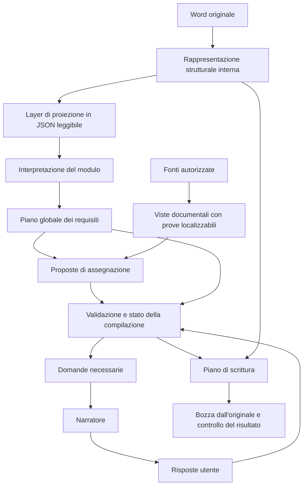

# Architettura proposta per la compilazione affidabile dei documenti Word

**Versione concettuale 0.1 — 15 ottobre 2026 — da discutere e validare.**

Questo documento propone il funzionamento del sistema indipendentemente
dall'applicazione, dal linguaggio e dal provider LLM. Il punto di partenza è
un layer intermedio che renda la rappresentazione del Word più comprensibile
al modello, conservando il collegamento con l'originale.

La richiesta dell'utente è validare il disegno prima di modificare qualsiasi
codice. La redazione del documento non autorizza un'implementazione. Gli
schemi e gli esempi qui presenti descrivono concetti, non contratti API
definitivi. Nessuna capacità proposta viene considerata già realizzata.

La diagnosi del sistema esistente è in [astra.md](astra.md). La descrizione
dell'implementazione attuale rimane in [ARCHITETTURA.md](ARCHITETTURA.md).
Questo documento serve a decidere come dovrebbe funzionare il sistema.

### Base di verifica fissata il 16 ottobre

Su autorizzazione dell'utente, la [fixture Minervino V1](demo-documents/benchmark-minervino/v1/README.md)
diventa il caso completo di riferimento per valutare questa proposta,
affiancato a Labirinto V1 invariato. Sono congelati modulo, cinque fonti,
richiesta iniziale, scelte USER per argomento, Word gold e 267 annotazioni
di destinazione. Gold e copione completo rimangono fuori dagli input del modello.

Il [protocollo](demo-documents/benchmark-minervino/v1/PROTOCOLLO.md) distingue
60 occorrenze testuali SOURCE, quattro testi USER, preferenze/checkbox e vuoti
corretti. Il confronto deve attribuire gli errori a lettura, proposta, grounding,
dialogo o scrittura: il solo numero di campi compilati non basta.

| Problema già osservato | Criterio per valutare la proposta |
|---|---|
| Campi dei soci omessi e copertura incompleta | Inventario dei requisiti confrontato con tutte le destinazioni autoriali, inclusi rami esclusi e ripetizioni |
| Dati del firmatario non riutilizzati dopo la scelta | Scelta USER del soggetto distinta dai suoi attributi documentali; nessuna richiesta ripetuta di dati già dimostrati |
| Rifiuti dovuti a quote FORM o legami personali distribuiti | Prove localizzabili sufficienti per valore, soggetto e ruolo, senza accettare dati di altre persone o deduzioni non dimostrate |
| Dialogo terminato con decisioni ancora mancanti | Quattro argomenti USER coperti; vuoti irrisolti espliciti, senza suggerimenti del valutatore per recuperare omissioni |
| Preferenze e dichiarazioni inventate o ignorate | Decisioni disponibili soltanto al checkpoint previsto; gruppi, massimo sei preferenze ed effetti di deselezione tracciati |
| Spiegazioni o difetti nel Word | Valori nelle destinazioni corrette, nessuna nota nei campi, prestampati e numerazione conservati, firma vuota |

L'adozione del benchmark non equivale a validazione dell'architettura né ad
autorizzazione a implementare il motore. Prima si prepara la baseline integrata
isolata, poi si confrontano vista JSON compatta e modalità di presentazione
delle fonti con stessi contenuti, checkpoint e misure. Provider e configurazione
della nuova serie restano da fissare prima dell'esecuzione. Il tag di questa
base permette di recuperare il codice precedente ai nuovi interventi.

## 1. Obiettivo e risultato atteso

**Compilare tutte le richieste pertinenti per le quali esistono dati o decisioni
sufficienti, rendendo esplicito perché le altre rimangono irrisolte.**

Il risultato comprende una bozza Word, la provenienza di ogni valore e uno
stato comprensibile delle richieste ancora aperte. Il numero di celle riempite
è una misura parziale: bisogna verificare anche valore, soggetto, ruolo,
applicabilità e posizione.

Una domanda completa richiede tre contributi diversi:

| Contributo | Cosa determina |
|---|---|
| Modulo e istruzioni della procedura | Quali informazioni e decisioni sono richieste, dove e a quali condizioni |
| Fonti documentali | Quali fatti sono documentati, per quale soggetto e periodo |
| Utente responsabile della pratica | Quali scelte adottare e quali dati o attestazioni fornire |

L'LLM interpreta e propone collegamenti fra questi elementi. La conoscenza
generale del modello non sostituisce la documentazione di un fatto aziendale.
La generazione della bozza non certifica l'ammissibilità della candidatura.

## 2. Proposta in una pagina

Propongo una **rappresentazione strutturale interna**, una **vista JSON per
l'LLM** e un **piano dei requisiti con stato persistente**.

La rappresentazione interna conserva il dettaglio necessario a ritrovare e
modificare le destinazioni dell'originale. La vista LLM presenta il documento
in un ordine leggibile, con testo, tabelle e riferimenti compatti. Il piano
dei requisiti rappresenta il significato interpretato: cosa serve, per chi,
in quale ramo e con quali dipendenze.



Le caselle descrivono responsabilità logiche. Non implicano un servizio,
un agente o una chiamata LLM per ciascuna. Il numero delle chiamate sarà una
decisione successiva, verificata con misure di qualità, tempo e costo.

Il sistema mantiene una sola visione globale del documento. Gli eventuali
approfondimenti lavorano su requisiti identificati e dipendenze condivise;
non ricominciano l'interpretazione in gruppi indipendenti di campi.

## 3. Gli oggetti fondamentali

| Oggetto | Significato | Esempio |
|---|---|---|
| Documento originale | File immutabile con identità e versione | Il modulo ricevuto dall'ente |
| Destinazione | Punto fisico supportato per la scrittura | Uno spazio, una cella o un controllo |
| Blocco documentale | Unità di lettura con posizione nell'originale | Paragrafo, riga di tabella, nota |
| Requisito | Informazione, decisione o azione richiesta | Comune della sede dell'operatore |
| Soggetto | Entità cui si riferisce un requisito o un fatto | Impresa, persona, raggruppamento |
| Relazione di ruolo | Collegamento di un soggetto a un ruolo e a un ambito | Persona che ricopre un incarico presso l'impresa |
| Fatto documentato | Asserzione accompagnata da prove e limiti | Sede legale riportata in un documento |
| Decisione della pratica | Scelta attribuita all'utente e a questa candidatura | Operatore che presenta la domanda |
| Assegnazione | Proposta di usare un valore per un requisito e una destinazione | Inserire Bari nel comune della sede |
| Operazione di scrittura | Modifica concreta ammessa sul file | Sostituire il contenuto di una destinazione |

Questi oggetti non devono coincidere per comodità. Un requisito può comparire
in più destinazioni; ciascuna occorrenza può avere condizioni proprie. Un
fatto può soddisfare più richieste compatibili. Un gruppo di scelte può
corrispondere a più controlli fisici. Una firma è un'azione manuale, anche
quando il suo spazio assomiglia a un normale campo testuale.

## 4. Il layer intermedio: una vista documentale per l'LLM

### 4.1 Responsabilità

Il layer riceve la rappresentazione strutturale e produce una vista JSON
adatta alla lettura. Deve ridurre il lavoro necessario al modello per
ricostruire il documento, mantenendo le informazioni utili alle decisioni.

**La proposta iniziale è una trasformazione deterministica:** a parità di
originale, estrazione e versione della proiezione, produce la stessa vista.
Non richiede una chiamata aggiuntiva a un LLM per riscrivere il JSON.

La trasformazione può ordinare, deduplicare e sostituire metadati con
riferimenti. Non decide che un vuoto significhi «codice fiscale del
firmatario» o che una sezione sia non applicabile. Queste sono interpretazioni
da rappresentare e verificare nel piano dei requisiti.

### 4.2 Cosa rimane interno e cosa vede il modello

| Informazione | Vista LLM proposta | Rappresentazione interna |
|---|---|---|
| Testo, negazioni, istruzioni e condizioni | Conservati nella vista pertinente | Testo originale e corrispondenza |
| Ordine dei blocchi | Esplicito attraverso ordine e riferimenti | Posizione completa |
| Spazi scrivibili | Marker con identificatore stabile | Destinazione fisica e operazioni ammesse |
| Tabelle | Righe, colonne e relazioni delle celle | Struttura originale, incluse fusioni |
| Controlli di scelta | Tipo fisico e testo circostante | Dettagli necessari alla modifica |
| Gerarchia esplicita del documento | Conservata quando documentata dalla struttura | Stili e struttura originari |
| Offset e dettagli XML | Generalmente omessi | Conservati per risoluzione e scrittura |
| Hash e percorsi tecnici | Generalmente omessi | Conservati per integrità e versioni |
| Contesto ripetuto | Una copia con riferimenti | Disponibile integralmente |
| Parti non interpretabili o non modificabili | Limite visibile e riferimento | Originale e ragione del limite |

Non tutti i dettagli di layout sono irrilevanti. Un'unione di celle, una
nota, una barratura o un titolo possono cambiare il significato. Quando la
proiezione non sa conservarli adeguatamente, deve segnalarlo e consentire
una lettura più ricca, anche visuale.

### 4.3 Esempio di vista compatta

Il seguente documento è inventato per spiegare il contratto. Gli identificatori
sono illustrativi; il formato definitivo rimane da validare.

```json
{
  "document_id": "modulo_esempio",
  "blocks": [
    {
      "id": "B1",
      "text": "Operatore economico [[F1]], con sede nel comune di"
    },
    {
      "id": "B2",
      "text": "[[F2]]."
    }
  ]
}
```

Il modello vede direttamente la richiesta, anche se attraversa due paragrafi.
Il sistema conserva internamente dove si trovano F1 e F2 e come modificarli.
Il marker non deve essere interpretato cercando un testo simile nel Word:
deve risolversi verso una destinazione precisa dell'originale versionato.

L'interpretazione successiva propone che F2 richieda il comune della sede
dell'operatore, con riferimenti a B1 e B2. Si controllano sia la presenza dei
testi sia la correttezza del collegamento. Il semplice fatto che i blocchi
siano adiacenti non autorizza qualunque associazione.

### 4.4 Proprietà da richiedere alla proiezione

La proiezione deve soddisfare cinque condizioni:

1. **Rintracciabilità:** ogni marker e ogni blocco rimandano all'originale.
2. **Copertura dichiarata:** si conoscono contenuti inclusi, esclusi e non
   supportati. Un limite di contesto non può cancellare silenziosamente sezioni.
3. **Fedeltà delle relazioni:** ordine, appartenenza a tabella e contesti
   necessari rimangono leggibili, senza introdurre significati inventati.
4. **Stabilità:** gli identificatori rimangono stabili entro la stessa
   versione; cambiamenti dell'originale invalidano le associazioni precedenti.
5. **Verificabilità:** una proposta riferita alla vista può essere controllata
   contro i contenuti originari, incluse eventuali normalizzazioni dichiarate.

La vista non deve ricostruire da sola l'intero Word: per questo esiste
l'originale. Deve però mantenere la corrispondenza necessaria a verificare
ogni informazione che presenta.

### 4.5 Regole per ridurre il JSON

Il testo dovrebbe essere presente una sola volta per contesto documentale,
con riferimenti dove serve riutilizzarlo. Le proprietà vuote e i metadati
derivabili possono essere omessi se l'assenza ha un significato univoco nel
contratto. Una lista vuota che significa «nessuna scelta identificata» non
può diventare indistinguibile da «scelte non ancora valutate».

I nomi devono rimanere comprensibili. Ridurre i caratteri delle chiavi non è
l'obiettivo principale: un JSON corto ma ambiguo sposta il lavoro sul modello.
Gli identificatori possono essere brevi purché restino univoci e stabili.

La vista strutturale del modulo deve dare una visione globale. Le richieste
successive possono contenere soltanto i requisiti interessati, le condizioni
ereditate e le prove necessarie. Ogni vista parziale conserva un riferimento
al piano completo e dichiara il proprio ambito.

## 5. Comprensione del modulo e piano dei requisiti

Il lettore del modulo interpreta la vista compatta e propone un piano globale
con soggetti, proprietà richieste, rami, condizioni, gruppi di scelta e
destinazioni. Questa responsabilità è distinta dalla disponibilità dei dati
aziendali: la presenza di un dato nelle fonti non deve trasformare il
significato del campo per renderlo più facile da compilare.

Ogni requisito conserva:

- un significato comprensibile e il soggetto cui si riferisce;
- il tipo di informazione o decisione richiesta;
- le destinazioni fisiche e le condizioni specifiche di ciascuna occorrenza;
- gli estratti del modulo che giustificano l'interpretazione;
- eventuali dipendenze da altri requisiti o decisioni;
- ambiguità e stato di revisione.

Un campo riconosciuto come incerto resta nel piano. Le zone non supportate
rimangono visibili anche se non possono ancora essere tradotte in campi.
Il controllo di completezza non deve usare esclusivamente l'elenco delle
destinazioni individuate dal parser: altrimenti i campi persi in estrazione non
comparirebbero mai fra i problemi.

Le istruzioni della procedura possono integrare il modulo conservando la
propria provenienza. Se due documenti danno indicazioni incompatibili, il
sistema registra il conflitto; non stabilisce automaticamente una precedenza
basandosi sul nome del file o sull'ordine di caricamento.

Il piano è una proposta versionata. Il fatto che sia strutturato o completo
come inventario non dimostra che tutte le interpretazioni siano corrette.

## 6. Fonti: contenuti leggibili e fatti con prove

Anche le fonti hanno una rappresentazione interna e una vista per il modello.
L'unità di lettura dovrebbe conservare, quando possibile, un record o una
sezione coerente: persona con ruolo e attributi, riga di tabella con
intestazioni, clausola con eccezioni e periodo di validità.

Un fatto proposto deve contenere soggetto, proprietà, valore e prove
localizzabili nel documento originale. Ruolo, periodo e ambito sono necessari
quando influenzano l'uso del dato. Un codice o un indirizzo letteralmente
presente non è automaticamente pertinente a qualsiasi campo simile.

La ricerca può restituire record pertinenti o, per corpora piccoli, documenti
completi. In entrambi i casi conserva scope e limiti di copertura. «Non
trovato nella ricerca svolta» rimane distinto da «il documento dichiara
esplicitamente che il dato non è disponibile».

Le prove possono attraversare più blocchi quando una relazione verificabile
li collega. Il confine di un chunk non deve diventare una regola semantica
universale; allo stesso tempo, la vicinanza di due nomi non basta a unire
ruolo e dato personale.

Il nucleo della proposta richiede fatti e prove persistiti per la pratica.
Un archivio aziendale riutilizzabile fra compilazioni è un'estensione da
valutare: offre riuso, ma richiede gestione di aggiornamenti, conflitti e
scadenze. Non è necessario decidere subito di estrarre tutta la conoscenza
aziendale prima di poter compilare un singolo modulo.

Un documento della procedura sostiene fatti sulla procedura; una fonte
aziendale può sostenere fatti sull'impresa. Questi ambiti non si sostituiscono
reciprocamente, anche quando entrambi i documenti sono tecnicamente fonti.

## 7. Assegnazioni, dipendenze e stato della pratica

Il motore combina il piano dei requisiti con fatti documentati e decisioni
USER. Una proposta di assegnazione deve spiegare **quale valore risponde a
quale richiesta, per quale soggetto e sotto quali condizioni**.

Lo stato deve mantenere dimensioni distinte:

| Dimensione | Distinzioni necessarie |
|---|---|
| Comprensione | Interpretazione disponibile, incerta o non supportata |
| Applicabilità | Vera, falsa o sconosciuta, con motivazione e riferimento |
| Disponibilità | Dato documentato, ricerca senza riscontro, conflitto o dato USER |
| Validazione | Proposta da verificare, accettabile secondo la policy, respinta o sospesa |
| Materializzazione | Non selezionata, pronta per la bozza, scritta e controllata |

Per esempio, «dato disponibile ma ramo da confermare» deve conservare il
valore senza utilizzarlo prematuramente. «Ramo escluso» permette di lasciare
vuoti i relativi campi, senza dichiarare che i dati aziendali siano assenti.

L'applicabilità usa predicati espliciti. Identità del partecipante, tipologia
dell'impresa, qualità del firmatario e poteri di rappresentanza sono
dimensioni diverse. Una conferma generica non le risolve tutte.

Se una nuova risposta cambia un ramo, i valori dipendenti vengono rivalutati.
Se cambia una fonte, le assegnazioni che la usano tornano da verificare.
Lo storico conserva la precedente decisione e il motivo del cambiamento.
I dati USER non diventano automaticamente nuove prove documentali SOURCE.

## 8. Il narratore e la gestione delle domande

Il motore mantiene la coda completa delle domande ammesse e il loro stato.
Il narratore riceve l'oggetto preciso della domanda e ne cura la formulazione
comprensibile. Può segnalare ambiguità; non decide in autonomia che un requisito
sia soddisfatto o che una fonte manchi.

Ogni domanda conserva soggetto, proprietà o decisione, ambito, eventuali
alternative, requisiti dipendenti e versione dello stato. La frase presentata
deve rimanere equivalente all'oggetto richiesto. Una domanda che chiede chi
firma non può essere usata per confermare indistintamente tutti i dati societari.

L'ordine proposto è: decisioni che individuano i rami, conflitti fra dati
disponibili, informazioni pertinenti mancanti, scelte e attestazioni della
pratica. L'ordine può cambiare quando una dipendenza lo richiede.

Il numero di domande mostrate in un turno è una scelta di presentazione.
Non limita la coda complessiva, la revisione dei valori o l'esportabilità.
Una risposta già acquisita non viene richiesta di nuovo senza una ragione
registrata, come una correzione o un cambiamento del modulo.

Rinvio, rifiuto, assenza di informazione e non applicabilità rimangono distinti.
Una risposta ambigua non muta il dato; una risposta con più informazioni deve
essere associata esplicitamente ai rispettivi destinatari. Le correzioni fuori
dalla domanda attiva richiedono identificazione del requisito e del loro
effetto, non un trasferimento implicito al campo corrente.

Il ciclo termina quando tutti i requisiti pertinenti hanno un esito adeguato,
oppure quando l'utente sceglie consapevolmente una bozza parziale. Una coda
vuota, da sola, non dimostra che il piano del modulo sia completo.

## 9. Validazione e scrittura

### 9.1 Controlli di natura diversa

| Controllo | Cosa può stabilire |
|---|---|
| Strutturale | Il riferimento esiste e identifica una destinazione supportata |
| Documentale | L'estratto esiste nella versione autorizzata della fonte |
| Di tipo e formato | Il valore rispetta il formato richiesto e le trasformazioni ammesse |
| Semantico | Valore, proprietà, soggetto, ruolo, periodo e ramo sono coerenti |
| Della decisione USER | La risposta esprime la scelta attribuita al suo ambito |
| Dell'artefatto | La modifica approvata è stata applicata nel punto previsto |

Un controllo letterale non dimostra da solo la correttezza semantica.
Un revisore LLM può proporre una verifica, ma rimane fallibile; il disegno
deve prevedere incertezza, controprove e revisione umana secondo la criticità.
L'eventuale revisore riceve il requisito e le prove, non soltanto la
giustificazione scritta dal modello che ha proposto il valore.

Il grado di revisione necessario per dati, scelte e dichiarazioni è una
decisione di prodotto ancora aperta. La sua policy deve essere esplicita
prima di attribuire a uno stato un significato come «verificato».

### 9.2 Piano di scrittura

La scrittura riceve operazioni ammesse e riferite all'originale versionato.
Ogni operazione conserva destinazione, valore, provenienza, validazione e
condizioni soddisfatte. Il consenso alla bozza non sana un dato respinto
né autorizza una firma automatica.

Una scelta logica può essere rappresentata da checkbox, cella da marcare o
altro controllo supportato. Le modalità di scrittura sono specifiche, mentre
la scelta conserva un significato comune. Minimi, massimi, esclusività e
vincoli fra gruppi devono essere rappresentabili e ancorati alle istruzioni.
Una regola non compresa resta incerta; il sistema non ne inventa una.

Il documento viene generato dall'originale e dallo stato approvato. Il controllo
successivo verifica valori, posizioni, gruppi e parti preservate. Quando il
layout può influire sull'utilizzabilità, serve anche un controllo visuale.
Una bozza generata non rientra automaticamente fra le fonti fattuali.

## 10. Quali informazioni riceve ciascun compito LLM

| Compito | Contesto necessario | Risultato atteso |
|---|---|---|
| Interpretare il modulo | Vista globale, istruzioni e limiti strutturali | Requisiti, soggetti, condizioni e ambiguità |
| Individuare fatti | Richieste pertinenti e record documentali con provenienza | Asserzioni con prove e alternative |
| Proporre assegnazioni | Requisiti, fatti e condizioni della pratica | Collegamenti motivati, senza autorizzare la scrittura |
| Verificare casi dubbi | Richiesta, proposta e prove originali pertinenti | Accettabilità motivata, rifiuto o incertezza |
| Formulare domande | Oggetti delle domande, alternative e stato pertinente | Frasi equivalenti alle domande ammesse |
| Interpretare risposte | Messaggio USER, domande e destinatari individuabili | Proposte di aggiornamento limitate al loro ambito |

Questa separazione consente JSON più piccoli per compito. Il sistema può
conservare uno stato interno esteso senza inviarlo integralmente a ogni
chiamata. Le dipendenze necessarie restano presenti anche nelle viste parziali.

I prompt descrivono compito, significato dei riferimenti, limiti delle fonti
e contratto di risposta. I dettagli del writer restano interni. I documenti
vengono trattati come dati: un'istruzione contenuta in una fonte non può
ridefinire le regole del processo.

Una prima soluzione potrebbe accorpare individuazione dei fatti e proposta
di assegnazioni. La scelta di separarli in chiamate diverse va motivata con
un vantaggio misurabile. L'architettura richiede responsabilità riconoscibili,
non un numero prestabilito di invocazioni.

## 11. Il ruolo dei file inviati al provider

La vista JSON e la lettura diretta dei file sono due modalità di accesso al
contenuto. Una vista visuale può integrare il testo quando tabelle, simboli
o impaginazione portano significato. Anche in quel caso rimangono necessari
identità dell'originale, riferimenti alle destinazioni e prove verificabili.

La proposta non dipende da uno specifico provider o formato remoto. L'eventuale
adattatore documentale deve dichiarare quali contenuti sono stati letti,
quali trasformazioni sono avvenute e quali limiti rimangono. Una citazione
alla pagina deve poter essere ricondotta al contenuto e alla versione locali.

La scelta fra testo, PDF e immagini verrà valutata dopo l'accordo concettuale.
Il confronto delle capacità ufficiali già consultate è nella sezione 8 di
[astra.md](astra.md). Non si assume che l'upload di un file garantisca da solo
completezza, riduzione di token o corretta modifica del Word.

## 12. Alternative e compromessi

| Scelta | Beneficio atteso | Rischio o costo | Proposta da discutere |
|---|---|---|---|
| Proiezione deterministica | Riproducibilità e nessuna interpretazione aggiuntiva nascosta | Alcune relazioni visive restano difficili da rappresentare | Usarla come base, segnalando i limiti |
| LLM che riscrive preventivamente tutto il JSON | Può sintetizzare e assegnare significati | Omissioni e inferenze prima dell'analisi principale | Considerarlo eventualmente una fase semantica esplicita, non una conversione neutra |
| Piano del modulo separato | Richieste indipendenti dai dati disponibili | Un piano errato può propagarsi | Versionarlo e verificarlo prima del riuso |
| Unica analisi globale | Minore orchestrazione | Molte responsabilità e omissioni concentrate in un output | Mantenerla come alternativa di confronto |
| Approfondimenti mirati sul piano globale | Recupero di incertezze senza rileggere tutto | Più chiamate e rischio di perdere contesti | Conservare dipendenze e budget espliciti |
| Archivio di fatti riutilizzabili | Riutilizzo fra pratiche | Aggiornamento, conflitti e validità temporale | Valutarlo dopo il nucleo per singola pratica |
| Template già mappati | Interpretazione riusabile e revisionabile | Manutenzione delle versioni | Possibile percorso per moduli ricorrenti |
| Lettura visuale | Informazioni sul layout | Costi, ambiguità visive e raccordo con Word | Usarla dove un confronto ne dimostra il beneficio |

Ridurre la dimensione di una richiesta non garantisce un risparmio complessivo:
più verifiche e chiamate possono aumentare il costo totale. La misura utile
è il costo per risultato corretto, insieme al tempo e alla revisione richiesta.

## 13. Validazione concettuale prima del codice

La validazione richiesta ora è una revisione del disegno: si percorrono
manualmente casi rappresentativi per verificare che il sistema abbia un
posto preciso per ogni informazione, incertezza e decisione. Non misura
l'accuratezza futura del modello.

### 13.1 Esempio completo da discutere

Si assume, per questo esempio inventato, che una fonte attesti la
denominazione «Alfa Tecnica S.r.l.» e il comune della sua sede legale «Bari».
Il modulo contiene B1/B2 dell'esempio precedente. La scelta dell'operatore
partecipante non è ancora confermata.

| Passaggio | Esito concettualmente richiesto |
|---|---|
| Lettura strutturale | B1/B2 e F1/F2 conservano ordine e collegamento all'originale |
| Proiezione | Il modello vede testo e marker, senza dettagli XML |
| Interpretazione | F1 richiede l'operatore; F2 il comune della sua sede; il contesto comprende B1 e B2 |
| Lettura della fonte | Denominazione e comune sono fatti distinti sullo stesso soggetto |
| Assegnazione | Si propongono i valori con prove, subordinati alla scelta del partecipante |
| Domanda | Si chiede se la domanda riguarda quella società, senza chiedere all'utente di riscrivere Bari |
| Risposta positiva | Si soddisfa quella decisione, senza confermare implicitamente firmatario e poteri |
| Validazione | Si controllano collegamenti, prove e condizioni di ogni destinazione |
| Scrittura | Si modificano F1/F2 e si verifica il risultato |
| Correzione successiva | Se cambia l'operatore, le assegnazioni dipendenti tornano da valutare |

L'esempio è soddisfacente solo se ogni passaggio ha un proprietario e un
risultato osservabile. «Ci penserà il modello» non è un contratto sufficiente.

### 13.2 Casi che il disegno deve saper gestire

| Caso | Risultato richiesto per considerare coerente il disegno |
|---|---|
| Etichetta nel paragrafo precedente | Contesto multiplo verificabile, senza inventare una citazione unica |
| Comune e indirizzo completo | Proprietà e destinazioni distinte; niente duplicazione arbitraria |
| Persona con ruolo diverso da quello richiesto | Relazione non trasferita per somiglianza o plausibilità |
| Due persone omonime | Ambiguità esplicita finché manca una disambiguazione documentata |
| Ruolo cessato o fonte riferita a un altro periodo | Validità temporale pertinente oppure caso da chiarire |
| Dato realmente assente | Ricerca e limiti registrati; eventuale domanda o richiesta documentale |
| Dato presente ma non recuperato | Esito di ricerca distinto dall'assenza del fatto |
| Record diviso fra chunk | Possibilità di riferire più blocchi con una relazione verificata |
| Due valori incompatibili | Conflitto conservato, senza selezione per ordine di caricamento |
| Istruzioni contrastanti fra documenti | Conflitto sul requisito e revisione della precedenza |
| Più di 40 valori o molte domande | Stato completo, indipendente dai limiti della sintesi |
| Scelta opzionale o cella da marcare | Decisione rappresentata e operazione fisica supportata |
| Massimo di scelte fra gruppi | Vincolo con ambito esplicito; sospensione se l'ambito è ambiguo |
| «Sì» a domanda aperta | Nessun valore inventato per completare la risposta |
| Rinvio di un solo dato | Gli altri requisiti indipendenti continuano |
| Cambiamento di ramo | Rivalutazione dei dipendenti, con storico conservato |
| Zona del Word non supportata | Limite visibile, senza falsa dichiarazione di completezza |
| Fonte di un'altra pratica o bozza generata | Esclusione dalle prove non autorizzate |
| Output interrotto o riferimenti inventati | Nessuna applicazione dei record non validati; stato recuperabile |

Questa è una matrice di accettazione concettuale da esaminare, non una suite
eseguita e non una dichiarazione che tutti i casi siano già risolti.

### 13.3 Condizioni per approvare il disegno

Prima di passare all'implementazione devono risultare chiari:

1. Le informazioni che la proiezione conserva e quelle che può omettere.
2. La distinzione fra estrazione strutturale e interpretazione semantica.
3. Il collegamento verificabile fra marker, requisiti, prove e originale.
4. Chi decide applicabilità, scelta USER, accettabilità e scrittura.
5. Come vengono trattati incertezza, omissioni, conflitti e parti non supportate.
6. Come una correzione invalida soltanto le decisioni dipendenti.
7. Quando la compilazione si arresta e cosa significa esportare una bozza.

L'approvazione concettuale attesterebbe la coerenza del disegno e la scelta
dei compromessi. La capacità degli LLM di rispettarlo rimarrebbe un'ipotesi
da misurare successivamente.

## 14. Verifica empirica successiva all'accordo concettuale

Dopo la validazione del disegno si potrà concordare un esperimento limitato.
Il primo confronto proposto riguarda il solo layer di rappresentazione:
stessi originali, fonti, modello e compito; varia soltanto la vista inviata,
per quanto il contratto consente di isolare questa variabile.

Se servono modifiche ai riferimenti della risposta o ai controlli di ancoraggio,
non sarà più una semplice riduzione dell'input: il confronto dovrà dichiararlo
e separarne gli effetti. La compattezza non deve essere ottenuta indebolendo
i criteri di accettazione.

Le misure necessarie sono comprensione dei campi, dati recuperati, correttezza
di soggetto/ruolo/destinazione, rifiuti validi e falsi negativi, copertura
delle domande, token, latenza e costo complessivo. La baseline e i risultati
attesi devono restare congelati e fuori dai prompt.

Nuovi scenari o fonti più complete richiedono una valutazione separata. Le
prove su altri moduli serviranno a verificare che il risultato non dipenda
da un unico documento preparato. Nessuna percentuale di miglioramento viene
promessa in questa fase.

## 15. Decisioni aperte per la discussione

| Decisione | Orientamento proposto | Cosa resta da validare |
|---|---|---|
| Perimetro iniziale | Documenti con contenuti e destinazioni riconoscibili; limiti espliciti | Quali controlli e regioni Word sono indispensabili |
| Layer intermedio | Proiezione deterministica con testo e marker | Quali relazioni devono essere sempre presenti |
| Interpretazione | Piano globale dei requisiti distinto dai valori | Come verificarlo e quando richiedere revisione umana |
| Fonti | Record leggibili e prove localizzabili | Quanto contesto è necessario a ciascuna relazione |
| Condizioni | Predicati e decisioni distinti per ambito | Quali sono verificabili automaticamente e con quali prove |
| Narratore | Formulazione di domande possedute dal motore | Libertà linguistica ammessa senza cambiare significato |
| Revisione | Policy esplicita secondo il tipo di decisione | Significato operativo di «verificato» e gestione dei casi critici |
| Riutilizzo | Originali, piani e fatti versionati | Quali elementi riusare fra pratiche e come invalidarli |
| Lettura visuale | Integrazione per contenuti non rappresentati bene dal testo | Beneficio rispetto a costo e complessità del mapping |
| Chiamate LLM | Responsabilità separate, numero non fissato | Quali compiti accorpare senza perdere osservabilità |
| Risultato | Bozza con provenienza e requisiti aperti espliciti | Eventuali condizioni aggiuntive per una pratica considerata completa |

**Stato finale di questo documento: proposta pronta per la discussione,
non ancora validata.** Il prossimo passaggio è esaminare il contratto del
layer intermedio e percorrere i casi della sezione 13. Le decisioni concordate
andranno registrate in una revisione del documento prima di avviare modifiche
al codice.
