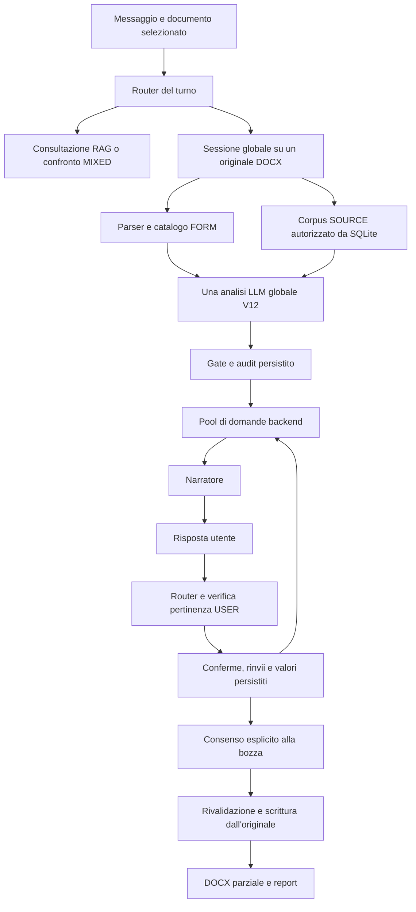
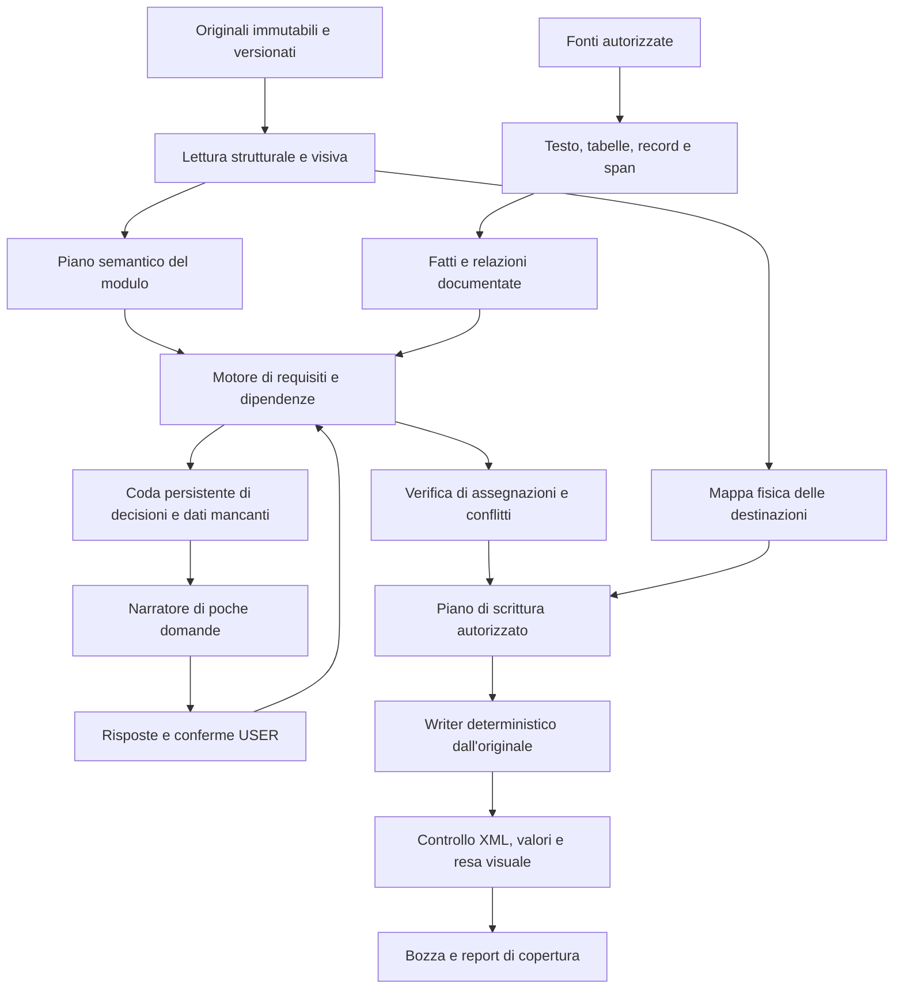

# Studio dell'architettura per la compilazione affidabile dei bandi Word

15 ottobre 2026 — analisi del repository al commit `4b7d828`, branch
`prune-backend`. Documento di diagnosi e proposta: le alternative descritte
non costituiscono una nuova architettura già implementata o approvata.

## 1. Risposta alla domanda principale

**La bassa compilazione attuale dipende sia dai dati disponibili sia dal
software e dalla rappresentazione del problema. Cambiare soltanto modello,
aumentare il contesto o inviare direttamente i file non risolve tutte queste
cause.** Il sistema possiede già protezioni utili e un writer conservativo;
il passaggio meno affidabile è la trasformazione del documento in richieste
semanticamente corrette, collegate a fatti, soggetti, scelte e dipendenze.

I risultati più importanti di questo studio sono:

1. **Nel percorso globale V12 non manca un retrieval più ampio per ogni
   campo.** Il modello riceve tutti i chunk SOURCE autorizzati del piccolo
   corpus. Nel caso Minervino sono 51; ho verificato che coincidono con quelli
   attualmente presenti nel database. Il problema non è un `top_k` troppo basso
   di Qdrant in questa specifica compilazione.
2. **La demo non contiene molti dei dati necessari a una domanda completa.**
   Dati personali, soci, poteri di firma, esperienze documentate e diverse
   scelte della pratica sono assenti o esplicitamente non documentati. Aggiungere
   più testo tecnico generico non colma queste lacune.
3. **Esistono falsi negativi del software su dati presenti.** Bari è nelle
   fonti, viene proposto dal modello e viene rifiutato perché l'etichetta
   «con sede in» termina nel paragrafo precedente. L'indirizzo completo passa
   invece i controlli pur essendo troppo ampio per la suddivisione del modulo.
4. **Il narratore non può completare ciò che la prima analisi non ha modellato.**
   Nell'acquisizione esaminata riceve una sola domanda di applicabilità,
   nessuna domanda locale e nessun gruppo di scelta. Dopo quella conferma,
   il pool delle domande diventa vuoto: l'ho riprodotto in memoria senza
   modificare la sessione. I vuoti spiegati in `coverage` non diventano domande.
5. **C'è un collo di bottiglia a 40 proposte nella revisione conversazionale.**
   Il codice presenta al narratore le prime 40 proposte selezionabili; l'export
   dalla chat richiede che siano state incluse nella revisione. Non c'è una
   paginazione automatica delle successive. Questo non causa i 20 valori di
   Minervino, ma è un ostacolo concreto all'obiettivo di compilarne molti di più.
6. **Una parte consistente del modulo contiene scelte, non dati anagrafici.**
   Minervino ha 67 celle vuote nelle tabelle di categorie, fasce e preferenze,
   catalogate come testo. Il contratto delle scelte gestisce soltanto checkbox
   native e non rappresenta un massimo generale di selezioni, come il «max. 6
   tipologie» stampato nel modulo. La corretta estensione richiede semantica
   delle scelte e operazioni di scrittura adatte a quelle celle.
7. **Il JSON è effettivamente oneroso, ma non è solo un problema di sintassi.**
   L'input compatto misura 229.253 caratteri, oltre a 24.675 di system prompt.
   Il testo delle fonti è 58.512 caratteri; catalogo e metadati occupano molto
   spazio. La stessa chiamata deve capire il modulo, estrarre fatti, scegliere
   ruoli, modellare condizioni, assegnare destinazioni e spiegare i vuoti.
8. **L'alternativa più promettente da sperimentare è ibrida:** originale DOCX
   e indirizzi di scrittura locali; lettura strutturale e, dove serve, visiva;
   fatti documentati riutilizzabili; stato dei requisiti indipendente dal
   narratore; scrittura deterministica e verifica finale. Le API file sono una
   possibile componente della lettura, non il proprietario dello stato né
   una garanzia di corretta compilazione.

Il primo intervento utile è costruire una misura dei campi davvero compilabili
con i dati disponibili e isolare le perdite per fase. Senza questo denominatore
si rischia di migliorare il numero di celle riempite peggiorando la correttezza.

## 2. Metodo, materiali e limiti dello studio

Ho letto stato, README, mappa storica e guida architetturale, verificando poi
nel codice il percorso globale, l'ingestion, il catalogo, i validatori, il
dialogo, il trasporto AI e la scrittura DOCX. La vecchia mappa è utile come
storia, ma non descrive da sola la V12 corrente.

Materiali principali forniti nella radice durante lo studio. I collegamenti
puntano alle copie equivalenti nel commit storico 4b7d828, così restano
consultabili anche dopo le rinomine o cancellazioni locali:

| Materiale | Funzione verificata |
|---|---|
| [richiesta LLM.json](https://github.com/MontesanoDev/Tesi/blob/4b7d828bbdea1e95908c2e3237108f1c0cf36acb/RELATORI_02_MINERVINO_RICHIESTA_LLM.json) | Richiesta di analisi con parametri, system e user prompt |
| [system prompt.txt](https://github.com/MontesanoDev/Tesi/blob/4b7d828bbdea1e95908c2e3237108f1c0cf36acb/RELATORI_02A_MINERVINO_SYSTEM_PROMPT.txt) | Istruzioni dell'analisi globale |
| [user prompt.json](https://github.com/MontesanoDev/Tesi/blob/4b7d828bbdea1e95908c2e3237108f1c0cf36acb/RELATORI_01_MINERVINO_INPUT_LLM.json) | Catalogo FORM, SOURCE, schema e reading plan |
| [risposta LLm.json](https://github.com/MontesanoDev/Tesi/blob/4b7d828bbdea1e95908c2e3237108f1c0cf36acb/RELATORI_03_MINERVINO_RISPOSTA_LLM.json) | Proposta grezza V12, prima dei gate |
| [json narratore.json](https://github.com/MontesanoDev/Tesi/blob/4b7d828bbdea1e95908c2e3237108f1c0cf36acb/json%20narratore.json) | Contesto della prima sintesi conversazionale |

Le copie dei primi quattro file sono equivalenti alle acquisizioni archiviate
della sessione `a067b0abf83f4d948137728669879604`, analisi
`e8ad0f46c3b34157bbe6c9988e1341f8`. Ho ricostruito l'input dall'originale e
rivalidato offline la risposta: entrambi coincidono con gli artefatti storici.
Il database è stato aperto con SQLite `mode=ro`; la sessione era alla versione 8,
con ultima generazione `aca0a0dd970343dda73b2b2caba3344f`.

Distinguo nel seguito tre livelli di evidenza:

- **Osservato:** ricavato dai file reali, dal database in sola lettura o dal
  replay deterministico dell'audit.
- **Dedotto dal codice:** comportamento di un percorso, senza pretendere che
  sia già avvenuto nella compilazione reale esaminata.
- **Proposto:** architettura, esperimento o criterio di accettazione ancora da
  valutare; nessun risultato futuro viene presentato come acquisito.

Non ho eseguito nuove chiamate ai provider, nuovi benchmark generativi, upload
esterni dei documenti, modifiche del motore, migrazioni, reindicizzazioni o
generazioni Word. Non ho annotato manualmente ogni campo di Minervino né
verificato la paginazione con Word/LibreOffice. Per questo non fornisco una
percentuale di accuratezza o un numero certo di tutti i campi recuperabili.
I dati aziendali analizzati sono quelli simulati della demo.

## 3. Mappa attuale del progetto

La ricognizione corrente conta 59 moduli Python in `backend/app`, 77 file di
test backend e 10 script backend. Nel frontend risultano 46 file sotto `src`
e 16 scenari `*.spec.*` sotto `e2e`. Questi sono conteggi di file, non numero
di test eseguiti, copertura o misura di qualità.

| Area | Punti di ingresso e responsabilità | Rilevanza per la compilazione |
|---|---|---|
| UI | [ProjectWorkspacePage.tsx](frontend/src/pages/ProjectWorkspacePage.tsx), [useCompilationSession.ts](frontend/src/hooks/useCompilationSession.ts), `ProjectFormsPanel.tsx` | Mention singola, chat, polling, originale selezionato, download |
| API e routing | [main.py](backend/app/main.py), [intents.py](backend/app/intents.py), [compilation_chat.py](backend/app/compilation_chat.py) | Distingue consultazione, compilazione, risposte e comandi; `CHAT_ENGINE="global"` |
| Archivio moduli | [project_forms.py](backend/app/project_forms.py) | Upload DOCX/TXT, preservazione originale, ruolo FORM |
| Fonti | [ingestion.py](backend/app/ingestion.py), [repository.py](backend/app/repository.py) | PDF/TXT/MD, testo, chunk, scope e rilettura autorizzata |
| Ricerca | [retrieval.py](backend/app/retrieval.py), `retrieval_documents.py`, `vector_retrieval.py`, `retrieval_embeddings.py` | FTS5/Qdrant, vicini e filtri per chat/MIXED e percorsi legacy |
| Geometria Word | [docx_templates.py](backend/app/docx_templates.py), [compilation_catalog.py](backend/app/compilation_catalog.py), [docx_checkboxes.py](backend/app/docx_checkboxes.py) | Posizioni fisiche, contesti, controlli supportati, renderer |
| Analisi globale | [compilation_global.py](backend/app/compilation_global.py), [compilation_global_contract.py](backend/app/compilation_global_contract.py) | Corpus completo piccolo, prompt V12, proposta e validazione |
| Semantica e copertura | `compilation_reading_plan.py`, `compilation_role_records.py`, `compilation_choices.py`, `compilation_clarifications.py`, `compilation_coverage.py` | Indizi strutturali, soggetti/ruoli, opzioni, chiarimenti e spiegazioni |
| Stato globale | [compilation_global_sessions.py](backend/app/compilation_global_sessions.py) | Analisi persistita, fasi, confronto revisioni/fonti, export parziale |
| Conversazione | [compilation_global_dialogue.py](backend/app/compilation_global_dialogue.py), [compilation_reply_guard.py](backend/app/compilation_reply_guard.py) | Pool domande, sintesi, risposte USER, revisione delle proposte |
| Compatibilità | `compilation_sessions.py`, `compilation_session_resolution.py`, `compilation_session_models.py`, `compilation_session_routes.py` | Sessioni V1 e componenti condivisi; non eliminabili perché assenti dal menu |
| Provider e audit | [ai_transport.py](backend/app/ai_transport.py), `ai_profiles.py`, `generation.py`, `compilation_routing_trace.py` | Adattatori HTTP, profili, interpretazione risposte e trace |
| Altre bozze | `artifacts.py`, `call_facts.py`, `fact_extraction.py`, `draft_generation.py` | Artefatti e bozze testuali: non sono automaticamente prove aziendali |
| Persistenza | [db.py](backend/app/db.py), `backend/data/` | SQLite, originali, JSON di stato, revisioni, report e file generati |

### 3.1 Tre percorsi da non confondere

La chat ordinaria può cercare nei chunk di una fonte o del modulo. Il percorso
MIXED estrae richieste FORM e cerca riscontri SOURCE. Le nuove compilazioni
DOCX usano invece il motore globale con `load_document_corpus`.



Il ciclo di dialogo **non riesegue l'analisi dei campi omessi**. In fase `REVIEW`,
`resolve_global` richiama la sintesi. Il budget storico di 36 passi/10 minuti
non significa che la V12 faccia 36 passaggi per recuperare nuovi dati: la vista
globale espone `max_steps=1` per l'analisi.

### 3.2 Cosa conviene conservare

L'originale immutabile, l'identità del progetto, la distinzione FORM/SOURCE/USER,
le revisioni, le quote rilette, gli hash e la generazione dall'originale sono
fondamenta corrette. Anche la rivalidazione all'export è utile: una fonte
cambiata non deve diventare silenziosamente la prova di un vecchio valore.

Il writer modifica il corpo del DOCX e conserva le altre parti ZIP. Non usa
il testo generato dal modello per ricostruire arbitrariamente tutto il Word.
La corrispondenza fra valori e posizioni era stata verificata nel
[controllo della seconda bozza](docs/minervino-output-2-2026-10-13.md);
quella verifica non garantiva la paginazione né la correttezza semantica di
ogni associazione.

## 4. Misura del caso Minervino

### 4.1 Cosa entra e cosa esce

| Passaggio | Risultato osservato |
|---|---:|
| Paragrafi nel catalogo globale | 246 |
| Blocchi strutturali | 134 |
| Tabelle | 4 |
| Posizioni testuali nei paragrafi | 187 |
| Celle testuali scrivibili | 67 |
| Checkbox native | 13 |
| Candidate complessivi | 267 |
| Chunk SOURCE inviati | 51 |
| Fatti atomici nella risposta | 15 |
| Assegnazioni grezze | 21 |
| Proposte condizionate con grounding accettato | 20 |
| Assegnazioni rifiutate | 1 |
| Gruppi di scelta proposti | 0 |
| Chiarimenti locali proposti | 0 |
| Domande nel pool iniziale | 1 |
| Domande dopo conferma della condizione, replay in memoria | 0 |
| Posizioni scritte nel report dell'ultima bozza | 20, tutte SOURCE |

Non è corretto calcolare «20/267 = accuratezza». Fra le 267 posizioni vi sono
rami alternativi, soci o componenti di raggruppamenti non scelti, firme,
preferenze e dati assenti. Inoltre uno stesso fatto riempie più posizioni.
Servono due conteggi diversi: fatti distinti utilizzati e destinazioni
correttamente riempite nel ramo pertinente.

Il resoconto iniziale separa 20 proposte, 1 proposta rifiutata, 147 posizioni
con spiegazione ancorata e 99 con spiegazione respinta: totale 267.
Le spiegazioni accettate sono 142 `source_not_found` e 5 `manual_input`.
Le 99 spiegazioni respinte hanno errori di appartenenza al contesto della
posizione. Non sono 99 valori persi; spesso il modello ha accorpato posizioni
di paragrafi diversi usando una sola ancora inadeguata.

`explicit_decisions_complete=true` descrive la presenza dei record;
`coverage_checks_passed=false` e `semantic_completeness_verified=false`
impediscono di leggerlo come prova di completezza.

### 4.2 Quali documenti fattuali riceve il modello

| Documento | Ruolo nel corpus | Chunk | Caratteri del contenuto |
|---|---|---:|---:|
| `avviso.pdf` | Fonte del progetto, contiene la procedura | 34 | 39.665 |
| `generalita-mapi.md` | Company KB simulata | 9 | 10.039 |
| `visura-mapi-ingegneria-simulata.pdf` | Company KB simulata | 4 | 4.097 |
| `progettazione-opere-pubbliche.txt` | General KB | 4 | 4.711 |
| Totale | | 51 | 58.512 |

I caratteri sono sommati sui chunk, quindi includono sovrapposizioni e non
misurano il testo unico. Il corpus corrente riletto dal database coincide con
quello dell'acquisizione per identità, contenuto e metadati inviati. Non ho
quindi trovato chunk aziendali presenti oggi in SQLite e assenti da questa
richiesta.

Questo risultato **non prova che l'ingestion abbia estratto perfettamente ogni
originale**, né che i documenti caricati siano sufficienti. Il confronto tra
immagine originale e testo estratto resta un livello di verifica distinto.
L'avviso è una fonte sui requisiti della procedura; il fatto che abbia ruolo
tecnico `source` non lo rende prova del possesso di quei requisiti da parte
dell'impresa.

### 4.3 I dati che davvero mancano

Le fonti della demo esplicitano numerose indisponibilità. Esempi:

| Richiesta | Dato disponibile | Perché non basta |
|---|---|---|
| Sottoscrittore | Luca Ferri è amministratore unico | La fonte precisa che non identifica automaticamente chi firma la pratica né ne documenta tutti i poteri |
| Nascita, residenza, CF personale | Nomi di alcune persone e ruoli aziendali | I dati personali sono esplicitamente non disponibili |
| Soci | Amministratore, direttore tecnico e altri referenti | La fonte precisa che non è un elenco completo dei soci |
| Iscrizione camerale | REA e data societaria simulati | REA non è automaticamente il numero richiesto dal Registro Imprese; gli estremi completi sono dichiarati assenti |
| Albo del direttore tecnico | Nome, qualifica, Ordine e numero 8421 | Sezione, dati personali e data pertinente non sono documentati come richiesto |
| Servizi pregressi | Descrizione generale delle attività | Non documenta committenti, importi, categorie e prestazioni eseguite |
| Preferenze d'incarico | Capacità e servizi descritti | La scelta per questa domanda richiede una decisione della pratica |
| Dichiarazioni e allegati | Testo prestampato del modulo | Il testo richiesto non dimostra la verità della dichiarazione né la presenza dell'allegato |

Il fascicolo aziendale e il fascicolo della candidatura devono quindi crescere
se l'obiettivo è una domanda sostanzialmente completa. La raccolta deve essere
guidata dalle richieste del modulo e dall'applicabilità, non da una lista
generica di «altri documenti da caricare».

### 4.4 I dati presenti ma trattati male

**Comune Bari, `p15.s0`.** La SOURCE contiene il valore e il modello lo propone.
La quote FORM è `[[p15.s0]] (`; il gate la respinge perché il marker da solo
non documenta il significato. La label è alla fine di `paragraph:14`.
È un difetto di rappresentazione/ancoraggio, con un falso negativo concreto.
Accettare qualsiasi marker sarebbe una correzione sbagliata: serve una
relazione verificabile tra label precedente e destinazione.

**Sede legale, `p41.s1`.** Viene proposto l'intero indirizzo, seguito da campi
separati per provincia, via e civico. Il valore è documentato, ma la scelta
della sua granularità è inadeguata. I controlli letterali non risolvono da soli
la distinzione fra `indirizzo_completo`, `comune`, `via` e `civico`.

**Ordine professionale, `p53.s0`.** Il valore è nella posizione prevista ma
si unisce alla label senza spazio. È un difetto di resa testuale, distinto
dall'estrazione e dal grounding. Vanno verificate le giunzioni e, in un livello
successivo, la resa visuale.

**Ruoli.** Il recupero dei dati professionali di Elisa Romano è un successo
reale del collegamento FORM/SOURCE. Non autorizza a usarla come firmataria,
socia o professionista designata per un incarico diverso. Il dato corretto
diventa una compilazione errata se cambia il soggetto o il ruolo di destinazione.

## 5. Limiti tecnologici e limiti introdotti dall'implementazione

### 5.1 Il parser vede posizioni, non requisiti già compresi

Il parser riconosce celle vuote, placeholder testuali e, nel percorso globale,
checkbox native gestite dal modulo dedicato. È una base fisica utile, ma non
copre ogni modo in cui un autore Word rappresenta una richiesta: soli spazi,
tabulazioni con righe, caselle disegnate, alcuni controlli testuali, aree in
oggetti grafici e contenuti complessi richiedono capacità aggiuntive.

Intestazioni, piè di pagina e note possono essere inventariati in lettura,
senza diventare destinazioni di scrittura. Revisioni pendenti, protezioni e
contenuti importati non supportati vengono rifiutati. Un limite esplicito è
preferibile alla modifica silenziosa di un punto sbagliato.

Nel caso concreto tutti i 267 candidate hanno `section_ids` vuoto: il Word non
fornisce un outline utilizzabile per essi. Le sezioni esistono nel testo, ma
la loro interpretazione è affidata al modello. Non basta contare candidate
per sapere che tutti i campi logici siano stati riconosciuti.

Il parser testuale segnala 15 paragrafi complessi; molti corrispondono alle
13 checkbox riconosciute dal percorso dedicato. **Non vanno sommati come 15
campi mancanti.** La copertura strutturale va unificata per capacità, evitando
di scambiare la diagnostica di un parser con il risultato complessivo.

### 5.2 Scelte in celle e cardinalità non rappresentate

Le 67 celle delle quattro tabelle sono fisicamente scrivibili come testo.
La risposta le descrive come preferenze non documentate nelle SOURCE. Si tratta
però di una famiglia di richieste diversa dalla ricerca di dati aziendali:
l'utente deve scegliere categorie, fasce e incarichi.

`ChoiceGroup` rappresenta `single/multiple/unknown`, un minimo 0/1 e opzioni
che il validatore vincola a candidate di tipo `checkbox`. Non c'è un
`max_selected` generale né un vincolo trasversale fra gruppi. Il modulo
contiene l'istruzione «max. 6 tipologie»: occorre prima interpretarne e
verificarne l'ambito, poi rappresentarlo. Non basta applicare meccanicamente
un massimo di sei a ogni tabella.

Estensione proposta: una scelta logica deve poter puntare a un controllo
nativo, a una cella da marcare o a un simbolo supportato, con operazioni di
rendering distinte. La scelta USER e l'eventuale prova di un requisito devono
restare separate. Una competenza documentata non equivale a scegliere un
incarico, e una scelta non prova il possesso del requisito.

### 5.3 I chunk possono perdere relazioni anche quando vengono inviati tutti

L'ingestion corrente usa `pypdf` per estrarre testo, senza OCR automatico,
poi chunk da 1.200 caratteri con overlap 200. I confini rispettano le parole,
ma non necessariamente una tabella, una persona o una relazione documentale.
Per PDF, le pagine vengono concatenate; i chunk non conservano una mappa
completa di pagina, coordinate e celle.

La validazione dei ruoli personali richiede ruolo e valore nello stesso chunk
e usa formati documentali riconoscibili: coppie `ruolo: persona`, intestazioni
Markdown o righe maiuscole. Inoltre richiede uguaglianza letterale normalizzata
fra ruolo FORM e SOURCE. Questo previene trasferimenti arbitrari, ma limita
documenti narrativi, sinonimi corretti e record divisi fra chunk.

Il modello può quindi vedere entrambi i pezzi nel prompt e produrre comunque
una proposta che il contratto non sa accettare. **Disponibilità nel contesto
e possibilità di costruire una prova valida sono cose diverse.** In Minervino
il record professionale principale rientra nel chunk e passa; l'incidenza
quantitativa del problema su altri documenti va misurata.

Una rappresentazione per record/sezioni, con span su documento canonico,
consentirebbe prove multiple verificabili senza imporre che ogni relazione
stia dentro una finestra arbitraria di 1.200 caratteri. Non significa unire
liberamente persone o citazioni: le relazioni devono essere dimostrate.

### 5.4 Limiti espliciti del sistema corrente

| Limite | Dove | Effetto |
|---|---|---|
| 20 MB DOCX; 40 MB decompressi; 2.048 entry ZIP | `docx_templates.py` | Rifiuto di pacchetti oltre budget |
| 60.000 caratteri del corpo | `inspect_docx` | Rifiuto di moduli lunghi |
| 400 candidate | Parser/catalogo/contratto | Tetto applicativo, non limite intrinseco di Word |
| 100.000 caratteri catalogo testuale; 200.000 catalogo globale | Parser e catalogo | Vincoli distinti prima della chiamata |
| 96 chunk e 100.000 caratteri SOURCE | `_allowed_sources` | Corpus oltre budget rifiutato, senza troncamento implicito |
| 350.000 caratteri input JSON | `build_global_input` | Non è un budget misurato in token del provider |
| 49.152 token output; 300 secondi | Analisi globale | Budget della chiamata, non prova che tutto venga considerato |
| 128 fatti; 128 condizioni/binding; 64 gruppi di scelta | Contratto | Limiti da riconsiderare per moduli grandi |
| 16 chiarimenti locali nella prima analisi | Contratto V11/V12 | Nessuna coda successiva che cataloghi automaticamente tutti gli altri dati |
| Pool 24; massimo 3 domande per risposta | Dialogo | Limiti utili alla presentazione, da distinguere dalla completezza |
| Prime 40 proposte al narratore | `model_context`, `narrate` | Collega il budget di presentazione all'esportabilità SOURCE |

Per Minervino non emerge un superamento del budget di input o output:
la risposta termina con `finish_reason=stop`. Non è dimostrato che i vuoti
siano causati da troncamento. I limiti espliciti spiegano soprattutto quali
documenti più grandi fallirebbero e quali percorsi non scalano.

### 5.5 Il limite delle 40 proposte richiede una correzione architetturale mirata

In `model_context` e `narrate` la lista è tagliata con `[:40]`. `narrate`
salva quegli ID in `reviewed_candidate_ids`; `export_selection` richiede che
un valore SOURCE sia in quell'insieme e non fra i sospesi. La prosecuzione
ricostruisce ancora le prime proposte selezionabili, senza un cursore sui
record non ancora esaminati.

Questa è una **deduzione dal codice**, non una nuova prova LLM con 41 valori.
Riguarda il normale export SOURCE dalla chat, non il massimo fisico del writer,
ogni API manuale o il totale dei valori USER. Se cambia l'insieme selezionabile,
può cambiare anche il sottoinsieme visto dal narratore; non è comunque una
strategia di copertura completa.

La revisione semantica deve avere uno stato proprio per ogni proposta. Il
riassunto può citare pochi gruppi umani, ma non deve decidere implicitamente
quali 40 valori esistono per la compilazione. Aumentare 40 a 100 sposta il
problema; una revisione esaustiva e persistente lo rende controllabile.

## 6. Studio di system prompt, user prompt e risposta

### 6.1 Peso effettivo del contesto

Le misure seguenti usano JSON compatto UTF-8 decodificato in caratteri,
non byte del file indentato e non stime di token.

| Componente | Caratteri | Quota indicativa dell'input JSON |
|---|---:|---:|
| FORM complessivo | 126.928 | 55,4% |
| SOURCE con metadati | 69.638 | 30,4% |
| Reading plan | 20.744 | 9,0% |
| Schema output | 11.701 | 5,1% |
| Input JSON completo | 229.253 | 100% |
| System prompt aggiuntivo | 24.675 | fuori dal totale sopra |

Nel FORM, `blocks` occupa 63.758 caratteri e `candidates` 62.947. Parte della
ridondanza serve al grounding e non va eliminata alla cieca. Il reading plan
ripropone anche righe delle fonti per facilitarne la lettura. Il punto è
scegliere una proiezione adatta al singolo compito mantenendo i dettagli
completi nel backend.

La risposta compatta misura 19.307 caratteri: `fields` 6.216, `facts` 3.683,
`coverage` 7.832. Le sole spiegazioni dei vuoti occupano circa il 40,6%
dell'output JSON. Non sono inutili: rendono visibili omissioni e problemi,
ma mostrano il costo di far rendicontare tutto nella stessa risposta.

Nella chiamata storica il provider ha riportato:

- 72.405 token di prompt;
- 30.291 token di completion, inclusi 23.877 di reasoning;
- 102.696 token totali e circa 120,98 secondi per l'analisi;
- narratore: 7.781 token totali e circa 3,67 secondi.

Sono misure storiche riacquisite, non tempi di un nuovo esperimento né tempi
end-to-end della chat. Il prompt aveva 72.192 token in cache secondo il
provider: il totale dei token non è direttamente il costo monetario, e non
permette di confrontare economicamente provider diversi senza i rispettivi
listini e dettagli d'uso.

### 6.2 Troppi compiti dipendenti dentro una singola risposta

Il system prompt è accurato ma accumula responsabilità: condizioni del FORM,
lettura completa, fatti atomici, binding personali, granularità dei valori,
quote, posizioni, alternative, scelte, chiarimenti e motivi di mancata
compilazione. Specifica perfino i formati letterali che il validatore accetta.

L'output finale dipende da più decisioni in catena. Se il modello sbaglia la
condizione iniziale, molte assegnazioni e domande possono essere formalmente
consistenti con una premessa sbagliata. Se omette un gruppo di scelta, la
conversazione non ha modo di proporlo. L'accettazione di un riferimento non
dimostra la correttezza del significato attribuito.

Le istruzioni chiedono campi sparsi e, contemporaneamente, un resoconto di
tutte le posizioni restanti. È una tensione operativa comprensibile:
risparmiare output e garantire copertura. Una formulazione ancora più lunga
non risolve necessariamente tale tensione.

Nei [benchmark V12 già acquisiti](docs/compilazione-esiti-vuoti-2026-10-13.md)
le due prove finali Minervino hanno 19/17 proposte valide, 88/105 spiegazioni
respinte e 0/7 omissioni. La fixture Labirinto ha esiti più stabili. Questo
dimostra variabilità sul materiale reale; non dimostra che una particolare
dimensione del prompt ne sia la causa unica.

La ricerca sui contesti lunghi mostra che contenere un'informazione nel prompt
non garantisce di usarla correttamente, e suggerisce prove di sensibilità
all'ordine. È una motivazione per sperimentare, non una diagnosi automatica
del modello corrente: [Liu et al., Lost in the Middle, TACL 2024](https://aclanthology.org/2024.tacl-1.9/).

### 6.3 JSON valido e schema vincolato

La richiesta osservata usa `response_format={"type":"json_object"}` e mette
lo schema nello user prompt. Nell'adattatore OpenAI è usato Responses, ma
ancora con `text.format.type=json_object`; lo schema passato a `post_chat`
viene usato nativamente dal ramo Ollama, non da quello OpenAI. Il ramo
Anthropic invia testo a Messages, senza un contratto strutturato nativo.

Un adattatore può usare output vincolati allo schema quando supportati. Questo
riduce errori di forma, ma non certifica soggetto, verità o destinazione.
Vanno gestiti rifiuti, risposte incomplete e il sottoinsieme di JSON Schema
supportato. Le mappe dinamiche attuali non sono necessariamente trasferibili
senza adattamento: [OpenAI Structured Outputs](https://developers.openai.com/api/docs/guides/structured-outputs).

La direzione utile è mantenere JSON come formato interno e ridurre ciò che
ogni chiamata deve ricostruire. Sostituirlo con prosa libera trasferirebbe la
complessità a un parser più fragile.

## 7. Perché il narratore oggi si ferma troppo presto

### 7.1 Ha una vista limitata per progetto

Il narratore riceve proposte accettabili, contesti di ruolo, risposte precedenti,
riassunto della copertura e pool di domande. Non riceve un incarico indipendente
di analizzare tutto il Word o ricercare nuovi fatti. Può sospendere proposte
dubbie, ma non crearne liberamente di nuove.

Questo confine è corretto per un componente di presentazione. Il problema è
che il sistema gli affida anche parte della revisione, mentre a monte manca
un inventario semantico completo dei requisiti da soddisfare.

### 7.2 La domanda reale ha un significato più preciso della condizione originale

La condizione grezza `c_partecipazione` cita soltanto «IN QUALITÀ DI» e
controlla i 21 campi proposti. Il narratore la traduce nella conferma:

> Confermi che il modulo è presentato da Mapi Ingegneria S.r.l. in qualità di società di ingegneria?

Il contesto originale mescola qualifica del dichiarante, forma di partecipazione
e tipi di soggetto. La domanda naturale introduce un'interpretazione più
specifica. Il verificatore USER può controllare che «sì» risponda alla domanda
posta; non ricostruisce da zero se quella domanda modellasse correttamente
tutte le dipendenze del modulo.

Questo è il punto delicato: la qualità della conversazione dipende dalla
qualità della decisione che viene chiesta, non soltanto dalla pertinenza
della risposta. L'identità dell'impresa, la sua tipologia, chi firma e con
quali poteri richiedono relazioni distinte.

### 7.3 Nessuna coda completa dei dati mancanti

La risposta reale contiene `clarifications={}` e `choice_groups={}`. La funzione
`question_pool` costruisce domande da condizioni con impatto, gruppi validati
e campi `missing/review` con ancore valide. Le spiegazioni in `coverage` non
alimentano tale coda. La conferma della sola condizione lascia zero domande.

Nel contratto ci sono inoltre al massimo 16 chiarimenti iniziali. Un gruppo
di scelta opzionale con `min_selected=0` viene escluso dal pool attuale. È
quindi possibile avere preferenze compilabili dall'utente che non vengono
mai chieste in questo percorso, anche dopo un miglioramento dell'emissione.

Il rimedio non è trasformare ogni vuoto in domanda. Serve uno stato del
requisito: applicabile, non applicabile, non ancora determinato; valore
disponibile, conflittuale o da acquisire; decisione richiesta o firma manuale.
Solo dopo si costruisce una coda ordinata e riprendibile.

### 7.4 Un comportamento conversazionale più affidabile

Proposta da discutere:

1. Il backend sceglie l'oggetto della domanda e il suo ambito; il narratore
   formula la frase senza ampliarlo.
2. La domanda conserva identificatore stabile, versione della sessione,
   soggetto, proprietà o decisione, opzioni ammesse e campi dipendenti.
3. Si chiedono prima le decisioni che delimitano il ramo, poi i dati pertinenti
   non già disponibili. Due dati diversi non diventano una sola conferma.
4. Un valore già nelle fonti viene proposto per conferma soltanto quando
   manca una scelta della pratica; non si chiede di riscriverlo inutilmente.
5. Una risposta USER aggiorna soltanto i destinatari individuati. Le risposte
   con più dati richiedono una proposta di associazioni esplicita e validata.
6. Rinvio, dato assente, rifiuto e non applicabilità restano stati distinti.
7. La risposta al turno descrive solo cambiamenti realmente accettati.

Una coda persistente può mostrare poche domande alla volta senza perdere le
successive. Il criterio di fine conversazione diventa «tutti i requisiti
pertinenti hanno un esito», oppure «l'utente ha scelto una bozza parziale»,
non semplicemente «il narratore non ha emesso altre domande».

## 8. Inviare file alle API: cosa cambia realmente

### 8.1 Quattro operazioni diverse

Caricare un file sul provider è un'operazione di trasporto e conservazione.
Passarlo nel contesto è un'operazione di lettura. Indicizzarlo per File Search
è un'operazione di retrieval. Far generare un DOCX tramite esecuzione di codice
è un'operazione di produzione dell'artefatto. Non sono equivalenti e possono
essere usate separatamente.

In particolare, un `file_id` breve nella richiesta non significa che il modello
legga pochi token, né che ottenga gli identificatori delle celle Word usati dal
writer locale. Un servizio di ricerca sui file continua a selezionare parti
del documento: non garantisce una lettura esaustiva del modulo.

### 8.2 Capacità ufficiali verificate al 15 ottobre 2026

Le indicazioni seguenti riguardano la documentazione consultata, non un test
eseguito con gli account del progetto. Disponibilità e limiti vanno verificati
per endpoint e modello prima dell'implementazione.

| Provider/percorso | File e rappresentazione | Conseguenza per Mapi |
|---|---|---|
| OpenAI Responses `input_file` | DOCX e altri documenti non PDF: estrazione testuale. PDF con modelli visivi: testo e immagini delle pagine. Limite documentato complessivo 50 MB per richiesta, ogni file sotto 50 MB | Il DOCX diretto non garantisce lettura del layout o delle immagini incorporate. Il PDF può aggiungere informazione visiva; il catalogo locale resta necessario per scrivere |
| OpenAI File Search | Ricerca semantica e per parole chiave su file in vector store | Alternativa al retrieval ospitato localmente, da valutare per copertura, filtri e provenienza |
| Anthropic Messages/Files | Blocchi documento per PDF; testo e immagini di pagina. DOCX non supportato direttamente nei blocchi documento: convertire in testo o PDF | Possibile lettura del PDF; occorre raccordare gli estratti con originali e posizioni locali |
| Gemini document understanding | PDF con comprensione visiva; documentati fino a 50 MB o 1.000 pagine, entro il contesto. Gli altri formati documentali descritti sono trattati come testo | Candidato per leggere tabelle e layout; mantenere mapping e validazione locali |
| DeepSeek Files API | La guida consultata documenta JPEG, PNG, GIF e WebP per `deepseek-flash` | È possibile sperimentare immagini di pagine. La disponibilità di Files API non dimostra supporto nativo a DOCX/PDF |

Fonti della tabella: [OpenAI File inputs](https://developers.openai.com/api/docs/guides/file-inputs),
[OpenAI File Search](https://developers.openai.com/api/docs/guides/tools-file-search),
[Claude PDF support](https://platform.claude.com/docs/en/build-with-claude/pdf-support),
[Claude Files API](https://platform.claude.com/docs/en/build-with-claude/files),
[Gemini document understanding](https://ai.google.dev/gemini-api/docs/document-processing),
[DeepSeek Files API](https://api-docs.deepseek.com/guides/files_api/).

L'adattatore attuale di Mapi non costruisce questi input documentali: riceve
messaggi testuali. OpenAI usa già Responses, Anthropic Messages, Google un
percorso compatibile Chat Completions; questo non equivale ad avere integrato
le rispettive API native dei file.

### 8.3 Dove i file possono aiutare

Un PDF renderizzato dal Word può aiutare a riconoscere gerarchie visive,
tabelle, istruzioni lontane, celle da barrare e allineamenti che il solo testo
appiattisce. È una buona ipotesi per Minervino, dove tutti i `section_ids`
sono vuoti e numerose scelte sono celle.

L'effetto va misurato: immagini sfocate, rendering diverso dai font originali,
salti pagina e OCR possono introdurre altri errori. La conversione deve
conservare l'originale e registrare versione del renderer, font, hash e mappa
tra pagine, blocchi e candidate. Una pagina PDF non è un indirizzo XML Word.

Per fonti aziendali brevi, inviare testo completo strutturato per documento o
record è un confronto prioritario e meno oneroso da predisporre. Nel caso
esaminato i chunk sono già tutti presenti: l'eventuale beneficio deriverebbe
dalla continuità delle relazioni e dalla rappresentazione, non dalla magia
del trasporto file.

### 8.4 Dove i file non risolvono il problema

Non aggiungono dati mancanti, non scelgono legittimamente il firmatario,
non distinguono automaticamente tutte le condizioni e non rendono sicura
una scrittura in una cella ambigua. Non eliminano il bisogno di uno schema,
di uno stato persistente o di una verifica del risultato.

Una citazione a pagina dimostra la localizzazione della prova; non dimostra
che il valore appartenga al soggetto e al ruolo richiesti. Il provider può
anche normalizzare il testo diversamente dall'estrattore locale: serve un
allineamento verificato, non un confronto fuzzy senza soglia e senza esito
di incertezza.

### 8.5 Gestione dei file esterni

Se si sperimenta questo percorso, il backend deve conservare un registro
`document_hash → provider/account/file_id`, con scope, scadenza e cancellazione.
Gli ID esterni non devono sostituire gli originali locali né diventare
accessibili da progetti non autorizzati. L'upload remoto deve essere limitato
ai documenti previsti dalla prova.

Le scadenze non sono uniformi: Gemini documenta la cancellazione automatica
dopo 48 ore; DeepSeek documenta una scadenza opzionale o conservazione
permanente se omessa. Non va applicata una regola comune per supposizione:
[Gemini Files API](https://ai.google.dev/gemini-api/docs/files),
[DeepSeek Files API](https://api-docs.deepseek.com/guides/files_api/).

**Raccomandazione:** sperimentare la lettura file mantenendo il writer locale.
Per il modulo provare catalogo compatto più PDF/immagini; per le fonti provare
record completi con span e, nei documenti visuali, PDF. Non scegliere oggi un
provider vincente senza un confronto sugli stessi casi e gli stessi risultati
attesi.

## 9. Architettura proposta: responsabilità esplicite e stato verificabile

### 9.1 Confronto delle alternative

| Alternativa | Vantaggio | Costo o limite | Giudizio per questo progetto |
|---|---|---|---|
| Mantenere V12, semplificare input e migliorare il modello | Intervento circoscritto, confronto facile con baseline | La stessa chiamata continua a decidere quasi tutto; omissioni congelate e dialogo limitato | Utile come controllo sperimentale, insufficiente come unica strategia |
| File diretto e unica risposta con campi | Riduce l'estrazione applicativa, può aggiungere visione | Mapping delle destinazioni e controllo del contesto meno trasparenti; nessuna soluzione ai dati assenti | Da provare come modalità di lettura, non assumere come architettura completa |
| LLM che manipola direttamente il Word con strumenti | Può affrontare formati e trasformazioni eterogenei | Modifiche più difficili da circoscrivere e verificare; esecuzione e risultati variabili | Sandbox di ricerca separata; non prima scelta per l'export affidabile |
| Piano documentale globale, fatti documentati e risoluzione incrementale controllata | Diagnosi per fase, riuso dei dati, coda completa, verifica puntuale | Più contratti e orchestrazione; rischio di propagare un piano iniziale errato | Direzione raccomandata da validare con esperimenti |
| Template preparati e mappati manualmente | Elevata prevedibilità su moduli ripetitivi | Costo di onboarding e manutenzione delle versioni | Opzione molto valida per un catalogo ricorrente; fallback per moduli nuovi |

La raccomandazione non è reintrodurre il vecchio motore a gruppi. Un nuovo
processo per fasi deve condividere una sola mappa globale dei soggetti,
dei requisiti e delle dipendenze; nessuna parte deve reinterpretare da zero
il modulo o perdere le condizioni delle altre sezioni. Le eventuali unità
di lavoro sono revisionabili e persistenti, non batch indipendenti di campi.

### 9.2 Componenti logici



Questi componenti possono restare nello stesso backend FastAPI. Non è
necessario introdurre subito microservizi, un database a grafo o un framework
di agenti autonomi. Il problema principale è il contratto fra responsabilità,
non il numero di processi distribuiti.

### 9.3 Primo livello: documento canonico e mappa fisica

Ogni originale conserva hash, versione, ruolo, progetto e percorso. La
lettura produce blocchi, paragrafi, tabelle, celle, controlli, relazioni di
continuità e regioni non supportate. Per il FORM si distingue:

- **destinazione fisica:** dove è lecito scrivere;
- **richiesta logica:** quale dato o decisione viene richiesto;
- **soggetto e ruolo:** a chi si riferisce;
- **applicabilità:** in quali condizioni va compilata;
- **resa:** valore testuale, componente di indirizzo, selezione, data o firma.

Un campo può avere una label in un paragrafo e il vuoto nel successivo.
Un requisito può corrispondere a più destinazioni ripetute. Una tabella può
contenere celle di selezione e non dati numerici. Queste relazioni devono
essere rappresentate esplicitamente.

Il backend conserva offset e dettagli XML; il modello può ricevere un testo
con ancore compatte e una tabella di destinazioni. Per un ancoraggio a cavallo
di paragrafi, il contratto può contenere due span verificati e la relazione
strutturale ammessa. Non occorre chiedere al modello una quote impossibile
che fonda artificialmente due paragrafi.

Le posizioni fuori capacità restano visibili nel report. Non devono sparire
dal denominatore prima ancora che si misuri il riconoscimento dei campi.

### 9.4 Secondo livello: piano semantico del FORM

Una fase dedicata interpreta soltanto il modulo e le istruzioni pertinenti
della procedura. Produce requisiti tipizzati, soggetti, ruoli, rami,
dipendenze e gruppi di scelta; non propone ancora dati aziendali.

La separazione permette di capire se una mancanza nasce prima della ricerca
nelle fonti. Il piano deve poter affermare «questa zona non è stata compresa».
Un controllo di copertura confronta l'inventario fisico con il piano, mentre
una verifica semantica valuta le associazioni dubbie e i predicati troppo
generici. Le dipendenze cicliche o i gruppi sovrapposti devono essere segnalati.

Esempio concettuale, non schema implementato:

```json
{
  "requirement_id": "req_sede_comune",
  "subject_ref": "operatore_della_pratica",
  "property": "sede_legale.comune",
  "value_type": "municipality",
  "destinations": ["p15.s0", "p41.s1"],
  "applicability_refs": ["operatore_confermato", "ramo_societa"],
  "form_evidence_refs": ["span_label_sede", "span_indirizzo_societa"],
  "semantic_review": "pending"
}
```

In produzione le due destinazioni potrebbero avere condizioni differenti:
la relazione `requisito → destinazione` deve ammettere vincoli per occorrenza,
non applicare un'unica condizione a tutto per comodità. L'esempio mostra la
distinzione fra significato e posizione, non stabilisce un mapping approvato.

Pro e contro: il piano può essere memorizzato per hash del template e riusato;
un errore nel piano può però propagarsi a tutte le compilazioni successive.
Per questo servono versione del contratto, revisione e casi di regressione
prima di considerarlo affidabile. Un nuovo originale non eredita il piano
solo perché ha lo stesso nome file.

### 9.5 Terzo livello: fatti e relazioni con prove

I fatti aziendali ricorrenti non dovrebbero essere riscoperti per intero
in ogni domanda. Si può introdurre un archivio di asserzioni documentate,
senza trasformarlo in una nuova fonte autoreferenziale.

Ogni asserzione deve conservare almeno soggetto, proprietà, valore originale,
eventuale valore normalizzato, documento/versione, span, periodo e stato di
validazione. Le relazioni hanno identità propria: una persona ricopre un ruolo
presso una società, eventualmente durante un periodo; una persona è scelta
come firmataria di una pratica. Non sono lo stesso fatto.

```json
{
  "claim_id": "claim_8421",
  "subject_ref": "persona_elisa_romano",
  "property": "iscrizione_professionale.numero",
  "raw_value": "8421",
  "evidence_refs": ["source_span_ordine"],
  "role_relation_ref": "rel_direttore_tecnico_mapi",
  "valid_from": null,
  "valid_to": null,
  "validation": "documented_proposal"
}
```

I valori normalizzati richiedono una trasformazione dichiarata. Separare un
indirizzo in comune/via/civico è diverso dal cambiare il numero o correggere
un identificativo demo inventando un dato reale. Una normalizzazione deve
essere reversibile o accompagnata dal valore originale e dalla regola usata.

Le prove possono essere più span dello stesso documento o di documenti
diversi solo quando la relazione è esplicita e verificata. Nessuna unione
basata unicamente sulla somiglianza del nome. Un conflitto di fonti rimane
un conflitto; il documento più recente non prevale automaticamente se tratta
un periodo o una proprietà differenti.

I fatti estratti da AI restano proposte fino ai controlli previsti. La cache
serve a riusare estrazioni, non a eliminare provenienza o revisione. Una
modifica delle fonti invalida le dipendenze pertinenti; non promuove bozze o
risposte precedenti a prove SOURCE.

### 9.6 Quarto livello: recupero delle evidenze

Per il corpus attuale, una vista completa per documento/record può essere
sufficiente e permette un confronto diretto con V12. Per corpora grandi
occorre retrieval: ricerca di entità e proprietà, combinazione di lessicale
e vettoriale dove utile, recupero del record completo e dei contesti necessari.

Il risultato del retrieval deve includere i limiti della ricerca. «Non trovato
nei candidati recuperati» non significa «inesistente nell'archivio». Un campo
senza risposta può attivare una ricerca diversa o una rilettura del documento,
entro un budget esplicito e con una ragione registrata.

FTS5, Qdrant, espansione dei vicini e rilettura devono mantenere gli stessi
filtri di progetto, ruolo e documento. Il filtraggio soltanto nel prompt o
dopo aver esposto i contenuti al modello non è sufficiente. La General KB può
aiutare a interpretare termini, ma non sostenere dati aziendali specifici.

### 9.7 Quinto livello: risoluzione incrementale e applicabilità

Una volta disponibile il piano globale, il backend combina fatti, decisioni
USER e dipendenze. Ogni requisito ha dimensioni separate, per esempio:

| Dimensione | Stati concettuali |
|---|---|
| Comprensione del campo | riconosciuto, ambiguo, non supportato, da valutare |
| Applicabilità | vera, falsa, sconosciuta, con prova o decisione di riferimento |
| Disponibilità | documentata, non trovata nella ricerca svolta, conflittuale, richiesta USER |
| Assegnazione | proposta, verificata secondo la policy, respinta, sospesa |
| Scrittura | esclusa, selezionata per la bozza, materializzata, verificata |

Questo evita che un unico `missing` significhi contemporaneamente «nessun dato»,
«ramo sconosciuto» e «il modello non ha capito». L'esito `GENERATED` continua
a descrivere un artefatto, non la completezza amministrativa.

La tipologia aziendale è un fatto; la modalità di partecipazione è una scelta
della pratica; il potere di rappresentanza richiede un'attestazione pertinente.
I predicati che governano questi aspetti devono essere tipizzati. Finché un
predicato non è compreso o provato, resta sconosciuto. Il modello non lo
risolve dichiarandosi sicuro.

Una nuova risposta o una nuova fonte comporta il ricalcolo dei requisiti
dipendenti, non una nuova analisi indiscriminata di tutto il documento.
Questo è un cambiamento proposto rispetto all'audit immutabile V12: dovrà
essere introdotto come nuova versione, senza riscrivere le sessioni storiche.

### 9.8 Sesto livello: verifica semantica prima della scrittura

I controlli deterministici devono continuare a verificare identità e hash,
span, riferimenti, tipi, limiti, progetti, cardinalità e destinazioni.
Occorre aggiungere una verifica mirata delle relazioni che oggi sfuggono:
persona corretta, ruolo locale, granularità, ramo, tempo e negazioni.

Un secondo giudizio LLM può aiutare sui casi ambigui, ma non è un oracolo e può
condividere gli errori del primo. Il revisore deve vedere la richiesta e le
prove originali pertinenti, non soltanto la spiegazione della proposta. Per
i casi di alto impatto l'esito incerto deve rimanere esplicito o passare a
revisione umana. Il controllo formale non va indebolito per far salire il
conteggio dei campi.

Il narratore dovrebbe presentare l'esito di questa fase. La sospensione di
una proposta deve avere motivo e revisione propri, non dipendere soltanto
dal fatto che fosse fra i primi 40 elementi di una sintesi.

### 9.9 Settimo livello: piano di scrittura e verifica dell'artefatto

Il writer riceve esclusivamente operazioni autorizzate: sostituire uno slot,
scrivere una cella, attivare un controllo o marcare una scelta supportata.
Ogni operazione contiene destinazione, valore, prova o risposta USER e
dipendenze soddisfatte. Il piano deve essere riproducibile dall'originale.

La verifica finale deve controllare:

- valori esatti nelle posizioni previste, senza sostituzioni per somiglianza;
- assenza di scritture nei rami esclusi, nelle firme e nelle aree protette;
- coerenza delle ripetizioni e dei gruppi di scelta;
- parti ZIP non autorizzate invariate;
- giunzioni, spazi, righe e dimensioni dei valori;
- resa visuale nei moduli che rischiano testo troncato, sovrapposizioni o
  cambiamenti di impaginazione rilevanti.

L'uguaglianza byte per byte dell'intero DOCX può dipendere da metadati e
compressione: va distinta dalla riproducibilità del contenuto e delle parti
non modificate. Per dichiarare una bozza «verificata visualmente» serve
effettivamente renderizzarla e controllarla.

## 10. Ridurre il JSON senza perdere affidabilità

La riduzione consigliata è per responsabilità e riferimenti, non per
abbreviazioni incomprensibili o rimozione delle evidenze.

**Catalogo:** mantenere nel backend offset/XML, hash e mappa completa. Inviare
al lettore del FORM blocchi con ancore e solo metadati utili a interpretare
relazioni e destinazioni. Non ripetere l'intero testo locale in più oggetti
quando un riferimento univoco basta.

**Fatti:** separare le estrazioni riutilizzabili dalle assegnazioni alle
destinazioni. Un fatto può essere citato una volta e riutilizzato con
vincoli di soggetto/ruolo/ramo. Questo principio esiste già in `facts` V12:
va reso persistente e più completo, non reinventato senza motivo.

**Output:** assegnazioni e modifiche come record compatti; spiegazioni di
errore tramite codici e dettagli mirati. Il backend deriva conteggi e
inventari, mentre il modello fornisce solo decisioni che richiedono
interpretazione. Ogni requisito mantiene comunque un esito esplicito:
meno testo non deve significare omissioni invisibili.

**Contesto:** le istruzioni stabili e i contesti riusabili possono beneficiare
dei meccanismi di cache del provider, se disponibili. Upload, cache e
riduzione di token sono fenomeni differenti. Le misure devono includere
token di input, cache, output, reasoning e modalità visive.

**Budget:** sostituire progressivamente le sole soglie di caratteri con
preflight compatibili col modello scelto, riservando spazio per l'output.
Mantenere comunque limiti locali su file, oggetti e memoria. Non promettere
una riduzione del costo prima di misurare il numero complessivo di chiamate.

Una pipeline con più chiamate piccole può essere più affidabile ma anche più
lenta o costosa. Il criterio è costo e tempo per requisito correttamente
risolto e per documento utilizzabile, non la sola lunghezza del JSON finale.

## 11. Come aumentare concretamente i campi compilati

Occorre intervenire su tre insiemi distinti.

### 11.1 Recuperare quanto è già documentato

Prima: correggere la rappresentazione degli ancoraggi fra paragrafi,
distinguere componenti di indirizzo, rilevare tutte le occorrenze pertinenti
di un fatto e rendere esaustiva la revisione delle proposte oltre il limite 40.
Questi miglioramenti non richiedono di inventare nuove informazioni.

Per Minervino il recupero certo individuato riguarda Bari. Gli altri potenziali
recuperi richiedono annotazione dei requisiti e revisione semantica: non è
corretto promettere decine di nuovi valori anagrafici con lo stesso dataset.

### 11.2 Acquisire ciò che dipende dalla candidatura

Definire soggetto partecipante, firmatario, qualità e poteri pertinenti,
preferenze e professionisti proposti. Le scelte devono avere ambito di
pratica e non contaminare il profilo permanente dell'azienda.

Il sistema può chiedere un dato, proporre un fatto già noto da usare in quel
ruolo o richiedere un documento specifico. L'utente non deve rispondere
centinaia di volte per ricopiare dati già documentati, ma nemmeno confermare
con un solo sì soggetti, dichiarazioni e poteri differenti.

### 11.3 Arricchire il fascicolo delle fonti

Per i dati realmente assenti servono documenti o input pertinenti: anagrafiche,
registrazioni professionali, composizione societaria, deleghe, esperienze,
certificazioni e coperture richieste dal particolare modulo. La lista concreta
dipende dal piano dei requisiti, dal ramo scelto e dalle fonti già disponibili.

L'importazione deve registrare data, titolare, ruolo del documento e ambito.
Una visura, un CV, un certificato e una dichiarazione USER hanno forze e
finalità diverse nel sistema. Questo studio propone distinzioni tecniche;
non stabilisce l'ammissibilità legale di una specifica candidatura.

Per dimostrare il beneficio di nuovi dati, creare una nuova fixture separata
con fascicolo più completo. La V1 congelata deve restare invariata: aggiungere
fonti ad hoc alla baseline e confrontarla con i vecchi risultati confonderebbe
il miglioramento dei dati con quello del motore.

## 12. Piano sperimentale per separare le cause

### 12.1 Baseline e denominatori

Conservare V12 al commit indicato, fixture Labirinto V1, fonti e gold congelati,
oltre all'acquisizione Minervino esaminata. Il gold resta fuori da ogni prompt,
compresi quelli di revisori e narratori.

Per Minervino costruire un'annotazione umana indipendente prima dei confronti:
campo logico, posizione fisica, soggetto/ruolo, ramo, tipo, dati disponibili,
fonte, decisione necessaria e possibili varianti corrette. I casi dubbi vanno
marcati come tali, non forzati in un gold apparentemente preciso. Separare
requisiti obbligatori, opzionali e non applicabili.

Prima di cambiare il motore, misurare la catena:

```text
richieste reali del modulo
  → richieste riconosciute
  → richieste applicabili o con applicabilità da chiarire
  → dati effettivamente presenti negli originali delle fonti
  → dati presenti nel testo estratto
  → dati inclusi nel contesto
  → proposte corrette emesse
  → proposte corrette accettate
  → proposte rese disponibili al dialogo/export
  → valori correttamente scritti
```

Ogni perdita deve avere una categoria osservabile. Per esempio, Bari arriva
fino a «proposta corretta emessa» e viene perso nel grounding della destinazione.
Una data personale assente si ferma prima; una scelta non chiesta si ferma
nel piano o nel dialogo.

### 12.2 Esperimenti isolati

| Prova proposta | Variabile modificata | Cosa permette di capire |
|---|---|---|
| E0 — replay e annotazione | Nessuna chiamata nuova; baseline congelata | Coerenza degli artefatti e punto di perdita dei casi già osservati |
| E1 — testo per record/documento | Stesso modello, stesso contenuto fattuale, rappresentazione SOURCE diversa | Quanto incidono confini dei chunk e ripetizioni |
| E2 — FORM compatto | Stesso corpus/modello, proiezione del catalogo meno ripetitiva | Copertura e associazioni con meno metadati nel prompt |
| E3 — FORM con PDF/immagini | Stesso modulo e fonti, aggiunta della vista visiva su modello compatibile | Recupero di sezioni, celle di scelta e label lontane |
| E4 — provider/modello | Input testuale congelato dove compatibile | Qualità del modello separata dagli effetti della modalità file |
| E5 — piano semantico separato | Separazione dei compiti con stessi dati e condizioni di misura | Copertura, propagazione degli errori e costo dell'orchestrazione |
| E6 — fascicolo arricchito V2 | Nuove fonti e nuovo gold, scenario distinto | Quanto limita davvero la disponibilità dei dati |
| E7 — conversazione completa | Stessa analisi iniziale; dialogo e risposte controllate | Campi acquisiti, domande ridondanti, rinvii e recupero dopo correzioni |

Per le prove visive un confronto fra DeepSeek testuale e un altro provider
con PDF cambia due variabili. Per attribuire il miglioramento alla visione
serve anche il controllo testuale dello stesso modello, con stessi requisiti
e criteri di valutazione. Analogamente, deduplicare il testo e cambiare il
grounding contemporaneamente richiede un'ablazione o una dichiarazione
esplicita del confronto non isolato.

Partire con almeno tre repliche per configurazione congelata, come già
previsto dalla fixture, conservando anche errori e risultati peggiori. Tre
repliche sono esplorative, non una dimostrazione statistica di robustezza.
Per decidere un rilascio servono più documenti indipendenti e una misura della
variabilità fra documenti, non soltanto fra celle dello stesso modulo.

### 12.3 Regressioni mirate

Oltre a Labirinto, verificare casi di:

- label e spazio in paragrafi distinti; titolo ripetuto in rami diversi;
- stesso nome per ruoli differenti e stessa proprietà per persone diverse;
- record persona spezzato al confine del chunk;
- ruolo cessato, date differenti, negazioni e fonti contraddittorie;
- almeno 41 e poi 100 valori SOURCE ammissibili, senza perdita nella chat;
- più di 16 dati USER pertinenti, senza arresto prematuro della coda;
- scelte opzionali, celle da marcare, esclusività e limiti fra gruppi;
- risposta «sì» a domanda aperta, più risposte nello stesso turno, rinvio locale;
- correzione di una scelta che rende obsolete risposte e valori dipendenti;
- aggiunta, modifica o rimozione di una fonte durante la sessione;
- ricarica browser, timeout, retry, doppia richiesta e conflitto di versione;
- fonte di altro progetto, dichiarazione FORM e bozza generata usate come
  falsi indizi fattuali;
- caratteri speciali, indirizzi, valori lunghi e impaginazione del Word.

Per i nuovi scenari creare una versione separata delle fixture. Non adattare
le aspettative agli output ottenuti. Le prove software con provider simulati
dimostrano regole e gestione degli errori; la qualità semantica richiede
provider reali e revisione delle risposte.

### 12.4 Prove su altri bandi

Mantenere la prova occasionale richiesta dall'utente su un bando reale
estratto casualmente da un pool registrato. Salvare pool, seed/metodo,
estrazione e tutti gli esiti; niente nuova estrazione perché il primo
documento è difficile. Non ho effettuato una nuova estrazione in questo
studio documentale.

Questa prova resta separata dai confronti congelati. Senza annotazione
completa si registrano errori, copertura osservata e casi esaminati, senza
inventare percentuali di accuratezza.

## 13. Metriche che rendono il risultato valutabile

| Misura | Definizione utile | Errore da evitare |
|---|---|---|
| Recall dei campi | Richieste logiche riconosciute / richieste annotate | Usare solo i candidate già trovati dal parser come universo |
| Recall delle evidenze | Requisiti con prova pertinente nel contesto / requisiti supportati dalle fonti annotate | Confondere assenza di retrieval con dato non disponibile |
| Precisione delle assegnazioni | Destinazioni con valore, soggetto, ruolo e ramo corretti / destinazioni scritte | Considerare corretta qualsiasi citazione formalmente valida |
| Recall sui dati disponibili | Destinazioni corrette compilate / destinazioni pertinenti compilabili con le fonti | Penalizzare campi manuali e rami non applicabili come omissioni AI |
| Copertura delle decisioni | Requisiti pertinenti con esito valido / requisiti pertinenti | Equiparare una motivazione MODEL a un esito verificato |
| Errori critici | Scritture senza prova, soggetto/ruolo/ramo errato, falsa dichiarazione | Nasconderli dentro una media con molti recapiti corretti |
| Qualità del dialogo | Domande necessarie, già risposte, fuori ambito; informazioni acquisite correttamente | Valutare soltanto naturalezza e brevità |
| Qualità dell'artefatto | Posizioni, parti preservate, cardinalità e resa visuale | Fermarsi al successo HTTP o all'esistenza del DOCX |
| Efficienza | Costo reale, chiamate, token, tempo end-to-end, interventi umani | Confrontare solo token di output o un singolo tempo caldo di cache |
| Robustezza | Variabilità per documento/run, recupero dopo errori e cambi fonte | Presentare un caso favorevole come risultato generale |

Un esempio di obiettivo di rilascio da concordare è zero errori critici nei
casi di accettazione e incremento del recall disponibile senza regressioni
di precisione. «Zero osservati» non significa rischio matematicamente nullo;
il report deve indicare numero e diversità dei casi esaminati.

Prima di stabilire soglie come 95% o 99% serve un gold sufficiente e una
definizione di gravità. Un errore nel ruolo del firmatario non pesa come
uno spazio mancante. La valutazione del documento intero deve restare
distinta da quella dei singoli campi.

## 14. Sequenza di lavoro raccomandata

Questa è una proposta operativa da discutere prima di implementare il nuovo
motore. Conserva la baseline e introduce passaggi confrontabili.

| Passo | Risultato concreto | Verifica per proseguire |
|---|---|---|
| 0. Inventario delle perdite | Gold di Minervino o sottoinsieme dichiarato; matrice campo → fonte → proposta → export | Dati realmente assenti separati da false negative e scelte |
| 1. Correzioni circoscritte | Ancoraggi fra paragrafi, componenti indirizzo, revisione oltre 40, giunzioni testuali | Casi prima falliti recuperati; nessun allentamento SOURCE; test del percorso oltre 40 |
| 2. Piano dei requisiti | Contratto versionato per soggetti, richieste, rami e scelte anche in celle | Copertura misurata e nessun campo perso silenziosamente |
| 3. Evidenze strutturate | Record/span documentali e fatti riutilizzabili con provenienza | Prove indipendenti sui confini chunk e sui cambi fonte |
| 4. Dialogo guidato dallo stato | Coda completa, domande atomiche, dipendenze e ricevute affidabili | Conversazioni lunghe con rinvio/correzione senza loop o trasferimenti arbitrari |
| 5. Lettura file/visiva | Adattatore limitato, mapping verso il catalogo e confronto controllato | Beneficio misurato su tabelle/layout a parità di modello e fonti |
| 6. Verifica del DOCX | Piano di scrittura, controlli strutturali e visuali | Valori nelle posizioni esatte; originale e parti estranee preservati |
| 7. Prova esterna e consolidamento | Bandi diversi, scenari grandi e misure di costo | Miglioramento non limitato alla fixture e limiti residui dichiarati |

L'ordine può essere adattato agli esperimenti: un piccolo confronto visivo
può precedere il piano definitivo. Non conviene però integrare in produzione
una nuova modalità di lettura prima di sapere come verificarne gli effetti.

### 14.1 Cosa evitare nel primo intervento

Non alzare indiscriminatamente tutti i limiti, riscrivere il backend,
reintrodurre il vecchio motore a gruppi, eliminare la validazione letterale
o convertire ogni proposta in `RESOLVED`. Non usare le parti vuote come
autorizzazione a inventare dati, dichiarazioni o scelte.

Non è necessario cambiare subito database o frontend. SQLite e FastAPI
possono sostenere un prototipo più affidabile se i contratti e le transazioni
sono chiari. Il refactoring va guidato dalle nuove responsabilità e dalle
misure, non dal desiderio di ridurre righe di codice.

### 14.2 Aspetti operativi da progettare insieme alle fasi

Il motore corrente conserva sessione, versione e lease; una futura pipeline
deve conservare anche esito e input di ogni fase. Un worker o una coda di job
diventa utile per analisi lunghe, ma va introdotto con idempotenza e recupero,
senza duplicare chiamate o generazioni dopo un timeout del browser.

Chiavi di riuso possibili: hash dell'originale, manifest delle fonti, versione
di parser/prompt/schema, modello e impostazioni. L'esito deve distinguere
errore tecnico, contenuto non supportato, dato assente e decisione in attesa.
I retry non possono scegliere silenziosamente l'output più conveniente.

L'osservabilità per fase deve registrare dimensioni, token, tempi, risultati
e rifiuti, evitando credenziali. La persistenza su filesystem e database
richiede una strategia esplicita di finalizzazione e recupero dei file orfani;
un nuovo worker non rende automaticamente atomiche le due risorse.

La compatibilità richiede una nuova versione del motore/piano, con feature
flag o percorso sperimentale. Le sessioni V1/V12 rimangono leggibili e non
ricevono upgrade impliciti. Nuovi span e indici potrebbero richiedere
riestrazione/reindicizzazione esplicita: **nessuna è stata effettuata qui**.

## 15. Decisioni ancora da prendere

Per scegliere un'implementazione concreta occorre stabilire:

1. **Perimetro dei Word supportati:** moduli arbitrari o catalogo di template
   ricorrenti; quali aree e controlli devono essere modificabili.
2. **Livello di risultato:** bozza parziale verificabile o dossier con tutti i
   requisiti pertinenti rendicontati. L'ammissibilità della candidatura non
   coincide con il completamento del documento.
3. **Fonte delle decisioni:** quali dati USER basta acquisire e quali relazioni
   devono essere accompagnate da documentazione/revisione.
4. **Modalità di lettura:** testo strutturato, PDF/immagini, o scelta adattiva
   secondo la complessità, sulla base dei confronti proposti.
5. **Budget:** costo e tempo accettabili per documento, includendo domande,
   verifiche e rendering, non soltanto la prima analisi.
6. **Criteri di rilascio:** precisione, recupero dei dati disponibili, errori
   critici e quantità di revisione umana tollerata.

La mia raccomandazione è partire dal passo 0 e dalle correzioni circoscritte,
poi sperimentare piano del FORM e fatti documentali separati. Il narratore
deve diventare l'interfaccia di uno stato completo e comprensibile. La
lettura multimodale va misurata soprattutto sui problemi di layout e sulle
fonti poco estraibili; non deve nascondere l'assenza di dati o di un modello
corretto delle decisioni.

## 16. Acquisizioni, riproducibilità e verifiche eseguite

La diagnosi offline è riproducibile con
[astra_inspect.py](docs/benchmarks/astra_inspect.py), usando l'ambiente Python
del backend e un percorso di output nuovo:

```bash
backend/.venv/bin/python docs/benchmarks/astra_inspect.py \
  --output backend/data/compilation-audit/astra-NUOVA-ACQUISIZIONE
```

Lo script richiede gli artefatti locali della sessione indicata e il database
locale. Apre SQLite in sola lettura, non carica chiavi né chiama provider;
scrive soltanto la directory di acquisizione. I file di input dell'utente,
l'originale e la sessione sono risultati invariati nei controlli prima/dopo.
Questo controllo riguarda gli oggetti esaminati, non un congelamento globale
del database mentre l'applicazione può essere in uso.

Risultati conservati:

- [Metriche della diagnosi](docs/benchmarks/2026-10-15-astra-metrics.json).
- Raw locali in `backend/data/compilation-audit/astra-20261015-02/`: metriche,
  diagnostica per candidato, pool prima/dopo e manifest degli hash del codice.
- [Backup delle nuove acquisizioni offline](docs/benchmarks/2026-10-15-astra-offline-audit.tar.gz),
  SHA-256 `66afe409e1dc95564558723c45cb612819dcf95ce6c060dbce0259bbfd73351f`.
- Prima esecuzione dello script fallita per nome di attributo errato
  (`unsupported` invece di `unsupported_locations`), conservata in
  `backend/data/compilation-audit/astra-20261015-01/error.txt` e nel bundle.
  Corretto lo script; non era un fallimento del motore o una prova del modello.

Le acquisizioni LLM originali restano sotto
`backend/data/uploads/minervino-di-lecce-elenco-sia/_global_compilations/a067b0abf83f4d948137728669879604/e8ad0f46c3b34157bbe6c9988e1341f8/`.
Il nuovo bundle conserva la diagnosi e gli hash, non duplica l'intero archivio
storico con originali e risposte. Le precedenti acquisizioni e i loro backup
sono descritti nei report già versionati. I dati esclusi da Git non vengono
salvati da un semplice push.

Verifiche svolte: parsing ed equivalenza dei JSON, ricostruzione dell'input,
rivalidazione identica dell'audit, confronto del corpus con SQLite, lettura
del report di generazione, replay del pool esclusivamente in memoria,
hash degli input e controllo di continuità della sessione. Controllati inoltre
i riferimenti locali e il diff dei documenti prodotti. Nessuna suite completa
backend/frontend o browser rieseguita per questo studio; nessun nuovo test
di accuratezza del modello e nessuna nuova verifica visuale del Word.

Riferimenti interni per approfondire i riscontri:
[architettura corrente](ARCHITETTURA.md),
[bozza Minervino e difetti di destinazione](docs/minervino-output-2-2026-10-13.md),
[copertura e rinvii](docs/compilazione-copertura-2026-10-13.md),
[dialogo e condizione del ruolo](docs/compilazione-dialogo-2026-10-13.md),
[benchmark V12](docs/compilazione-esiti-vuoti-2026-10-13.md),
[checkbox](docs/checkbox-2026-10-13.md),
[fixture congelata](demo-documents/benchmark-compilazione/v1/README.md).

Le capacità esterne citate sono state controllate su pagine ufficiali dei
provider con la skill OpenAI Docs per la parte OpenAI. Sono fonti per il
confronto architetturale, non prove di prestazioni sui documenti Mapi.
