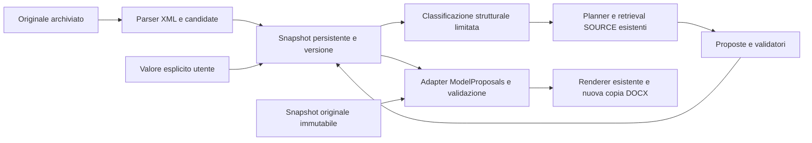

# CompilationSession V1: backend, chat e verifica

## Motivi dei vuoti nella prima analisi — V12,13 ottobre

[Contratto, prove reali e limiti](compilazione-esiti-vuoti-2026-10-13.md).
Nuove analisi in V12: stessa singola chiamata, proposte SOURCE distinte da
coverage, gruppi con candidate_ids/outcome/reason/form/conditions. Il backend
riporta ogni posizione come PROPOSED, CLARIFICATION, REJECTED_PROPOSAL,
EXPLAINED_UNFILLED, REJECTED_EXPLANATION, UNASSESSED o UNEXPLAINED.
Sono esiti di copertura dell'analisi, **non nuovi stati CompilationField**.

source_not_found è un claim del modello, non prova di inesistenza nella KB.
Motivazioni FORM non autorizzano valori, esenzioni o domande USER. La non
applicabilità dichiarata richiede una condizione locale effettivamente falsa;
semantic rimane unknown. Errori/sovrapposizioni restano registrati e non eliminano
le proposte SOURCE indipendenti. Il gruppo può condividere solo contesti
strutturali/condizioni/gruppi già validati; gate dei valori invariati.

La sintesi iniziale spiega categorie di vuoti; avvisi backend distinguono
omissioni e ragioni respinte, senza affermare che un campo non sia stato letto.
Niente checklist/ID nella UI. Tutte le spiegazioni sono nel global-report e
nel global_audit della generazione. coverage_summary è la fotografia della
prima analisi; aggiornamenti USER e selezioni correnti rimangono nel dialogo
e nel report, senza riscrivere l'audit iniziale. V11 continua a rivalidarsi identica.
Nessuna migrazione o seconda analisi implicita: usare una nuova conversazione.

Budget:400 candidate,400 gruppi,49.152 token output come prima; contesto narratore
max24 gruppi, tutte le motivazioni nel report.2219 backend e277 mirati passati,
Ruff/diff. Frontend invariato. Due prove finali DeepSeek sul benchmark fisso:
55/55 esiti formalmente validati; Minervino ancora88/105 motivazioni respinte e
0/7 omissioni. Ancoraggio formale non certifica correttezza semantica o completezza
del modulo: non presentare i contatori come accuratezza. Source proposte17/19,
nessuna generazione reale o stato RESOLVED automatico.

## Prosecuzione conversazionale — 13 ottobre

[Diagnosi, replay reali e limiti](compilazione-dialogo-2026-10-13.md).
Primo riepilogo AI separato dagli aggiornamenti. ContinuationPlan può soltanto
proporre domande residue e sospendere proposte: niente message/inventario ripetuto.
Ricevuta backend delle azioni effettivamente accettate nell'ultimo turno, con
parti scartate distinte. Lo stesso contesto SOURCE completo resta disponibile
per il controllo delle destinazioni. Nessuna chiamata aggiuntiva o promozione
fattuale. USER mantiene quote, destinatario e domanda realmente posta.

Schema provider: confirmation obbligatoria per slot di applicabilità,
question per valore/scelta, slot ammessi assegnati dal backend. Conferme
renderizzate come domanda chiusa; un assenso a una vecchia domanda aperta
non fornisce un ruolo o valore. Rimosso il contatore tecnico dei dati collegati
dalla domanda; perimetro e guard dei rinvii condivisi conservati internamente.

UI: un solo indicatore contestuale, nessun messaggio provvisorio o vecchia
sintesi durante refresh/resolve. Il completamento globale sostituisce la ricevuta
nel proprio turno persistito. Riapertura conserva la narrazione finale.
Vecchie domande aggiornabili con ripresa esplicita senza nuova analisi;
gruppo in pausa conservato. presentation_version=2, nessuna migrazione al GET.

2178 backend,106 frontend,8 browser desktop/mobile/movimento ridotto passati.
Replay reali DeepSeek mantengono18 proposte SOURCE e riducono la ricevuta
a13 parole. Non sono nuove analisi end-to-end. Il replay della vecchia condizione
«IN QUALITÀ DI» espone ancora una domanda di ruolo troppo specifica: risposta
incompatibile respinta, nessuna mutazione. Resta da correggere la modellazione
delle condizioni del primo output, non il solo wording della narrazione.

## Copertura testuale e chiarimenti locali — 13 ottobre

[Intervento e misure](compilazione-copertura-2026-10-13.md): reading_plan di
riferimenti strutturali, ruoli letterali e proprietà SOURCE nella stessa analisi.
Nessuna nuova autorità fattuale. clarifications opzionale V11 contiene fino a16
domande su candidate testuali grounded FORM; nessun valore/fact_id. Permette
rinvio locale invece di trasformare un dato personale assente in una condizione
sui recapiti aziendali. Le condizioni reali restano necessarie; vecchi output
senza clarifications compatibili, nessun upgrade automatico delle sessioni.

Il perimetro di una conferma condivisa resta nel contesto e nel gate USER
(il contatore tecnico nella domanda è stato rimosso nell'intervento sopra).
SKIP/UNKNOWN/REFUSE su blocchi di più field sono verificati nella medesima chiamata
bounded delle scritture; il rinvio locale non aggiunge una chiamata. Backend
conserva destinatari ed effetti del rinvio; USER non diventa SOURCE. Indizi di
ruolo con zero proposte non vengono descritti come KB priva di dati già cercati.

DeepSeek reale: quattro proprietà professionali incluse in sei analisi Minervino,
ma copertura e separazione delle condizioni ancora variabili. Non promettere
compilazione completa: le conversazioni private hanno scritto quattro/zero testi
secondo conferme e rinvii realmente acquisiti. Labirinto conserva undici testi.
2146 test backend finali, fuzzing riproducibile e boundary HTTP corretti; nessuna
nuova UI/browser, RAG/parser/renderer invariati. Checkbox non migliorate in questo
intervento. Nuova conversazione per osservare l'input aggiornato.

## Minervino reale — 13 ottobre, limite di copertura osservato

[Verifica del DOCX utente](minervino-output-2026-10-13.md): nove valori SOURCE
scritti nel ramo societario e zero checkbox su tredici native. L'output reale
contiene choice_groups={} e nessuna assegnazione checkbox; i dati del direttore
tecnico sono già nell'input ma restano omessi. L'indirizzo completo nel campo
«sede legale in» duplica via/civico dei campi successivi. I test del writer non certificano
la copertura del modello sui bandi reali. Confermare una condizione di ramo
non crea una selezione nativa; SKIP su una condizione può rinviare l'intero
gruppo di proposte associate. Copertura/collegamento/perimetro dei chiarimenti
restano da discutere. Diagnosi in sola lettura, nessuna modifica del motore.

## Gruppi rifiutati e sintesi — 13 ottobre, correzione

L'export selection ignora i record REJECTED prima di accedere agli attributi
del modello ChoiceGroup: l'audit di un item fuori schema conserva diagnostica,
non necessariamente min_selected/selection. Risolto il 500 osservato su
Minervino per label troppo lunga, senza rendere valide le scelte rifiutate.
Le altre proposte restano salvabili e disponibili alla sintesi.
[Riproduzione e test](checkbox-crash-2026-10-13.md): 136 mirati, 2.061 backend,
Ruff/diff check; replay reale registrato e nuova sintesi DeepSeek senza errore.
Sessione utente invariata: il tentativo già FAILED si riprende esplicitamente;
nessuna migrazione, nuova UI o allentamento della provenance.

## Checkbox native V11 — 13 ottobre, stato corrente

Le nuove analisi globali usano V11: `choice_groups` descrive istruzione FORM,
soggetto/proprietà, opzioni ancorate ai controlli nativi e cardinalità. Una
singola chiamata di analisi comprende testo e checkbox; sintesi/router/gate
USER riusano le chiamate esistenti. Nessuna checklist nella UI. Versioni
precedenti ancora leggibili/rivalidabili, senza migrazione automatica: usare
una nuova conversazione per osservare la nuova analisi.

SOURCE sostiene una scelta solo con valore/opzione compatibili, prova positiva
completa e soggetto nello stesso chunk; General KB non verifica queste scelte.
USER sceglie soltanto tra le alternative del gruppo attivo del backend,
attraverso indici controllati anche dal verificatore indipendente. FORM non
verifica valori. Unknown/skip/ambiguità mantengono le caselle irrisolte.
Le proposte non diventano automaticamente RESOLVED.

L'export esplicito rivalida gruppi, fonti e condizioni, parte dall'originale
e riusa il renderer testuale più il writer dei controlli legacy/content control.
Controlla la selezione finale e registra separatamente le deselezioni delle
alternative esclusive, comprese quelle inizialmente spuntate. Gruppi fisici
incompleti/ambigui vengono rifiutati. Report: `checkbox_values`,
`checkbox_effects`, valori e provenance SOURCE/USER distinte.

[Report, protocollo e limiti](checkbox-2026-10-13.md): nove analisi reali sul
set dedicato, cinque checkbox corrette su Labirinto, conversazione HTTP nuova
con dieci checkbox e due testi SOURCE nel Word. Nel terzo run della serie
finale tre scelte partner restano conditional, non scritte. Quattro prove USER
su checkpoint preparato passano; non sono conversazioni nuove complete.
La nuova conversazione omette gruppi senza SOURCE e quindi non pone tutte le
domande attese: copertura ancora incompleta. Verifica visiva Word desktop dei
campi legacy non eseguita; simboli stampati non nativi esclusi.

Software: 2.051 backend, Ruff/diff check; UI/contratti frontend invariati,
frontend/browser non ripetuti. Regressione reale comandi:42/43, rifiuto export
con errore schema senza scritture. Nessuna modifica al RAG o ai dati live.
Le sezioni seguenti conservano gli esiti storici V10/legacy: le note «checkbox
non scritte» descrivono quelle versioni, non le nuove sessioni V11.

## Contesto dei ruoli nella sintesi — 12 ottobre, aggiornamento

Il JSON della sintesi conserva ora `role_contexts`: soggetto, ruolo FORM,
ruolo SOURCE e prove SOURCE della relazione già groundata per quel field/fact.
Le proposte referenziano slot condivisi per binding/soggetto/entity, senza
mescolare persone o ruoli; il modello non decide destinatari XML. Budget massimo
40 contesti (40 proposte), due quote SOURCE da 800 caratteri/contesto, flag di
troncamento. Nessuna nuova chiamata o schema/API/frontend. Task esplicito per
destinazione locale, incarichi attuali/cessati e cautele nelle prove del ruolo.
La sintesi può solo sospendere, mai validare nuovi valori; grounding SOURCE,
condizioni USER, rivalidazione all'export e originali immutati restano richiesti.
Le sospensioni storiche sono cumulative: non si sbloccano automaticamente.

[Confronto congelato](sintesi-ruoli-2026-10-12.md), DeepSeek Flash reale: **5/7
->7/7**, corretti due controesempi di incarichi cessati. Catanzaro 12 e Labirinto
17 proposte mantenute; Catanzaro senza conferme resta non esportabile. Sono
audit rivalidati, non nuove analisi complete. +455 token input/caso in media,
stesso numero di chiamate. Replay HTTP isolato BEFORE/AFTER: 12 SOURCE scritti,
incluso 8421, zero valori USER, originale/altre celle/checkbox invariati.
Il vecchio replay 8/12 aveva perso gli anchor nel runner: risultato conservato,
attribuzione corretta, non miglioramento applicativo rivendicato 8->12.

143 test mirati /21,30s, 1.985 backend /144,54s, Ruff/diff check; frontend/browser
non ripetuti, UI/contratti invariati. Nessuna migrazione/reindex o push. Restano
sparse coverage, checkbox, incarichi fuori dalle quote e comandi composti.

## Conferme riferite al gruppo — 12 ottobre, aggiornamento

La proiezione ai modelli conserva la domanda naturale di ciascuno slot già
persistita (600 caratteri, default vuoto per lo storico); i destinatari
rimangono backend. Il verificatore indipendente può risolvere un riferimento
univoco alla scelta appena chiesta e una conferma esplicita di più condizioni.
Eccezioni, polarità e incertezza si valutano per slot; un sì senza ambito a più
condizioni non viene distribuito a tutte. Confermare il gruppo non inventa
email/date mai comunicate. Solo SUPPORTED consente le mutazioni già validate,
con provenance USER; nessun valore viene trasformato in SOURCE o RESOLVED.
Nessuna nuova chiamata, schema/API, migrazione o modifica UI/RAG/DOCX.

[Prove congelate e acquisizioni](conferme-gruppo-2026-10-12.md): DeepSeek
14/16 ->15/16 ->16/16, regressioni 9/9 guard e 43/43 dialogo. Nel replay
dell'analisi reale Catanzaro entrambe le conferme passano in un turno; export
esplicito genera otto valori SOURCE. Il confronto previsto di 12 export non
passa: la nuova sintesi sospende quattro proposte del direttore tecnico, ancora
presenti nello stato. È un limite distinto della sintesi, non del gate USER;
nessuna nuova analisi SOURCE o misura di completezza del documento.
270 test software mirati, 1.972 backend finali, Ruff/diff check. Frontend/browser
non ripetuti. Il riepilogo seguente conserva i risultati storici precedenti al fix.

## Conversazioni complete — 12 ottobre, dopo i test dei comandi

Il [nuovo test reale](test-conversazione-completa-2026-10-12.md) attraversa
conversazioni nuove, non checkpoint autoriali: una analisi per sessione, domande
raggruppate, pause/riprese in processi nuovi, esplicita richiesta di bozza.
Catanzaro: 12 valori SOURCE nel Word, incluso 8421; Labirinto con scope corretti:
17, recapito/polizza differiti con SKIP/UNKNOWN e lasciati vuoti. USER conferma
condizioni, senza fornire i valori aziendali già recuperati. Nessuna promozione
automatica a RESOLVED, nessun nuovo workflow o cambiamento applicativo.

Limite conversazionale osservato: «confermo entrambe ... il partecipante è
quello indicato nelle fonti» produce un falso negativo del gate sul partecipante;
serve un secondo consenso, poi la stessa sessione prosegue. La composizione
«valore + pausa/export» resta da discutere. Le prove verificano bozza/materializzazione,
non copertura completa dei candidate. La serie Labirinto con setup iniziale
errato è archiviata separatamente; non viene usata come confronto congelato.
In quella serie Ordine includeva il numero albo, ancora un limite da misurare.

## Comandi conversazionali — 12 ottobre

Il routing unico distingue azione, oggetto e polarità: rinvio di una voce
SKIP, dato non conosciuto UNKNOWN, sospensione dell'intero lavoro PAUSE.
Comandi negati o citati in una spiegazione non autorizzano la loro esecuzione.
Le risposte libere continuano a riguardare solo gli slot attivi del backend.

| Indicazione | Effetto |
|---|---|
| «Questa conferma la vediamo dopo» | Rinvio locale, sessione attiva; nessuna applicabilità inventata. |
| «Non conosco il recapito» | UNKNOWN sulla voce, nessun valore inserito. |
| «Interrompiamo tutto per oggi» | Pausa persistita, domanda conservata per la ripresa. |
| «Ripartiamo da dove eravamo» | Ripresa della stessa sessione. |
| «Prepara una bozza con quanto disponibile» | Richiesta esplicita di export, soggetta ai gate correnti. |

La regola attuale resta conservativa: PAUSE/FINISH prevalgono sui nuovi dati
presenti nello stesso messaggio; non c'è ancora un turno composto che prima
salva il valore e poi sospende/esporta. Questa evoluzione resta da discutere.
Nel motore globale generate fuori dalla domanda di generazione viene
normalizzato in finish, usando soltanto il checkpoint backend: stessa operazione,
nessun nuovo consenso o permesso. Legacy invariato, perché lì i due comandi
hanno effetti diversi. Nessuna nuova chiamata AI o modifica agli schemi pubblici.

Prove DeepSeek reali sul codice 802c483: **28/28** Comandi V1 (BEFORE 24/28),
**43/43** Dialogo V1 (baseline precedente 40/43), fixture/gold invariati.
Un primo output invalido in export-no è respinto, poi corretto dall'unico retry;
nessuna scrittura/export nel frattempo. Il controllo semantico delle risposte
USER resta attivo; nessun falso valore acquisito nei casi di pausa/esportazione.
Sono checkpoint preparati, non una misura della completezza del DOCX reale.
[Report, costi e acquisizioni](comandi-conversazionali-2026-10-12.md).

## Pertinenza delle risposte USER

Dal 12 ottobre le proposte di aggiornamento conversazionale attraversano anche
`compilation_reply_guard.py`: controllo semantico indipendente di pertinenza
USER -> domanda/slot, prima della scrittura. Una sola verifica per gruppo,
massimo quattro proposte, 768 token di output, timeout 15 s, nessun retry.
Solo SUPPORTED ammette VALUE/CONDITION_TRUE/CONDITION_FALSE; schema invalido,
ambiguità o errore provider non autorizzano aggiornamenti. Le altre parti valide
del gruppo restano utilizzabili. Il verificatore non restituisce valori o ID:
il backend conserva i destinatari; quote USER, validazione DOCX e CAS restano
necessari. Nessuna chiamata aggiuntiva per RAG, export o soli controlli di
sessione. Il costo aggiuntivo riguarda i turni USER che modificano dati.
Verifica reale su 132bc6a: il router ripete l'assegnazione errata denominazione
-> recapito, il gate la rifiuta e lo stato resta identico. **40/43** sul gold
Dialogo V1 invariato (prima 39/43) e **9/9** proposte del verificatore indipendente.
Una sola serie per dataset, non una garanzia di accuratezza generale. Le 12
verifiche aggiungono 11.594 token /13,81 s AI ai 43 turni; costo esplicito di
protezione della scrittura, nessun cambiamento alle chiamate dell'analisi globale.
Provider failure/timeout bloccano conservativamente l'aggiornamento.
[Report e acquisizioni](fix-pertinenza-user-2026-10-12.md).

Benchmark del dialogo del 12 ottobre: [43 casi reali, 39 conformi al gold](benchmark-dialogo-2026-10-12.md).
Il consenso naturale funziona nei casi fissati, ma una correzione fuori dagli
slot veniva applicata al campo attivo sbagliato. Estratto USER e
slot valido non garantiscono la pertinenza semantica. Nella baseline erano noti
anche messaggi misti con export ignorato e rinvio locale interpretato come pausa:
sono affrontati dal successivo intervento sui comandi descritto sopra, mentre
il gate corregge soltanto la pertinenza. Il benchmark usa checkpoint
isolati preparati, senza una nuova analisi SOURCE o una compilazione completa.

## Motore attivo dal 12 ottobre: proposta globale e revisione

Avviare `./start.sh`, scegliere il modello del progetto (DeepSeek per le prove
reali già effettuate), aprire una **nuova conversazione**, selezionare il DOCX
con `@` e scrivere **«me lo compili?»**. Il routing è quello esistente;
«riassumilo» continua a usare FORM RAG senza creare una compilazione.

La chat crea/riprende una sessione `engine=global`. Un'unica chiamata riceve il
catalogo completo e il piccolo corpus SOURCE autorizzato. Il risultato
persistito rimane una **proposta da rivedere**, non uno stato RESOLVED:

1. Attendere l'analisi globale. Una breve chiamata separata sintetizza l'audit
   validato: dati trovati, dubbi e fino a **tre chiarimenti** con nomi comprensibili.
   Niente checkbox di revisione, ID XML, elenco di posizioni vuote o editor.
2. Rispondere nel composer, anche a più domande insieme. Il planner `TurnPlan`
   esistente interpreta gli slot; il backend conserva destinatari e revisione.
   Applicabilità e valori USER restano distinti dai dati SOURCE. Una parte
   ambigua non annulla le risposte valide agli altri slot.
3. «Non lo so»/«salta» rinviano solo i chiarimenti coinvolti, senza inventare dati
   né riproporli immediatamente. «Basta»/«riprendi» conservano la stessa sessione.
4. Per esportare, rispondere alla proposta di bozza o scrivere **«genera la bozza
   parziale»**. La chat usa le proposte SOURCE ammesse, esclude quelle dubbie
   trattenute dalla sintesi e quelle con condizioni non confermate. I valori
   USER sono ammessi solo se acquisiti nella risposta a uno slot attivo e
   validati. Nessuna generazione implicita. Download DOCX nella chat;
   report tecnico disponibile tramite API, senza pulsante automatico nelle
   risposte. La gestione UI dei comandi verrà definita separatamente.

Se tutte le proposte sono escluse (per esempio perché le condizioni sono state
rinviate), la chat propone esplicitamente una **copia senza valori inseriti**.
Il consenso alla generazione autorizza soltanto quella copia, non conferma
l'applicabilità né rende disponibili i dati saltati. Report e messaggio
dichiarano zero valori scritti. Non viene generata automaticamente.
Le risposte di chiarimento/blocco del backend vengono mostrate nella chat,
senza sostituirle con il vecchio riepilogo o ripetere la proposta di export.

La sintesi può soltanto trattenere/escludere proposte, mai renderne valida una
respinta. Riceve contesto FORM, valori e prove SOURCE (massimo 40 proposte,
24 chiarimenti candidati); il messaggio non certifica completezza o correttezza
semantica perfetta. Le posizioni omesse dal modello rimangono **non analizzate**,
non diventano automaticamente dati mancanti da chiedere all'utente.

Il renderer e il validatore DOCX vengono riusati: ogni export parte
dall'originale e rivalida le SOURCE correnti. CAS e ricontrollo nella transazione
impediscono di esportare con revisioni/fonti obsolete. I valori mantengono
provenienza SOURCE e consenso USER all'esportazione (`reviewed_by=USER` non
significa verifica manuale di ogni campo). Valori forniti in chat hanno
provenienza USER, nessuna evidence SOURCE fittizia; conferme/rinvii e relativi
estratti USER restano nel report della bozza. Rifiuti e alternative non scelte
non sono esportati automaticamente;
checkbox native visibili nel report ma non scritte. Nessuna generazione
incompleta implicita o promessa di completezza/ammissibilità.

Stato salvato nello `state_json` esistente: CREATED -> ANALYZING ->
WAITING_FOR_USER (phase REVIEW) -> GENERATED soltanto dopo review/export.
`fields=[]` distingue la proposta globale dai campi risolti V1. La API espone
`global_compilation.fields/conditions/proposal_count/omitted` e `engine`.
`global_compilation.dialogue` persiste sintesi, gruppo attivo, risposte USER,
rinvii, proposte trattenute e valori espliciti. Refresh ripristina dialogo e
risultato/download; pausa/errore non consumano altre chiamate.
Ripresa esplicita dopo errore autorizza un solo nuovo tentativo: se l'audit
esiste già, si ritenta soltanto la sintesi, senza ripetere l'analisi globale.
Una vecchia sessione globale in REVIEW senza dialogo riceve solo la sintesi;
nessuna migrazione o perdita delle proposte precedenti.

API: POST /compilation-sessions con `engine=global`; resolve esistente fa una
sola analisi globale; POST /{id}/global-draft riceve `version`, `candidate_ids`,
`confirmed_condition_ids`, `allow_unresolved=true`, opzionalmente
`user_candidate_ids` e `user_quote`; la chat costruisce questi dati dal proprio
stato persistito, senza selezione manuale. GET /{id}/global-report
scarica l'audit. Download di DOCX/report generato tramite document-compilations
esistenti. `/finalize` V1 non può esportare sessioni globali.

Per una selezione vuota, `/global-draft` richiede anche `allow_empty=true`
(default false), `allow_unresolved=true` e `user_quote` non vuota. La chat
abilita questo caso soltanto durante una domanda di generazione valida, dopo
un consenso interpretato dal planner; mai durante l'analisi o la pausa.
[Regressione reale del consenso](test-consenso-bozza-2026-10-12.md): «si» e
«siii» producono la copia senza valori se le condizioni sono state rinviate;
confermandole prima, 13 valori SOURCE materializzati correttamente. Nessuna
nuova analisi globale nella prova, nessuna conferma implicita delle condizioni.

Budget: 400 candidate / 96 chunk / 100.000 caratteri SOURCE / 350.000 input;
nessun taglio silenzioso. Una chiamata di analisi con timeout 300 s e lease 360 s;
il planner della chat è una chiamata separata. Sintesi: massimo una chiamata
per passaggio, timeout 45 s, 2.048 token di output, nessun retry automatico;
max tre domande per messaggio. Ogni risposta valida può avviare una nuova
sintesi, **mai una nuova analisi globale**. Errore di sintesi -> risposta
prudente, esportazione conversazionale bloccata fino a una ripresa esplicita.
Corpus SOURCE autorizzato completo
entro il limite, non ranking del vecchio resolver. Provider scelto dal progetto;
DeepSeek thinking low nell'analisi, altri provider usano il trasporto esistente
ma non sono ancora validati semanticamente su questo adapter.

Prompt/input/originale/raw output/audit/tempi salvati nel relativo storage
`<project>/_global_compilations/<session>/<attempt>/`, senza chiave API.
Questi artefatti locali richiedono backup separato. Nessuna migrazione DB.

[Verifica della nuova chat conversazionale](test-chat-conversazionale-globale-2026-10-12.md):
1.882 backend, 101 frontend e 12 browser passati; DeepSeek reale su Catanzaro
(13 valori SOURCE scritti) e Labirinto V1 (17). Sintesi finale con contesto dei
ruoli verificata in due replay separati, ~2 s ciascuno. È una bozza parziale,
non prova di completezza. Errore di schema e imprecisione di ruolo iniziali
conservati nel report. Analisi globale ancora ~88–108 s nelle due nuove prove.

**Compatibilità:** sessioni precedenti rimangono `engine=legacy`, senza cambio
di stato o avanzamento automatico della UI. Le API dirette senza engine
conservano la semantica V1. Le sezioni successive descrivono il percorso
storico V1 e gli esperimenti precedenti: non sono il nuovo default della chat.


Una sessione riguarda un solo modulo DOCX archiviato nel progetto. L'iterazione
modifica dati persistiti; il file Word viene generato soltanto su richiesta.
La chat esistente offre selezione `@`, avvio/ripresa, riepilogo, chiarimenti
raggruppati e generazione/download inline. Il backend rimane la fonte dello stato.

**Alternative SOURCE sperimentali dell'11 ottobre:** contratto globale 6 con
review e 2–4 fatti/prove distinti, sempre una chiamata. Sei prove reali mantengono
due recapiti e due polizze separati senza scelta arbitraria; restano inferenze
sul firmatario e applicabilità unknown, quindi nessuna attivazione nella V1.
[Report e acquisizioni](benchmark-alternative-source-2026-10-11.md).

**Contesto JSON sperimentale dell'11 ottobre:** catalogo V3 con posizione
blocco/tabella/riga e intestazioni esplicite, senza prima riga assunta come
header. Sei prove reali sul Labirinto, miglioramento strutturale verificato e
benefici semantici parziali; nessuna sostituzione della V1 descritta qui.
Dettagli nel [catalogo](catalogo-compilazione.md) e nel [registro](../relazioni.md).

**Esperimento sparse dell'11 ottobre:** contratto 5 con inventario dei candidate
nel backend, proposte validate singolarmente e scope strutturali tipizzati.
Nessuna attivazione nella chat o promozione automatica a RESOLVED. La V1 e
il renderer restano invariati. [Contratto e limiti](proposta-globale-compilazione.md).
Le due prove finali conservano 9/8 proposte grounded invece del rifiuto globale,
in 20,26/31,00 s, ma restano assegnazioni semanticamente improprie. Per questo
il percorso operativo descritto qui non cambia.
[Report reale e acquisizioni](benchmark-proposte-sparse-2026-10-11.md).

**Esperimento compatto successivo del 10 ottobre:** output ridotto e fatti
professionali separati, ma tutte le sei risposte sono state rifiutate per
troncamento/budget/inventario/ID. Ultime due ~47 s, nessun valore accettato.
[Report e acquisizioni](benchmark-proposta-compatta-2026-10-10.md). Contratto
sperimentale storico 4, mappa inversa delle condizioni derivata dal backend;
non attivo nella chat. Questa V1 resta il percorso di produzione invariato.

**Secondo contratto sperimentale del 10 ottobre:** fatti SOURCE condivisi e
condizioni FORM esplicite, con riferimenti dai candidate e confronti conservativi
nel backend. [Contratto e limiti](proposta-globale-compilazione.md). Continua a
essere isolato: nessuna proposta viene promossa a RESOLVED o scritta nel DOCX.
La V1 descritta qui resta il percorso attivo.

Le [nuove prove reali](benchmark-condizioni-globali-2026-10-10.md) non dimostrano
ancora un miglioramento: condizioni omesse senza thinking e JSON troncato con
thinking low. Nessuna attivazione sperimentale nella chat.

**Prima milestone del 10 ottobre verso la proposta unica:** disponibile il
[catalogo FORM condiviso](catalogo-compilazione.md), con contesto completo e
riconoscimento strutturale delle checkbox native. È ispezione backend in sola
lettura: il resolver V1, i suoi campi persistiti, le chiamate AI e il renderer
restano attivi come prima. Nessuna migrazione o reindicizzazione richiesta.

**Proposta globale sperimentale del 10 ottobre:** realizzati un
[contratto isolato](proposta-globale-compilazione.md) e
[tre prove reali DeepSeek](benchmark-proposta-globale-2026-10-10.md), con tutte
le 307 posizioni in una chiamata. Non è collegata a sessione/chat/export: le
proposte restano non scrivibili finché proprietà, soggetto e condizioni non
sono verificati. Rilevati errori di applicabilità e una risposta JSON invalida;
nessuna modifica della V1 o dei dati locali, nessun nuovo DOCX generato.

**Stato dell'8 ottobre:** retry di interpretazione e SOURCE separati e persistenti;
implementata la semantica ancorata al FORM con contesto di sezione e distinzione
fra procedura corrente e servizi pregressi. 1.192 test backend passati. Dopo la
ricarica DeepSeek, la prova reale finale verifica otto dati societari SOURCE,
tipologia SOURCE, Fax MISSING e nessun firmatario inferito o falso dato pregresso.
Restano 30 PENDING e chiarimenti: il modulo non è READY. Vedi [STATUS.md](../STATUS.md) e
il [report reale](test-reale-manifestazione-interesse-2026-10-08.md).

## Uso conversazionale nella chat

1. Caricare il DOCX nei **Moduli da compilare**. Digitare `@` nel composer e
   scegliere il modulo: la chip conserva `document_id` e ruolo. «Riassumilo» e «cosa richiede?»
   usano FORM RAG, senza creare sessioni. I TXT sono contesto, non template DOCX.
   Lo stesso menu, accessibile anche da **+**, include **Bandi e fonti** del
   progetto. Selezionare `@avviso.pdf` per consultarlo limita le evidenze a quel
   documento e conserva la compilazione eventualmente in attesa. Il ruolo
   registrato e il parser determinano le operazioni ammesse, non il nome del file.
2. Scrivere **«me lo compili?»**. Il planner esistente riconosce l'incarico e
   l'API crea/riprende la sessione della conversazione/form, senza passare al
   generatore RAG. Risposta: «Certo. Analizzo il modulo e verifico le informazioni
   disponibili». Il comando in chat è l'unico avvio: il pulsante **Avvia
   compilazione** è stato rimosso il 9 ottobre 2026.
3. L'indicatore nel thread mostra attività e quantità reali, senza percentuali.
   La UI avanza in serie, un `resolve` per snapshot backend. Non serve premere
   un pulsante per ciascun gruppo da 12. Il budget è persistito, non React.
4. Il primo problema aperto **non interrompe l'analisi**: il backend raccoglie
   chiarimenti pendenti e continua sui candidate analizzabili entro il budget.
   Al checkpoint WAITING_FOR_USER propone **fino a quattro chiarimenti coerenti**.
   Una condizione condivisa ha priorità perché può sbloccare più field.
   Alternative SOURCE sono mostrate come scelte; una condizione dubbia richiede
   conferma di applicabilità. I pending e i dati mai ricercati non diventano
   domande o campi obbligatori.
5. Rispondere nel composer, ad esempio «12 giugno 2014». Con una domanda attiva
   singola il planner usa `answer_fields` e lo slot attivo con l'eventuale
   valore, **senza ID di campo**. Il backend conosce già il destinatario dalla
   domanda persistita e conserva il messaggio USER; verifica revisione e
   appartenenza letterale del valore al messaggio. Le date
   complete italiane possono diventare `12/06/2014` deterministicamente.
   Il valore è USER_PROVIDED, mai RESOLVED da SOURCE. Gli altri campi restano
   invariati. Risposte ambigue, più date o proposte non grounded chiedono un
   chiarimento, senza cambiare valori. Una nuova domanda documentale resta RAG.
6. «No» a una domanda di applicabilità esclude **i candidate legati alla stessa
   condizione e allo stesso contesto strutturale**, con
   provenance USER e motivo. «Sì» conferma la condizione, non fornisce un valore
   fattuale: il campo torna PENDING prioritario e viene ricercato nelle SOURCE;
   soltanto se la ricerca non verifica il valore, la chat lo chiede. «Non lo so»
   non esclude nulla: registra UNKNOWN e passa oltre, lasciando la voce aperta.
7. A un gruppo si può rispondere in un unico messaggio, anche numerato. Il
   planner restituisce decisioni per slot 1–4, mai ID di campo. Risposte parziali
   aggiornano soltanto gli elementi identificati; un elemento ambiguo rimane
   aperto senza annullare gli altri aggiornamenti validi. UNKNOWN/SKIP possono
   riguardare un singolo elemento. Dopo l'input valido la sessione continua
   automaticamente se ha lavoro disponibile, altrimenti conserva solo le domande
   non risposte del gruppo prima di proporne un altro. Con READY chiede **«Vuoi che generi
   il DOCX?»**: confermare in chat. Non viene prodotta
   una bozza incompleta implicitamente. Download DOCX nella risposta di Mapi;
   il report resta disponibile tramite API.
8. «salta»/«passa oltre» registra SKIP senza cambiare valore, status fattuale o
   provenance; «non lo so» registra UNKNOWN. La chat passa al prossimo problema
   oppure continua sui pending. I rinvii non vengono richiesti immediatamente.
   Se restano solo questi, mostra un riepilogo senza loop e non genera il DOCX.
9. «basta»/«fermati» mette in pausa la stessa sessione, anche durante l'analisi:
   nessuna domanda attiva né avanzamento automatico. «riprendi» conserva i campi
   e rinnova un ciclo; sul riepilogo dei rinvii riapre una sola voce.
10. Ricaricare/riaprire: stato, domanda e budget sono riletti dal backend. Chiudere
   la pagina interrompe l'orchestrazione frontend, non elimina la sessione.
   Un claim attivo viene seguito con polling GET; scaduto, si propone una ripresa
   esplicita ad alto livello, senza chiedere all'utente di gestire i batch.

Dal 10 ottobre il pannello **Dettagli compilazione** è rimosso dalla UI.
RAG e compilazione usano lo stesso messaggio, stile e animazione di attesa.
La domanda corrente sostituisce l'annuncio iniziale al termine dell'analisi;
un chiarimento conversazionale compare come normale risposta. Pausa, ripresa
e generazione si richiedono nella chat; il documento disponibile è scaricabile
dalla risposta. Conteggi, revisioni, evidenze e operazioni manuali restano
nei contratti API, senza controlli tecnici nella conversazione.

La domanda prodotta dall'analisi automatica viene salvata nel turno di Mapi
che ha avviato il passaggio. Rimane nello storico dopo risposte, pause e ricariche
ed entra nella cronologia del modello. La UI conserva subito il testo visualizzato
prima di inviare il messaggio successivo. Le richieste di spiegare o riformulare
la domanda usano il routing conversazionale `CHAT/reply`, con domanda ed estratto
FORM come contesto: non registrano risposte ai campi e non riavviano l'analisi.
Domande che richiedono nuove informazioni documentali restano sul percorso RAG.

### Routing, API e persistenza

- `/answer` accetta `document_id` (modulo o fonte del progetto) e conserva
  `form_id` per i vecchi client. Non si possono indicare due documenti diversi.
  Per una domanda della sessione visualizzata accetta
  `compilation_session_id` + `compilation_version`. Il backend verifica progetto,
  conversazione, documento e revisione prima di aggiornare. Un cambio concorrente
  risponde 409: rilettura, nessuna ripetizione della mutazione. Unica eccezione:
  una **pausa** può usare una revisione precedente, perché un claim può averla
  appena incrementata. La transazione conserva lo stato corrente e invalida il
  claim; risultati/fallimenti tardivi non possono sovrascrivere la pausa. Il
  provider già in volo può terminare, ma il risultato non viene applicato.
- Dal 10 ottobre il modello usa un unico contratto `TurnPlan`, con lo stesso
  prompt e schema JSON per chat normale, domanda singola, gruppo e sessione
  sospesa. `intent` distingue `reply`, `explain`, `retrieve`, `compile`,
  `answer_fields`, `pause`, `resume`, `finish`, `generate`. Non ci sono wrapper
  `CHAT` né un classificatore aggiuntivo: una chiamata di pianificazione nel
  normale percorso, al massimo un retry per risposta strutturalmente invalida.
- Il contesto comune conserva stato, pausa, domanda effettiva e slot attivi con
  etichetta, condizione, alternative ed estratto FORM di massimo 1.500 caratteri.
  Il modello non riceve ID di campo/sessione/versione. Se resta un solo elemento
  di un gruppo, conserva il suo numero originale: non viene rinumerato.
- `explain` restituisce una spiegazione in `answer` e non può contenere risposte
  ai campi. Anche «non so, prima spiegami» mantiene aperta la domanda, senza
  consumare budget o registrare UNKNOWN. Le nuove domande documentali usano
  `retrieve`, conservando la distinzione FORM/SOURCE/mixed.
- Solo `answer_fields` ammette fino a quattro
  `replies[{slot,action,value,normalized_value,user_quote,rationale}]`.
  Le azioni per slot sono VALUE, CONDITION_TRUE/FALSE, UNKNOWN, SKIP, REFUSE e
  CLARIFY. Una risposta non associabile usa `replies=[]`, chiedendo chiarimento
  senza scegliere un campo. Senza slot attivi, la risposta viene rifiutata.
  Il backend lega gli slot ai destinatari del proprio snapshot e verifica
  revisione e grounding USER. Gli slot invalidi/duplicati non vengono rimappati;
  gli altri aggiornamenti indipendenti e validi restano applicabili.
- CONDITION_FALSE riguarda soltanto l'applicabilità e non scrive un valore;
  CONDITION_TRUE richiede poi ricerca SOURCE. I valori devono appartenere
  all'ultimo messaggio, non al modulo o alla cronologia. Per la domanda singola
  il messaggio intero resta la provenienza; nei gruppi l'estratto deve contenere
  la clausola pertinente completa. Restano i validatori del dominio V1.
- `pause`, `resume`, `finish`, `generate` richiedono una sessione abilitata e non
  accettano `replies` o valori. In una sessione sospesa non sono esposti slot
  rispondibili; spiegazione e retrieval rimangono disponibili. Pausa e fine hanno
  priorità sulla risposta al campo nei messaggi misti; riprendere deve essere
  esplicito. Il backend verifica comunque le condizioni per esportare.
- Le decisioni vengono tradotte nelle operazioni interne esistenti prima del
  RAG. I guard circoscritti ai comandi interi inequivoci restano invariati come
  protezione; non sono aggiunte keyword per spiegazioni o regole specifiche dei
  moduli. Il routing semantico è valutato anche senza questi guard.
- `field_replies` contiene internamente `field_id`, `action=set|not_applicable|applicable`,
  `value`, `user_quote`: per la domanda singola questi input sono costruiti dal
  backend, non restituiti dal modello. Il backend accetta soltanto il campo
  chiesto. I valori devono appartenere all'ultimo messaggio USER, non al FORM,
  allo storico o alle alternative SOURCE. Restano i validatori DOCX della V1.
- Risposte e turni conservano `compilation={session_id,action}` opzionale in
  `conversation_turns.compilation_json`, nuova colonna additiva. Restano
  `form_reference`, `selected_form_id` e `form_reference_json` già implementati.
  `document_reference={document_id,name,role}` è salvato nei turni e nelle
  risposte; `selected_document_id` e `document_reference_json` sono colonne
  additive aggiornate automaticamente all'avvio. I vecchi FORM sono convertiti
  in lettura, senza riscrivere lo storico. La selezione di lettura è distinta
  dalla sessione attiva e non ne modifica campi, revisioni, domanda o budget.
- `chat_workflow` nello snapshot JSON conserva inizio ciclo, passi consumati,
  pausa, tentativi automatici per field e chiarimenti pendenti/attivi con slot,
  destinatari e fingerprint. `user_paused` è distinto da pausa per budget/errore;
  lo status di dominio può restare WAITING_FOR_USER mentre la conversazione è
  sospesa. `conversation_disposition` nel field conserva unknown/skip/refuse/
  uninterpretable, estratto USER, data e fingerprint. Il confronto esclude
  timestamp/versioni: un refresh o un semplice chiarimento non riapre il campo.
  Un cambiamento significativo o una revisione esplicita può riaprirlo.
  Le revisioni conservano anche il workflow. Nessuna nuova tabella/motore RAG.
  La proiezione backend `chat` espone domanda, avanzamento autorizzato e quantità effettive;
  `chat.metrics` conserva/espone automatic_resolved, user_required_fields e
  user_turns (messaggi di risposta ai chiarimenti, esclusi avvio/pausa/ripresa).
  I field differiti restano conteggiati come irrisolti e la risposta UNKNOWN/SKIP
  conta un turno; i dati non ancora ricercati non sono dichiarati USER-required.
  il frontend non riclassifica i field.
- `POST /compilation-sessions` con `start_in_chat=true` mantiene creazione atomica
  e riuso della coppia. Un avvio/ripresa esplicito rinnova un ciclo esaurito,
  una sessione legacy, un FAILED o un claim scaduto, senza azzerare i valori.
  Gli input USER validi iniziano un nuovo ciclo; GET/refresh non lo rinnovano.
- `POST /{id}/resolve` con `automatic=true` richiede budget e lavoro disponibili.
  Gli irrisolti non interrompono gli altri candidate analizzabili. Non consente
  `field_ids`; l'opzione manuale
  precedente rimane.
- La UI mostra una sessione, del modulo selezionato o la più recente nella
  conversazione. Una selezione non ancora inviata rimane una bozza locale.
  Cambio progetto/conversazione/modulo annulla le richieste UI; risultati già
  salvati dal backend rimangono recuperabili.

Riavviare il backend per la colonna additiva. Nessuna reindicizzazione o modifica
agli originali. Sessioni legacy si attivano esplicitamente; sessioni standalone
non vengono associate arbitrariamente a una conversazione.

### Budget del ciclo conversazionale

Massimo **36 passi**, ciascuno da **12 candidate** e fino a **6 chiamate LLM**
con tutte le revisioni semantiche dell'8 ottobre. Al massimo **216 chiamate di risoluzione**
per ciclo, più planner dei messaggi utente ed embedding. Non si ammettono nuovi
passi dopo **600 secondi** dall'inizio; un passo già avviato può terminare entro
il proprio timeout di 180 secondi. Stop su checkpoint senza altro lavoro
automatico disponibile, pausa USER, READY, GENERATED, FAILED o errore HTTP.

Ogni candidate ha al massimo **due tentativi per fase** di interpretazione e
risoluzione SOURCE, persistiti anche attraverso pausa/refresh e rinnovo del
ciclo. La seconda analisi prioritaria dei
candidate con errori di validazione usa un batch più piccolo, massimo **sei**,
senza chiamate per singolo campo. Un'interpretazione PENDING o un estratto
respinto possono così essere riesaminati una volta prima di chiedere un dato;
esauriti i tentativi, un PENDING non viene trasformato in una domanda USER.
Una dipendenza esplicitamente confermata riabilita la ricerca dei soli field
coinvolti. Non ci sono retry illimitati o nuovo motore SOURCE.

Un envelope valido con item identificabili permette di conservare quelli validi
e isolare gli errori locali. JSON malformato, envelope invalido o ID sconosciuti
restano failure globali senza applicazione delle proposte del batch. Nel workflow
automatico raggruppato la API recupera gli errori di output usando i due tentativi
persistiti della fase attiva: una seconda analisi più piccola, poi gli altri
candidate. `output_rejections` e l'ultima lista di
candidate rifiutati restano nello snapshot e nelle revisioni. La risposta HTTP
espone lo stato corrente; la UI prosegue solo se `chat.auto_continue=true`.
Provider/timeout/parser/storage e gli altri errori tecnici restano FAILED.
Una pausa o correzione concorrente prevale sul recupero. Esauriti i tentativi,
gli elementi non interpretati restano PENDING; se non c'è né altro lavoro né un
chiarimento legittimo, la sessione si ferma con un errore esplicito. Non si
trasforma un difetto di classificazione in una richiesta di valori all'utente.

Priorità/raggruppamento in `compilation_clarifications.py`: condizioni grounded
uguali, soggetto/ruolo e contesto strutturale uguali vengono condivisi; l'impatto
è il numero dei field influenzati. Prima i gruppi a impatto maggiore, poi le
condizioni, poi i valori locali. Si scelgono fino a quattro slot dello stesso
tipo e soggetto/contesto. La propagazione riusa soltanto una prova SOURCE/USER
già validata, mai una supposizione sul tipo di azienda. Condizioni o contesti
diversi e prove discordanti non vengono unificati. La V1 resta conservativa
quando la medesima condizione è parafrasata o appare in sezioni diverse.

Al checkpoint di budget si possono chiarire i problemi già analizzati; quelli
non ricercati rimangono PENDING/non searched. Riprendere rinnova il budget di
tempo/passi ma conserva i tentativi e le risposte. Il backend conserva il gruppo
in pausa, mentre `chat.question=null` lo nasconde: riaprire/riprendere conserva
gli slot non risposti, senza ricreare la sessione.

Al limite, il thread spiega che l'analisi si è fermata e offre **Prosegui
compilazione**, o accetta un incarico equivalente in chat. Questa nuova azione
utente rinnova il budget; non parte un nuovo ciclo automatico. Non ci sono loop
illimitati, worker in background o chiamate per ogni singolo campo.

## Pipeline riutilizzata

`inspect_docx()` valida il contenitore e individua le celle XML scrivibili,
con ID `t{tabella}.r{riga}.c{cella}`, e i segnaposti di paragrafo, con ID
`p{paragrafo}.s{segnaposto}`. Gli indici sono zero-based e dipendono
dall'originale. Celle unite, controlli Word, firme e contenuti complessi
mantengono i controlli del parser esistente. Le firme non vengono scritte.

Il percorso precedente, con il suo motore a chiamata unica, è stato rimosso il
9 ottobre 2026; restano elenco, dettaglio e download dei risultati salvati.
Lo schema `ModelProposals` contiene `cell_id`, `label`, `entity`, `kind`, `status`,
`value`, `evidence[{source_id,quote}]`, `reason`. `validate_proposals()`
verifica ID, estratti, valori, integrità numerica, email e protezioni;
`fill_docx()` riapre l'originale e applica i valori validi. Gli script esistenti
e questo percorso non sono stati convertiti in sessioni implicitamente.

La nuova pipeline è:



Il RAG non determina dove scrivere. Il collegamento candidate/posizione rimane
quello del parser. Il contesto FORM è strutturale: conserva file, progetto,
nome, ruolo, posizione e hash; `chunk_id=null` è intenzionale perché non è un
frammento recuperato dall'indice.

## Persistenza e stati

Due tabelle additive, create dal normale avvio del backend:

- `compilation_sessions`: progetto, modulo, conversazione opzionale, originale
  come BLOB, snapshot JSON dei candidate, versione intera e timestamp.
- `compilation_session_revisions`: versione, azione, prima/dopo dei soli campi
  cambiati, stato e riferimento all'eventuale documento generato.

`document_fields` appartiene alla revisione dimostrativa, senza identità DOCX.
`document_compilations` rappresenta risultati immutabili: viene riusata per
ogni generazione, insieme a storage e download già esistenti. La registrazione
dell'output e della revisione di sessione usa una sola transazione; gli errori
di salvataggio ripuliscono i file appena creati.

La creazione legge l'originale archiviato e salva tutti i candidate, massimo
400 secondo il parser. Non richiede AI né fonti e non genera una bozza.
Lo snapshot permette la ripresa dopo riavvio e resta utilizzabile anche se
il modulo viene rimosso dall'archivio: `form_id` diventa null, restano hash,
`original_file_id`, riferimento storico e copia dei byte. La cancellazione
del progetto elimina sessioni e revisioni tramite le relazioni esistenti.
Non vengono migrate vecchie compilazioni, reindicizzati moduli o modificati
gli originali. Per questo percorso non serve che il form abbia già frammenti.

| Campo | Significato |
|---|---|
| `PENDING` | Candidate non analizzato, interpretazione non verificata o ricerca rinviata per budget. Non è dichiarato obbligatorio o mancante. |
| `RESOLVED` | Valore letterale in una SOURCE ammessa, associato al requisito/soggetto e accettato dal validatore DOCX. |
| `MISSING` | Campo interpretato, ricerca pertinente eseguita, nessun valore accettato nelle evidenze recuperate. |
| `AMBIGUOUS` | Più alternative oppure significato, scelta o applicabilità da chiarire. Nessun valore scelto. |
| `CONFLICTING` | Proposte incompatibili dello stesso dato, ciascuna con supporto SOURCE valido. |
| `NOT_APPLICABLE` | Esclusione esplicita utente/SOURCE; oppure classificazione strutturale di spazio decorativo senza etichetta. Nessun valore scritto. |
| `USER_PROVIDED` | Valore esplicito dell'utente, con provenienza USER; non viene presentato come verificato in un documento. |

`USER_PROVIDED` è uno stato distinto per evitare di confondere la conferma
utente con `RESOLVED`. `provenance` separa ulteriormente SOURCE, USER e FORM:
FORM può classificare uno spazio decorativo, ma non verificare un valore.
Prove documentali mantengono chunk/file, nome, ruolo, progetto, scope, categoria,
contenuto ed estratto. Alternative e conflitti conservano tutte le proposte
accettate, fino a quattro per campo.

Stati sessione: `CREATED`, `ANALYZING`, `WAITING_FOR_USER`, `READY`, `GENERATED`,
`FAILED`. Se rimangono soltanto candidate da analizzare, lo stato torna
`CREATED`; `summary.pending` indica che serve continuare. Con missing,
ambiguous o conflicting diventa `WAITING_FOR_USER`, anche se restano pending.
`READY` significa che non ci sono candidate bloccanti nello stato corrente:
non certifica la completezza amministrativa del modulo. `GENERATED` indica
che è stata prodotta una copia; una modifica successiva ricalcola lo stato.

## Condizioni di applicabilità e protezione contro le ripetizioni

`condition` è ricavata dal contesto FORM e verificata sul testo originale dal
classificatore esistente; non viene estratta dal messaggio dell'utente. Non si
hardcodano campi, ruoli o sezioni del DOCX. `applicability` conserva condizione,
`applies=true|false`, provenienza USER/SOURCE e relativa motivazione/prova.
L'assenza di questa informazione rappresenta UNKNOWN.

Il matcher già esistente può proporre `applicability[]` nello stesso batch, con
`applies`, `source_id`, `quote`, `value` (asserzione completa letterale). Il gate
controlla SOURCE ammessa, grounding, parole del predicato e polarità locale;
respinge ipotesi, negazioni lontane, prove FORM e asserzioni inventate. Un
estratto non può eliminare il «non»/«se» precedente nella clausola SOURCE. La
conferma USER considera anche il messaggio completo, non una frase troncata.
Prove contraddittorie non scelgono un'applicabilità. Rimane compatibile anche la vecchia
esclusione SOURCE con dichiarazione esplicita. Le prove di applicabilità SOURCE
sono rilette prima di salvare e generare, come quelle dei valori.

- Falso -> NOT_APPLICABLE, con prova SOURCE oppure indicazione USER; niente valore.
- Vero -> ricerca/validazione del valore con SOURCE. Senza valore -> MISSING;
  valore verificato -> RESOLVED. Una conferma della condizione non è un valore.
- Sconosciuto -> AMBIGUOUS e domanda sulla condizione, prima del valore.
  Per compatibilità si fa la stessa domanda anche per vecchi MISSING condizionali.

Esempio: il FORM indica «(se procuratore) estremi procura». Prima si chiede se
questa condizione si applica. «non sono procuratore» esclude solo il field chiesto
con USER; «Sì» conserva applicabilità USER e cerca gli estremi nelle SOURCE;
se assenti, li chiede. «salta» differisce la voce senza escluderla. Non si deduce
un falso dall'assenza di fonte né si decide il ruolo dalla sola forma giuridica.
Una condizione già grounded resta tale anche se il classificatore la omette
nel passaggio successivo. Non si propagano decisioni a intere sezioni.

Una risposta ambigua/non valida permette **un chiarimento** sullo stesso stato.
Una seconda non interpretabile differisce il campo invece di chiedere ancora la
stessa cosa. SKIP, UNKNOWN e rifiuto differiscono subito. I problemi irrisolti
continuano a bloccare una generazione completa; una bozza incompleta rimane una
scelta esplicita nella chat. Se tutti sono rinviati, la chat mostra max cinque
nomi e il conteggio residuo: una richiesta esplicita di ripresa può rivederne uno.

Nessuna migrazione/reindicizzazione richiesta per questa correzione. Riavviare
backend e frontend. Nella diagnosi della precedente correzione dei controlli
il DB locale era stato letto soltanto in modalità read-only; tutti i test software
usano storage e DB temporanei. Il benchmark single-field del 7 ottobre, descritto
sotto, crea invece due nuove sessioni attraverso le normali API, senza modifiche SQL.

## Un passo automatico e i suoi limiti

Ogni `resolve` tratta al massimo **12 candidate**. L'unità è un gruppo di
posizioni selezionate, ciascuna con contesto della tabella o del paragrafo.
Non è il vecchio motore DOCX a gruppi da 32: qui ogni richiesta termina con
uno stato persistito e non produce né modifica Word.

1. Una chiamata classifica i candidate e propone requisiti atomici, con proprietà,
   soggetto, contesto e anchor FORM. Un reviewer indipendente approva il binding
   semantico e la completezza della condizione; il backend controlla slot e quote
   letterali. La label normalizzata può essere una parafrasi supportata. I retry
   SOURCE riusano l'interpretazione persistita senza queste due chiamate.
2. Il planner SOURCE già usato da MIXED raggruppa gli ID: al massimo una
   chiamata, saltata con uno/due requisiti. Rimangono sei gruppi, quattro
   requisiti per gruppo, due query e quattro evidenze per gruppo.
3. FTS5 o Qdrant cerca solo SOURCE, con gli stessi scope e filtri esistenti.
   Il budget massimo è **12 ricerche / 24 evidenze** per passo. Ogni candidate
   ricercato conserva query e chunk ammessi; gli esclusi restano `PENDING`
   con `search.status=coverage_limit`.
4. Una chiamata propone valori/alternative nei bucket ammessi. Nessuna
   chiamata se le SOURCE sono vuote. Grounding e associazione riusano
   `validated_supports`; `validate_proposals` conserva i controlli DOCX.
   Un reviewer SOURCE verifica proprietà/soggetto/contesto; per servizi pregressi
   una chiamata precedente estrae fatti di prestazioni già eseguite senza vedere
   candidate o valori attesi. Non si sceglie un valore fra proposte diverse.
   L'eventuale retry automatico usa il budget persistente della sola fase SOURCE.

Massimo **sei chiamate chat LLM per richiesta**, oltre alle eventuali chiamate
embedding del retriever esistente. `last_resolution` riporta candidate,
gruppi, query, copertura, evidenze e numero di chiamate. Non ci sono confidence
numeriche. Durata massima del passo: 180 secondi; claim persistito di 240
secondi. Dopo un crash, scaduto il claim, una richiesta con versione corrente
può riprendere; un risultato vecchio non può sovrascrivere il nuovo stato.

Con 279 candidate, un primo attraversamento richiede almeno 24 passi HTTP,
automatizzati nel percorso chat entro il budget del ciclo; al massimo 144 chiamate
chat se ogni passo arriva a tutte le fasi.
Con 400 candidate: 34 richieste / 204 chiamate per un attraversamento.
Questi numeri non promettono una risoluzione completa: gli elementi ancora
pending o ambigui possono richiedere interventi successivi. Non esiste un
ciclo illimitato che consumi questo budget. Senza `field_ids`, i pending mai
analizzati hanno precedenza sui rinviati per analisi, salvo il candidate con
condizione appena confermata da USER, che ha priorità nella ricerca SOURCE, evitando che un'omissione blocchi
la scansione. Il contesto strutturale del passo ha limite 60.000 caratteri:
se lo supera, il passo fallisce senza perdita di stato e si può ridurre il
gruppo. Tabelle singole troppo grandi richiedono revisione manuale.

## API e prova manuale

Prefisso: `/api/projects/{project_id}/compilation-sessions`.
Sono consultabili anche in `/docs`, senza implementare una pagina frontend.

| Metodo e suffisso | Corpo / risultato |
|---|---|
| `POST /` | `{"form_id":42,"conversation_id":null}` → sessione standalone; aggiungere `start_in_chat:true` per creare anche la conversazione. Con conversation_id si riusa la sessione della coppia. |
| `GET /` | Elenco sessioni e riepiloghi del progetto; filtro opzionale `conversation_id`. |
| `GET /{id}` | Stato completo, summary, open_issues, provenienza e ultimo output. |
| `POST /{id}/resolve` | `{"version":1}` oppure versione corrente + `field_ids` (massimo 12). |
| `PATCH /{id}/fields` | Versione corrente e `fields[{field_id,action,value,reason}]`. |
| `GET /{id}/revisions` | Cronologia persistente prima/dopo. |
| `POST /{id}/finalize` | Versione corrente; `allow_unresolved=false` di default. |

Nei percorsi il suffisso `/` rappresenta il prefisso senza slash finale.
I download sono quelli restituiti in `last_generation.downloads`:
`/api/projects/{project_id}/document-compilations/{run_id}/download/{docx|report|template}`.
Ogni generazione ha un nuovo `run_id`, report e copia dell'originale.

Per la prova:

1. Riavviare il backend; caricare un DOCX nei moduli di un progetto di prova.
   Creare una sessione con il suo ID. Verificare `summary.pending` e scaricare
   l'originale dall'archivio per confrontarne i byte.
2. Scegliere il profilo AI del progetto e fonti realmente pertinenti. Eseguire
   `resolve` usando la versione restituita, poi leggere la sessione con GET.
   Per il DOCX demo, si possono selezionare soltanto i candidate della tabella
   riportata sotto, evitando di elaborare prima tutte le altre sezioni.
3. Controllare `requirement`, `form_evidence`, `source_evidence`, `search`,
   `validation_errors` e `alternatives`. Le SOURCE globali mantengono category
   company/general; quelle di progetto il rispettivo project_id.
4. Per fornire un dato usare, ad esempio:

   ```json
   {
     "version": 3,
     "fields": [
       {"field_id":"t26.r2.c1","action":"set","value":"15 giugno 2010","reason":"Dato fornito dall'utente"}
     ]
   }
   ```

   Il valore e la versione sono esempi: usare il dato reale e la versione
   appena letta. `action=not_applicable` richiede una motivazione e nessun valore;
   `action=reset` azzera il valore e rimette il candidate pending. I campi già
   decisi non sono riesaminati automaticamente: serve reset esplicito.
5. Rileggere stato e revisioni anche dopo riavvio. Ogni mutazione usa la
   versione corrente, altrimenti risponde 409; resolve cambia versione sia
   all'acquisizione del claim sia al completamento.
6. Finalizzare: problemi aperti, inclusi pending, bloccano l'operazione con
   409. Per una bozza parziale usare esplicitamente `allow_unresolved=true`.
   I campi non risolti rimangono vuoti. `summary` e `open_issues` sono nel report.
7. Modificare un valore e finalizzare di nuovo. Controllare due output distinti,
   lo stesso hash/template e il nuovo valore. Nessuna bozza entra negli indici.

Le SOURCE vengono rilette prima di salvare la risoluzione e prima di esportare,
anche nella transazione di salvataggio del risultato: fonti cancellate,
mutate o non più ammesse bloccano l'operazione. Il valore USER può confermare
una scelta esplicita, anche «No», ma non aggira validazioni di formato, email,
posizione o firma. Il percorso AI precedente non riceve questa autorizzazione.

## Esempio verificato nei test software

Il DOCX `domanda-partecipazione.docx` reale della fixture contiene **279**
candidate grezzi. Il test seleziona otto posizioni 5.d, con fonti simulate
caricate in ambiente temporaneo e provider simulato. Risultato: sette
resolved, una missing, 271 pending. Non è un benchmark DeepSeek/Gemma.

| Candidate | Requisito | Valore nel test | Stato | Provenienza |
|---|---|---|---|---|
| `t25.r0.c1` | Denominazione sociale | Mapi Ingegneria S.r.l. | RESOLVED | SOURCE Company KB, chunk ed estratto persistiti |
| `t25.r4.c1` | Forma giuridica | Società a responsabilità limitata | RESOLVED | SOURCE Company KB |
| `t25.r4.c3` | Sede legale | Via Test 12, Bari | RESOLVED | SOURCE di test, nessun indirizzo dedotto dal modulo |
| `t26.r0.c1` | Nome e cognome del direttore tecnico | Elisa Romano | RESOLVED | SOURCE con ruolo personale |
| `t26.r1.c1` | Qualifica professionale | Ingegnere | RESOLVED | SOURCE con ruolo personale |
| `t26.r3.c1` | Ordine professionale | Ordine degli Ingegneri di Bari | RESOLVED | SOURCE con ruolo personale |
| `t26.r4.c1` | Numero albo | 8421 | RESOLVED | SOURCE con relazione locale iscrizione/numero |
| `t26.r2.c1` | Data di abilitazione | null | MISSING | Requisito FORM, nessuna SOURCE sufficiente |

Gli ID dei chunk sono quelli del database temporaneo di ciascun test; non
vengono spacciati per ID delle KB locali dell'utente. Cambiando le fonti,
cambiano i valori risolvibili. L'organigramma è un allegato richiesto nel
testo, non una posizione scrivibile identificata come tale dal parser: la V1
non inventa un candidate e non dichiara l'allegato disponibile. La gestione
degli obblighi senza candidate strutturale resta da collegare successivamente.

## Verifiche precedenti del workflow conversazionale (storico)

Il 6 ottobre 2026: 50 nuovi casi backend conversazionali FTS5/Qdrant con provider
simulati e storage temporaneo; **945 test backend complessivi**, Ruff; **78 test
frontend**, Oxlint e build TypeScript/Vite. Browser: **8 casi Chromium** con API
simulate, desktop/mobile e prefers-reduced-motion, su compilation-chat,
composer-model-menu e project-forms. Coperti routing dedicato, avanzamento senza
click per batch, budget persistito, WAITING/READY dopo refresh, ambiguità senza
update, risposta libera USER, generazione/download e isolamento. Questi esiti
non misurano la qualità di DeepSeek/Gemma; il benchmark reale resta da eseguire.
Comandi e punto di ripresa in [STATUS.md](../STATUS.md).

## Verifiche della correzione conversazionale precedente (storico)

- Backend: **79 nuovi test** per controlli/applicabilità/differimenti, con provider
  simulati e DB/storage temporanei (FTS5/Qdrant dove applicabile). Test mirati
  su sessioni/conversazione eseguiti prima della suite backend
  finale completa: **1024 passati**. Ruff superato sullo stato finale.
- Frontend: **83 passati in 12 file**, inclusi SKIP/UNKNOWN, pausa/refresh/ripresa e
  invio di «basta» durante un passo in corso e negazione della condizione. Oxlint e build TypeScript/Vite passati.
- Browser Chromium: **8 passati**, API simulate, desktop/mobile e movimento
  ridotto; scenari compilation-chat, composer-model-menu, project-forms. Aggiunti
  salta/unknown/ripresa, pausa senza domanda dopo refresh, nessuna mutazione dei
  valori rinviati, oltre al flusso USER -> READY -> download. Frontend separato
  porta 5193; nessun uso del backend/storage locale dell'utente.
- `git diff --check` e controllo whitespace dei file nuovi superati. Nessun
  benchmark con provider reale: i test verificano il software, non DeepSeek/Gemma.

Comandi realmente eseguiti: `uv run --locked pytest -q tests/test_compilation_controls.py`,
`uv run --locked pytest -q tests/test_compilation_controls.py tests/test_compilation_conversation.py`,
`uv run --locked pytest -q tests/test_compilation_conversation.py tests/test_compilation_sessions.py tests/test_compilation_session_guards.py`,
`uv run --locked pytest -q`, `uv run --locked ruff check .`; frontend `npm test`,
`npm run lint`, `npm run build`,
`PLAYWRIGHT_BASE_URL=http://127.0.0.1:5193 npm run test:e2e -- compilation-chat.spec.ts composer-model-menu.spec.ts project-forms.spec.ts`.

## Verifica del contratto single-active-field — 7 ottobre 2026

Il test reale precedente falliva con «no» e parafrasi negative perché DeepSeek
copiava `id` dal contesto, mentre lo schema richiedeva `field_id`: la negazione
era capita, ma primo tentativo e retry erano respinti. Il contratto single-field
separa ora scelta semantica e destinatario deterministico backend. Un solo retry
continua a essere consentito, includendo schema originale ed errori precisi.

Test software finali: **252 mirati**, **1067 backend completo**, Ruff e diff check
passati; provider simulati, DB/storage temporanei, FTS5/Qdrant. Nessun codice o
contratto frontend cambiato: test/lint/build frontend e browser non rieseguiti.

Due prove con **deepseek-flash reale**, codice congelato, originali e sessioni
precedenti conservati: negazione completa e «no» restituiscono CONDITION_FALSE
senza ID, senza errori e senza retry. Il target noto al backend diventa
NOT_APPLICABLE / USER, valore nullo; gli altri field restano invariati e viene
posta la domanda successiva. Nella prima preparazione il classificatore aveva
lasciato la procura PENDING per label non grounded: necessario un resolve
mirato tramite API, non una modifica SQL. La seconda raggiunge la domanda
direttamente con il primo passo automatico. La correzione non risolve quel
limite di classificazione e non certifica la compilazione completa.

Prompt, schemi, raw, errori e transizioni sono documentati in
[test-reale-active-question-2026-10-07.md](test-reale-active-question-2026-10-07.md).
Il POST di chiarimento usa la stessa API FastAPI via ASGITransport, con provider
reale e normale persistenza, per osservare il raw; preparazione/rilettura usano
il server HTTP corrente. Nessuna risposta/API di provider simulata nel benchmark.
Nessuna migrazione o reindicizzazione: caricare il codice backend aggiornato.

## Collegamento SOURCE dei candidate — 7 ottobre 2026

Il piano SOURCE della compilazione riusa i limiti/gruppi del motore esistente,
con un output specifico: cluster di requirement_id e fino a tre etichette
semanticamente equivalenti della proprietà. Non crea requisiti o valori;
il requirement FORM originale resta quello validato dal classificatore.
I contesti strutturali sono deduplicati e le query restano sintetiche,
senza aggiungere a tutti i campi le condizioni degli altri candidate.
La logica FORM/SOURCE/MIXED della chat generale non è cambiata.

Il risultato di un cluster non è un'esclusiva semantica: un chunk recuperato
per un altro candidate può entrare nel bucket aziendale se contiene una
proprietà locale con l'etichetta pertinente. Questa ammissione non risolve
il campo: serve ancora una proposta con valore letterale nella medesima
proprietà, SOURCE corrente del corpus consentito e validatore DOCX superato.
Un nome societario su una riga non verifica la forma giuridica su un'altra.
I gate su ruoli/dati personali e numeri professionali restano quelli precedenti.

`field.search` conserva `source_names`, `queries`, `source_chunk_ids` e
`allowed_source_chunk_ids`. Quest'ultimo include soltanto i chunk del proprio
retrieval e le riassociazioni ammesse; non l'intero pool indistintamente.
File/chunk/role/scope/category sono conservati nelle evidence accettate;
il requirement resta grounded nel FORM anche alla rivalidazione finale.
Unicode/case/whitespace possono essere normalizzati ripristinando lo span
letterale della SOURCE; quote parafrasate o valori assenti restano respinti.
USER mantiene una provenienza distinta e non partecipa come SOURCE.

Budget originale del collegamento SOURCE del 7 ottobre: 12 candidate e tre
chiamate modello; dall'8 ottobre fino a sei con le revisioni descritte sotto. Senza
chiamate per singolo campo, un unico piano e nessun retry del piano;
sei cluster di quattro requisiti, due query/cluster, 12 query totali,
due anchor/query, quattro evidence/cluster, pool fino a 24 chunk,
bucket fino a otto evidence/candidate. Piano invalido: fallback letterale
bounded, con gli eventuali candidate non cercati ancora PENDING.
Nessuna migrazione/reindicizzazione o correzione automatica delle vecchie sessioni.

Benchmark reale DeepSeek / `deepseek-flash` con Qdrant/BGE-M3: nuova sessione
`46d5be7dcf444b18ac519d7bf55d1680`, zero valori USER. Operatore, forma giuridica,
CF e PIVA risolti alla prima ricerca dei cinque; sede legale risolta dopo
un nuovo resolve esplicito perché la prima quote non era verificabile.
Finale: tutti cinque RESOLVED/SOURCE, 274 candidate ancora PENDING;
nessuna finalizzazione implicita. Classificazione e quote restano possibili
fonti di falsi negativi al primo passo. Questo test non certifica il
completamento integrale del modulo. Diagnosi/raw prima e prove finali:
[test-reale-candidate-source-2026-10-07.md](test-reale-candidate-source-2026-10-07.md).
Le verifiche software finali effettive sono riportate in STATUS.md.

## Retry separati di interpretazione e SOURCE — 7 ottobre 2026

Nel workflow grouped il budget è persistito per fase e candidate:
`chat_workflow.analysis_attempts` conta l'interpretazione di candidate senza
requirement; `chat_workflow.source_attempts` conta retrieval/proposta/validazione
per requirement già interpretati. Massimo due tentativi per ciascuna fase;
restano batch fino a 12, retry fino a 6 e ciclo di 36 passi/600 secondi.
La selezione automatica forma batch omogenei e dà precedenza alla risoluzione
SOURCE disponibile; un retry SOURCE conserva requirement, grounding FORM e
applicabilità, senza richiamare il classificatore.

Dopo una prima interpretazione valida si può proseguire verso SOURCE nello
stesso passo. Prima del retrieval una revisione `source_start` conserva gli
esiti di interpretazione e riserva il tentativo SOURCE soltanto per i candidate
che vi accedono. Timeout, crash con lease scaduta e failure non restituiscono
il tentativo consumato. Il recupero di JSON globalmente invalido riguarda
soltanto gli ID della fase attiva; pause e correzioni concorrenti vincono
tramite revisione ottimistica. Il riesame esplicito API conserva la precedente
semantica di riclassificazione; non è un retry automatico.

Un envelope valido con item identificabili e distinti viene validato per
item: gli item conformi proseguono, quelli invalidi ricevono un errore locale.
JSON malformato, envelope invalido, ID assenti/duplicati/sconosciuti restano
failure globali espliciti; provider e timeout restano failure tecnici. Nessuna
modifica agli schemi inviati al provider, al parser DOCX, renderer o gate SOURCE.
Le conferme nuove di applicabilità riaprono il budget della fase necessaria
(SOURCE per requisito interpretato, interpretazione per review senza requisito);
SKIP/UNKNOWN e PAUSE/RESUME conservano i rispettivi significati.

Le vecchie sessioni senza `source_attempts` conservano prudenzialmente il
budget condiviso già speso per i field interpretati; nessun azzeramento o
migrazione automatica. La separazione piena è verificata su sessioni nuove.
Prove software e benchmark effettivo sono riportati in
[test-reale-retry-phases-2026-10-07.md](test-reale-retry-phases-2026-10-07.md)
e in STATUS.md; i test con provider simulati non attestano qualità reale.

## Semantica FORM e contesto SOURCE — 8 ottobre 2026

`SemanticBinding` distingue `form_anchor`, `subject_anchor`, `subject_relation`,
`context_role`, `context_quote`, `section_id`, `condition_kind` ed eventuale
`exclusive_group_id`. La proprietà normalizzata rimane nel requirement. Il backend
costruisce l'anchor fisico dal catalogo strutturale dell'originale e aggiunge fino
a dodici paragrafi precedenti non vuoti, entro 6.500 caratteri; per le tabelle il
contesto precede l'intera tabella. Parser e renderer non sono modificati.

Il significato è proposto dal classificatore e approvato da un reviewer FORM
indipendente. Anchor, quote, soggetto e condizione devono appartenere al contesto
verificato; una label normalizzata non deve comparire letteralmente nel FORM.
Il digest persistito del binding impedisce di riutilizzare una revisione per un
requisito diverso. Le vecchie interpretazioni senza binding conservano i gate
letterali precedenti; non vengono migrate automaticamente.

Una proprietà dell'organizzazione rappresentata non diventa un dato della persona
che ricopre il ruolo. Una tipologia rappresentata omessa dal classificatore viene
conservata dal backend come condizione ancorata; `condition_complete` obbligatorio
nel reviewer verifica anche qualificatori geografici/giuridici e partecipazione.
La tipologia non determina il firmatario della pratica. Un fatto SOURCE/USER già
validato può propagare l'applicabilità nella stessa sezione/entità/condizione.
L'esclusione di altri rami richiede un gruppo FORM esplicito di scelta unica.

`CURRENT_PROCEDURE`, `PAST_SERVICE`, `ORGANIZATION_PROFILE` e `PERSON_PROFILE`
separano proprietà uguali con relazioni diverse. Prima di approvare offerte
PAST_SERVICE il modello estrae fatti di servizi già eseguiti dalle sole SOURCE,
senza candidate o valori desiderati. Esecutore e servizio devono essere nominati
nella stessa prova letterale; quote e valore devono appartenervi. La prova viene
persistita e ricontrollata rileggendo le SOURCE prima della finalizzazione.
La revisione SOURCE controlla anche soggetto e ruolo temporale. Il planner usa
contesto aziendale o di esperienza nelle query, mantenendo scope, bucket e filtri.

Placeholder, linee vuote, etichette senza valore, N/A e dichiarazioni di campo
non compilato non sono informazioni. La protezione vale anche quando il testo
compare letteralmente nella SOURCE; sigle informative come NA rimangono ammesse.
Gli span SOURCE rispettano token completi e grafia originale. Errori localizzabili
nei verdetti non eliminano quelli validi; indici extra noti sono registrati e
ignorati, duplicati disabilitano la sola proposta interessata. Errori globali o
provider restano espliciti, senza consumo incrociato dei retry delle due fasi.

269 test mirati e 1.192 backend completi passati; nessuna migrazione/reindicizzazione.
Il benchmark finale dopo la ricarica ha risolto gli otto valori societari con
tipologia SOURCE, mantenendo Fax MISSING e nessun firmatario inferito. Comune,
CAP e Provincia si risolvono al secondo tentativo SOURCE senza riclassificazione.
9 SOURCE prima del primo checkpoint; 15 checkpoint/SKIP, media 3,4667. La sessione
resta WAITING_FOR_USER, con 30 PENDING e 76 field rinviati; nessun DOCX generato.
Acquisizioni, replay negativo e limiti residui nel
[report reale dell'8 ottobre](test-reale-manifestazione-interesse-2026-10-08.md).

## Limiti e prossimo passo

- La semantica di classificazione e la proposta dei valori dipendono ancora
  dal modello. I gate conservativi possono produrre falsi negativi; nessun
  risultato software prova la qualità di un provider reale.
- L'applicabilità condivisa richiede condizioni ancorate e sezioni verificate;
  non riconosce arbitrariamente esclusività o equivalenze fra sezioni diverse.
  SOURCE può attestare vero/falso, altrimenti serve conferma USER. Una S.r.l.
  non determina la forma di partecipazione. La completezza di obblighi, allegati
  e rami condizionali non è certificata da READY.
- Campi composti possono richiedere intervento utente; le proposte SOURCE sono
  valori letterali fino a 300 caratteri, i valori USER fino a 1.500 come nel
  renderer. Non c'è composizione automatica di valori da più fonti.
- I rinvii non si riaprono soltanto caricando nuove fonti: serve una ricerca o
  revisione esplicita. Vecchi conditional RESOLVED non vengono migrati in silenzio:
  riesaminarli esplicitamente. Non c'è un diario di tutte le domande automatiche.
- Persistenza sincrona, nessuna coda di lavoro o continuazione autonoma dopo
  errore. Non ci sono migrazioni delle bozze precedenti né garbage collection
  dello storico delle revisioni.
- La chat collega la V1 tramite mention singola e chiarimenti liberi sui soli
  slot attivi, singoli o raggruppati. La comprensione del messaggio dipende dal modello;
  grounding letterale e validatori non certificano la verità di quanto dice USER.
  Non si correggono arbitrariamente altri campi con il testo libero. Le esclusioni
  condivise richiedono un contesto di condizione verificato e una prova esplicita.
  Le operazioni manuali avanzate restano disponibili tramite API.
- La domanda corrente è una proiezione persistibile dello stato, non un falso
  turno LLM. Dopo la risposta compare quella successiva; le revisioni conservano
  il prima/dopo. Non è ancora presente un diario testuale di tutte le domande
  automatiche. Valutare la qualità del workflow con il provider reale scelto.
